# 游戏美术 Prompt Kit

[English README](./README.md)

这是一个面向游戏美术、像素精灵表、角色设定图和 2D 场景设计的可复用 Prompt 档案库。

每个提示词档案都是独立的 Markdown 文件，包含用途说明、使用场景、示例图和可复制的提示词模板，方便在不同图像生成工具中使用和改写。

这些提示词不仅适用于各类主流图像生成大模型，也适用于 ComfyUI、Stable Diffusion 等本地部署或节点式工作流。

## 特点

- 14 个提示词档案，覆盖像素精灵表、生物动作表、角色设定图、俯视场景、横版环境和街机场景背景。
- 英文和简体中文双语档案。
- 每个提示词档案都配有示例预览图。
- 明确标注使用场景，区分纯文字生成、参考图驱动和两者兼备。
- 全部内容使用 Markdown 维护，方便复制、改写和版本管理。

## 使用场景说明

| 模式 | 含义 |
| --- | --- |
| `纯文字生成` | 只需要文字描述即可使用，不要求上传参考图。 |
| `参考图驱动` | 需要上传参考图，并通过提示词扩展、精炼或保持参考图的视觉设计。 |
| `两者兼备` | 既可以用文字描述生成，也可以结合上传参考图使用。 |

## 快速开始

1. 从下方表格中选择一个提示词档案。
2. 打开对应 Markdown 文件，先查看 `使用场景`。
3. 复制文件中的模板部分到图像生成工具。
4. 将占位字段替换为你的角色、生物、场景或风格描述。
5. 如果档案标记为 `参考图驱动` 或 `两者兼备`，根据需要上传参考图。
6. 生成图片，对照示例图调整变量字段并继续迭代。

## 目录结构

```text
.
├── README.md
├── README.zh-CN.md
├── img/
│   ├── reference-input.png
│   └── *.png
└── profiles/
    ├── en/
    │   └── *.md
    └── zh-CN/
        └── *.md
```

## 提示词档案

| 文件 | 用途 | 使用场景 | 预览 |
| --- | --- | --- | --- |
| [five-direction-jrpg-run-cycle-sheet.md](./profiles/zh-CN/five-direction-jrpg-run-cycle-sheet.md) | 五方向 JRPG 角色跑动循环精灵表 | 两者兼备 | 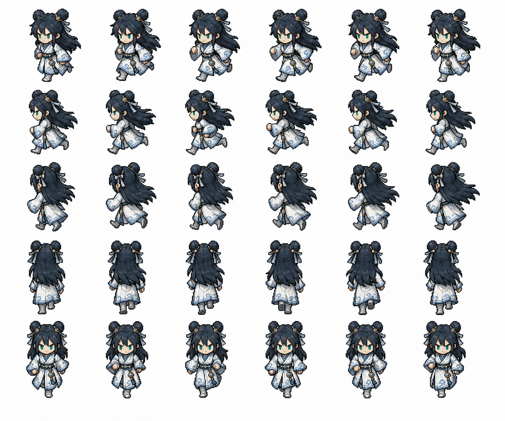 |
| [compact-8x8-action-platformer-sheet.md](./profiles/zh-CN/compact-8x8-action-platformer-sheet.md) | 8x8 紧凑动作平台角色精灵表 | 两者兼备 | 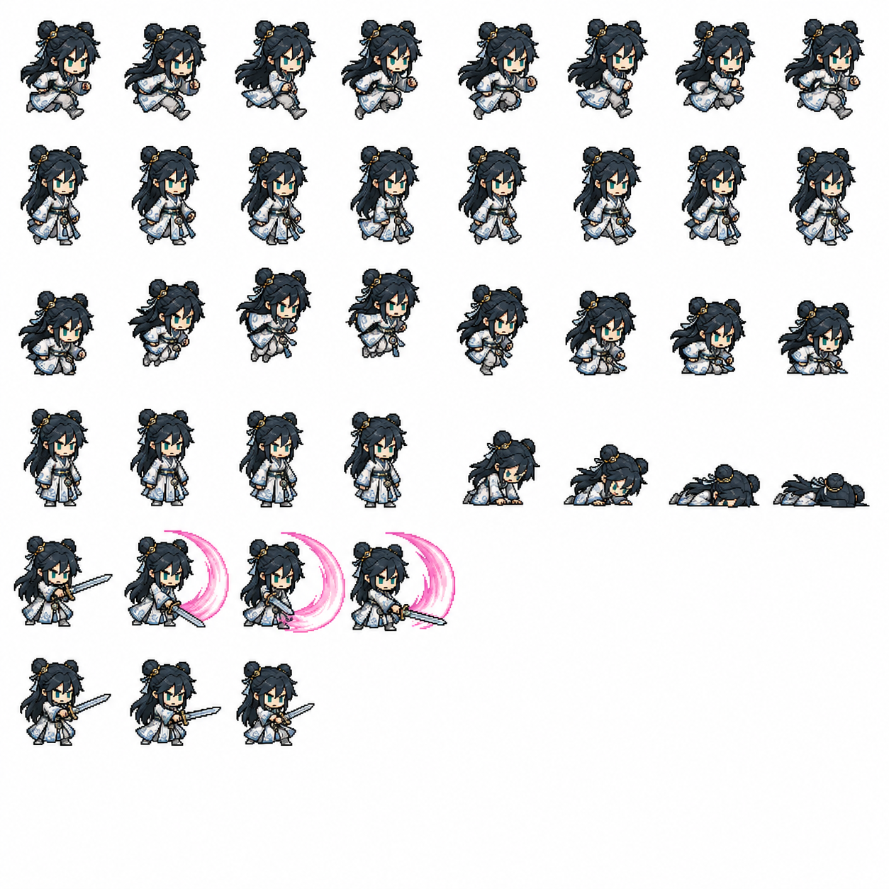 |
| [four-by-eight-jrpg-adventurer-sheet.md](./profiles/zh-CN/four-by-eight-jrpg-adventurer-sheet.md) | 4x8 JRPG 冒险者动作精灵表 | 两者兼备 | 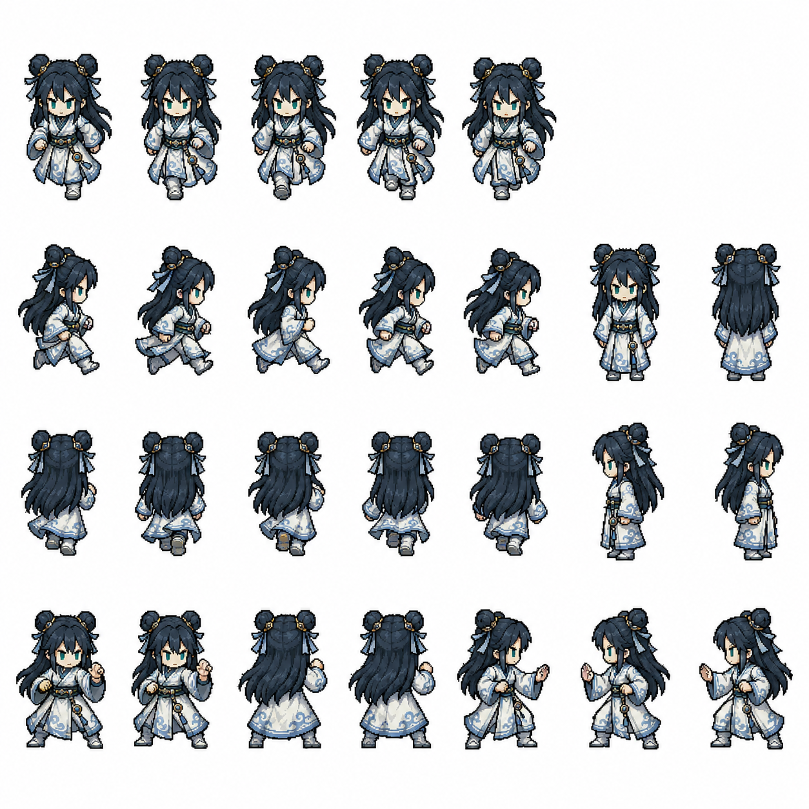 |
| [indie-character-grid-animation-sheet.md](./profiles/zh-CN/indie-character-grid-animation-sheet.md) | 支持 8x8 与 9x8 网格的独立游戏角色动作表 | 两者兼备 | 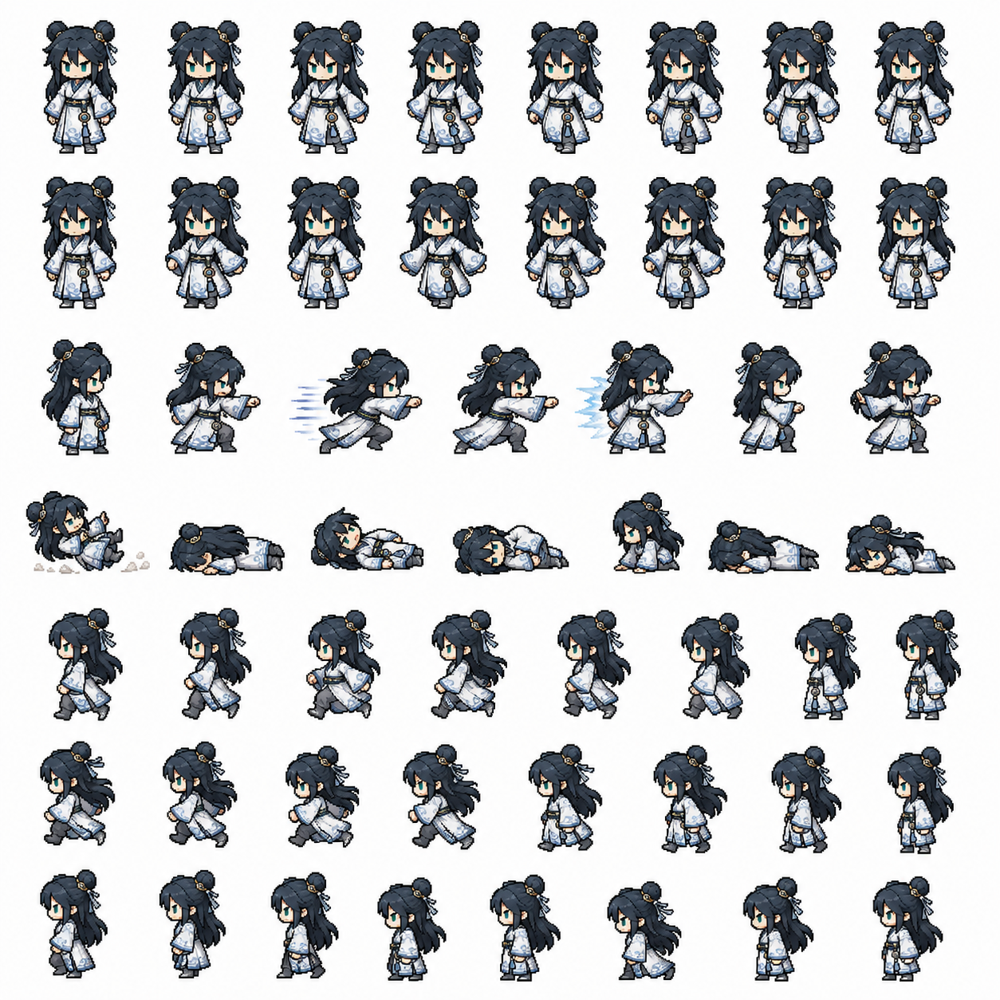 |
| [reference-based-sideview-action-sheet.md](./profiles/zh-CN/reference-based-sideview-action-sheet.md) | 基于参考图扩展的横向侧视角色动作表 | 参考图驱动 | 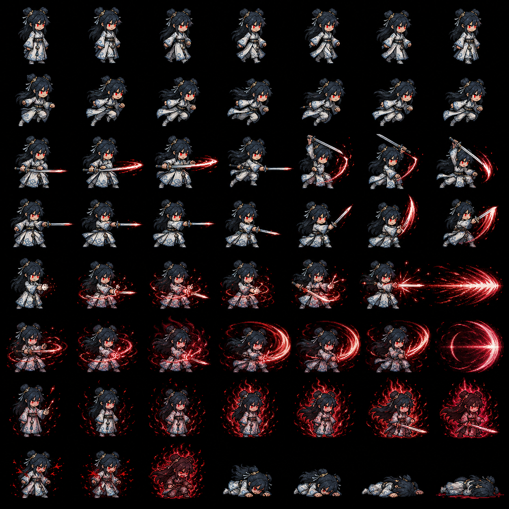 |
| [humanoid-enemy-action-spritesheet.md](./profiles/zh-CN/humanoid-enemy-action-spritesheet.md) | 人形对手动画精灵表模板 | 两者兼备 | 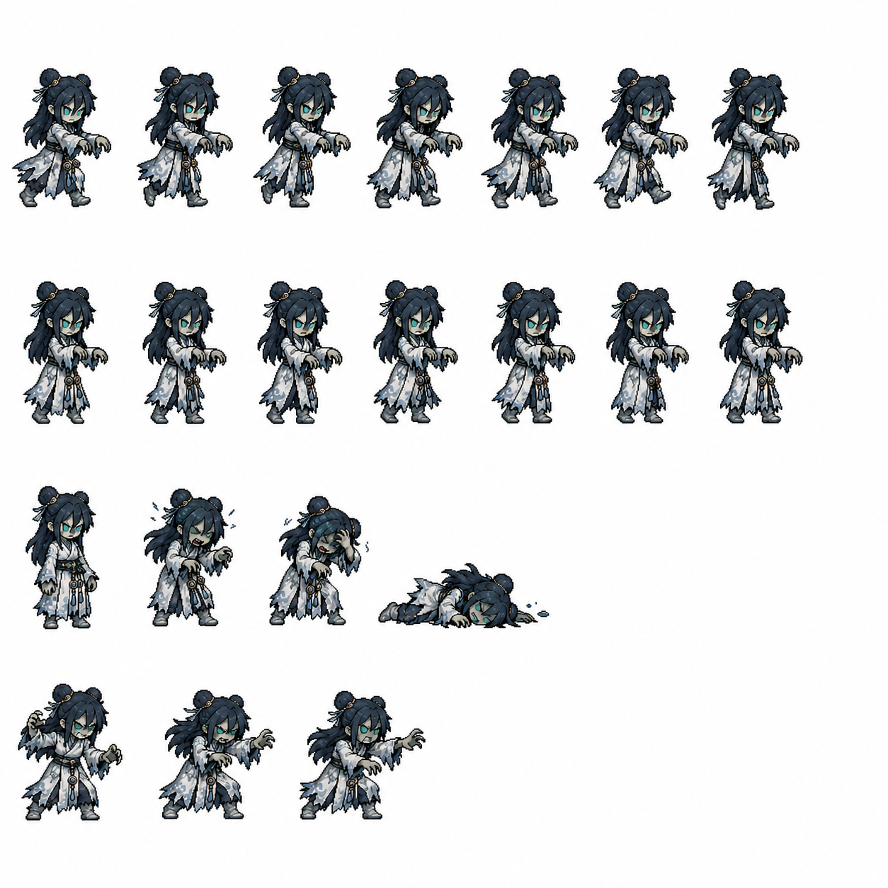 |
| [aerial-creature-spritesheet.md](./profiles/zh-CN/aerial-creature-spritesheet.md) | 5x6 飞行生物动作精灵表 | 纯文字生成 | 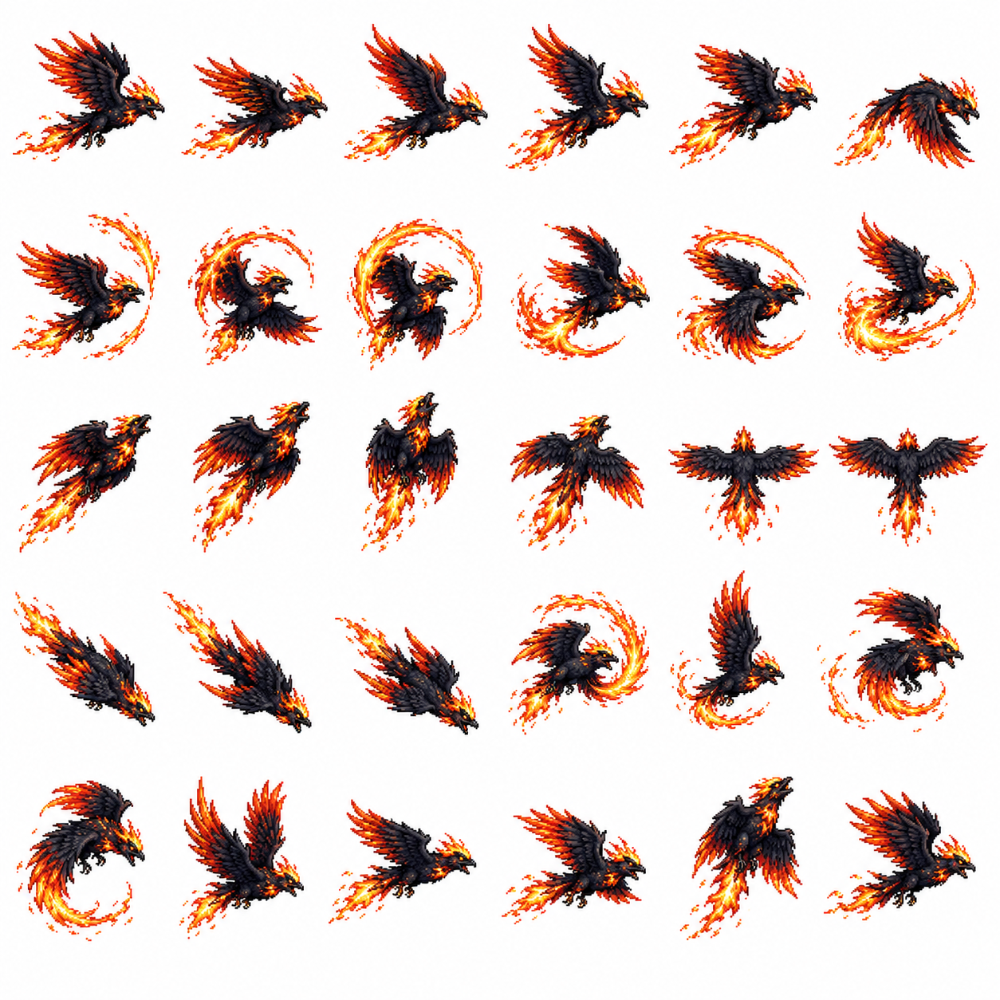 |
| [mounted-character-gallop-sheet.md](./profiles/zh-CN/mounted-character-gallop-sheet.md) | 角色骑乘奔跑动画精灵表 | 两者兼备 | 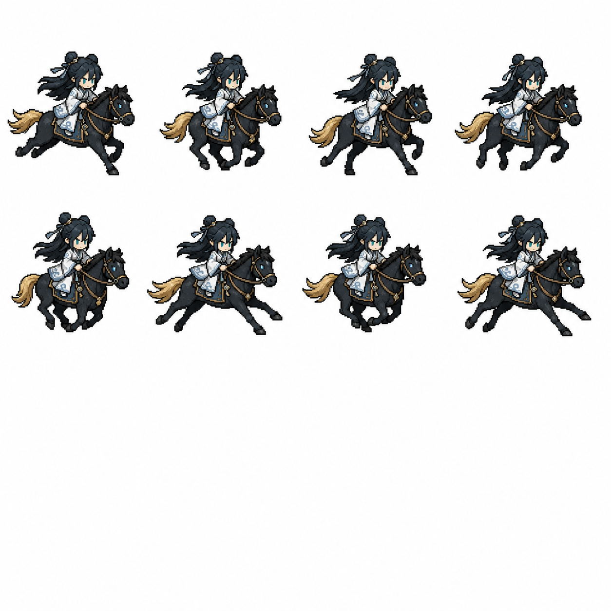 |
| [comprehensive-character-action-grid.md](./profiles/zh-CN/comprehensive-character-action-grid.md) | 10x10 全动作角色精灵表 | 两者兼备 | 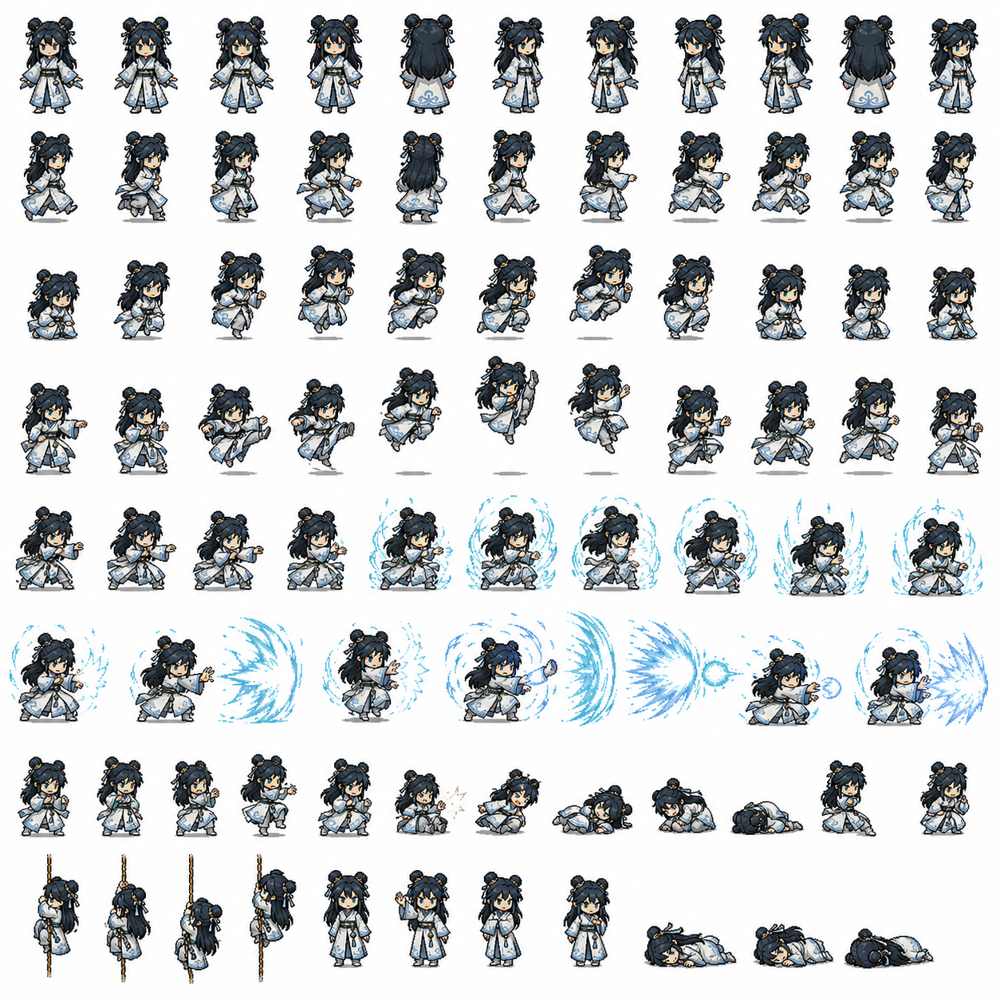 |
| [impasto-inkwash-character-concept.md](./profiles/zh-CN/impasto-inkwash-character-concept.md) | 厚涂水墨风角色设定图 | 两者兼备 |  |
| [orthographic-topdown-pixel-scene.md](./profiles/zh-CN/orthographic-topdown-pixel-scene.md) | 正俯视像素场景，包含物件和地面模式 | 纯文字生成 | 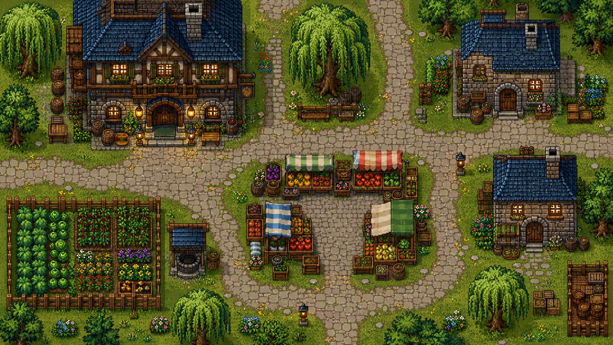 |
| [angled-topdown-pixel-scene.md](./profiles/zh-CN/angled-topdown-pixel-scene.md) | 斜俯视像素场景，包含资产和地面模式 | 纯文字生成 |  |
| [tilebased-sideview-pixel-environment.md](./profiles/zh-CN/tilebased-sideview-pixel-environment.md) | 图块化横版侧切像素环境 | 纯文字生成 | 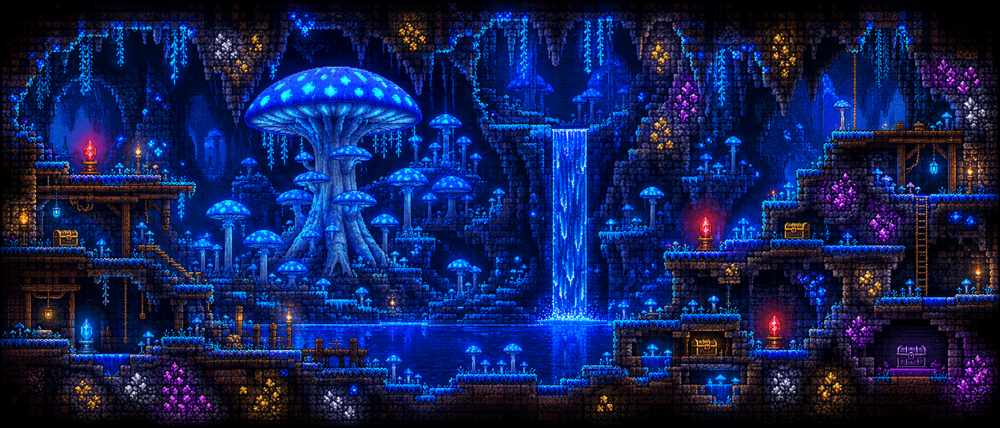 |
| [parallax-sideview-arcade-environment.md](./profiles/zh-CN/parallax-sideview-arcade-environment.md) | 带多层视差的横向侧视像素环境 | 纯文字生成 |  |

## 新增提示词档案

1. 在 `profiles/en/` 中新增英文档案。
2. 在 `profiles/zh-CN/` 中新增对应中文档案。
3. 在 `img/` 中添加同名 slug 的示例图。
4. 每个档案都应包含 `示例`、`用途` 和 `使用场景` 区块。
5. 将新档案同步加入两个 README 的表格。

## 注意事项

- 不同模型、模型版本、采样参数和参考图都会影响生成结果。
- 网格类精灵表提示词通常需要多次迭代才能得到精确帧对齐。
- README 中的预览图是示例效果，不代表每次生成都完全一致。

## License

本项目使用 [MIT License](./LICENSE)。除非另有说明，仓库中的提示词档案、文档和示例图片均按同一许可证授权。
