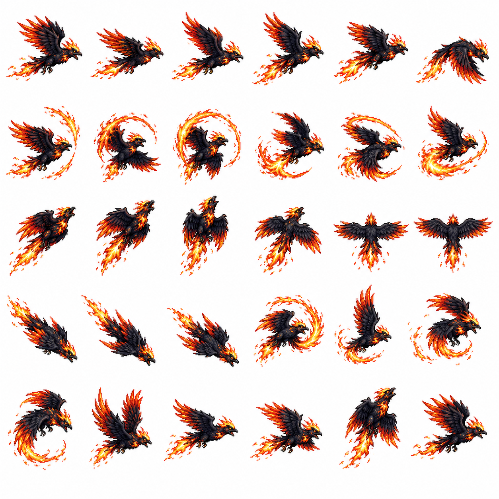

# Aerial Creature Spritesheet Prompt Profile

## Example



## Purpose

Generate strict-grid pixel monster animation spritesheets for game development.

The prompt profile is tuned around animal / monster spritesheets, emphasizing a black-bodied aerial creature that moves through side, side-front, side-rear, and rear aerial views while avoiding full frontal views.

## Usage Mode

- Mode: Text-to-image
- Text-only generation: Primary mode. Provide a creature description and animation layout requirements.
- Uploaded reference image: Not required by this profile; if supplied, treat it only as optional inspiration rather than a strict visual baseline.
- Best for: creating a new aerial creature animation sheet from text.

## Default Output Specification

- Format: high-resolution PNG spritesheet.
- Canvas ratio: 1:1 square.
- Layout: strict matrix grid, commonly 5 rows x 6 columns for 30 total frames.
- Other supported grids: 6x6, 8x8, 4x8, or another explicit grid matching the requested action set.
- Background: pure white by default; transparent, pure black, magenta, or another clean chroma-key background may be requested.
- Resolution: high-resolution output such as 1024x1024 or 2048x2048, while preserving crisp internal pixel blocks.
- Style: retro 16-bit JRPG pixel art or modern high-precision pixel art.
- Subject: one consistent monster / animal design across all frames.
- Asset restrictions: no text, no numbers, no coordinates, no watermarks, no visible grid lines, no scene background, no decorative environment elements.

## Default Subject Design

- Monster: pixel-art black-bodied fire creature.
- Body: dark charcoal / black body silhouette.
- Feathers: vibrant orange, yellow, and deep red plumage and feather tips.
- Eyes: glowing fiery eyes.
- Effects: dynamic flame trails with volumetric fire texture.
- Palette: limited palette of charcoal black, vivid orange, rich yellow, and deep red.
- Style: saturated, stylized, clean pixel edges with distinct color blocks and minimal gradients.

## Default Row Logic

The stable template describes a 5x6 layout with 30 frames:

1. Rows 1-2: dynamic side-view flight, circular flight, and sweeping fire attacks.
2. Row 3: side-view climbing, level flight, and full rear-view forward flight.
3. Row 4: additional side and side-rear diving, turning, banking, and pitching.
4. Row 5: one ground idle pose plus side, rear-view, circular, and aerial flight variations.

The migration template generalizes this as one continuous smooth animation loop across all frames, while preserving row-by-row logical continuity.

## Inferred Rules

- Preserve the reference monster's core silhouette, palette, flame behavior, and aerial posture.
- Strictly avoid full frontal views unless the user explicitly overrides this constraint.
- Favor side, side-front, side-rear, and rear perspectives.
- Keep the monster centered in each cell with stable center of gravity and anchor point.
- Keep transitions logical between neighboring sprites.
- Do not invent extra rows if the user leaves a row unspecified; leave missing cells or rows blank if needed.
- Avoid blurry scaling, anti-aliasing, modern soft gradients, or non-pixel rendering.
- Use no map background or environmental decoration behind the sprites.
- Keep all frames directly usable as game animation frames.

## English Migration Template

```text
(General Settings)
High-resolution pixel art monster sprite sheet.
Layout: Strict matrix of [ROWS] rows by [COLUMNS] columns, e.g. 5 rows x 6 columns for 30 total frames.
Canvas aspect ratio: 1:1 square.
Background: pure [BACKGROUND_COLOR, e.g. white, black, magenta, or transparent] background, entirely clean, with absolutely no grid lines, text labels, numbers, coordinates, watermarks, scenery, or decorative background elements.

(Creature Design & Style)
Style: retro 16-bit JRPG pixel art. Pixel-perfect, clean edges, limited palette, crisp silhouettes, no anti-aliasing.
Subject: a pixel-art black-bodied fire creature monster, .
Core details: dark charcoal black body, vibrant orange, yellow, and deep red plumage and flame effects. Glowing orange feather tips, burning eyes, and dynamic volumetric flame trails.
Color palette: charcoal black, vibrant oranges, rich yellows, deep reds. Minimal gradients, distinct color blocks.

(Perspective & View Constraints)
Perspective: multi-perspective aerial display.
Constraint: strictly avoid full frontal views. Maintain dynamic side, side-rear, side-front, and rear views.
Orientation: the creature should mostly face side and rear-angle directions, avoiding direct frontal interaction.

(Animation Sequence Logic)
Action: one continuous, smooth animation loop across all [TOTAL_FRAMES] distinct frames.
Row-by-row sequence:
Rows 1-2: dynamic side-view flight and sweeping circular fire attacks, transitioning between gliding and attacking.
Row 3: side-view climb and level rear-view flight, transitioning between climbing and following-camera rear view.
Rows 4-5: dynamic side and side-rear diving, turning, banking, pitching, and complex aerial maneuvers, with flame trail interactions.
Transition: the transition between sprites must feel logical and fluid, with a consistent center of gravity maintained within each grid cell.

(Enhancement Keywords)
Pixel-perfect details, consistent scaling across all sprites, volumetric flame effects, dramatic lighting from the creature core, distinct monster silhouette, clean animation-ready frames.
```

## Filled Example

```text
High-resolution pixel art monster sprite sheet.
Layout: strict matrix of 5 rows by 6 columns, 30 total frames.
Canvas aspect ratio: 1:1 square.
Background: pure white background, entirely clean, with absolutely no grid lines, text labels, numbers, coordinates, watermarks, scenery, or decorative background elements.

Style: retro 16-bit JRPG pixel art. Pixel-perfect, clean edges, limited palette, crisp silhouettes, no anti-aliasing.
Subject: a pixel-art black-bodied fire creature monster, .
Core details: dark charcoal black body, vibrant orange, yellow, and deep red plumage and flame effects. Glowing orange feather tips, burning eyes, and dynamic volumetric flame trails.
Color palette: charcoal black, vibrant oranges, rich yellows, deep reds. Minimal gradients, distinct color blocks.

Perspective: multi-perspective aerial display.
Constraint: strictly avoid full frontal views. Maintain dynamic side, side-rear, side-front, and rear views.
Orientation: the creature should mostly face side and rear-angle directions, avoiding direct frontal interaction.

Action: one continuous, smooth animation loop across all 30 distinct frames.
Rows 1-2: dynamic side-view flight and sweeping circular fire attacks, transitioning between gliding and attacking.
Row 3: side-view climb and level rear-view flight, transitioning between climbing and following-camera rear view.
Rows 4-5: dynamic side and side-rear diving, turning, banking, pitching, and complex aerial maneuvers, with flame trail interactions.
Transition: the transition between sprites must feel logical and fluid, with a consistent center of gravity maintained within each grid cell.

Pixel-perfect details, consistent scaling across all sprites, volumetric flame effects, dramatic lighting from the creature core, distinct monster silhouette, clean animation-ready frames.
```

## Variables

- `ROWS` / `COLUMNS`: common values include 5x6, 6x6, 8x8, or 4x8.
- `TOTAL_FRAMES`: grid row count multiplied by column count.
- `BACKGROUND_COLOR`: white, black, magenta, transparent, or another clean chroma-key color.
- `MONSTER_SUBJECT`: fire bird, ice bird, bat, dragonling, wolf, beast, slime, insect.
- `CORE_DETAILS`: silhouette, palette, eyes, wings, tail, effects, aura.
- `VIEW_CONSTRAINTS`: side, side-front, side-rear, rear, no full frontal.
- `ACTION_GROUPS`: flight, circle, dive, attack, climb, idle, turn, bank, pitch, death.
