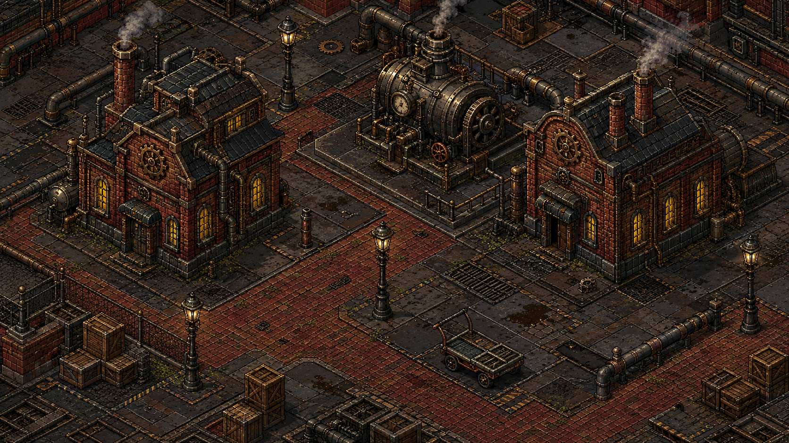

# Angled Topdown Pixel Scene Prompt Profile

## Example



## Purpose

Generate high-quality panoramic pixel-art scenes in a topdown 45-degree, isometric-like perspective.

The prompt profile is designed for static environment scenes with buildings, objects, ground, props, and decorative details. It never generates characters, animals, mountains, hills, sky, or clouds by default.

## Usage Mode

- Mode: Text-to-image
- Text-only generation: Primary mode. Provide scene theme, terrain base, object list, and decorative details.
- Uploaded reference image: Not part of the core workflow; this profile is designed for text-described angled topdown scenes and variants.
- Best for: creating new 45-degree topdown pixel panoramas, asset sheets, or clean ground plates from text.

## Default Output Specification

- Format: PNG static image.
- Aspect ratio: 16:9 panoramic widescreen.
- Resolution: high resolution, often described as 4K.
- Perspective: topdown 45-degree view, isometric-like, fixed 45-degree building orientation.
- Style: detailed pixel art with clear pixel grain.
- Characters: no people, NPCs, humanoids, animals, or creatures.
- Terrain exclusions: no mountains, no hills.
- Sky exclusions: no sky, no clouds.
- Animation: none; static scene only.
- Transparency: none by default.
- Default arrangement: organic continuous scene, not grid-based.

## Supported Modes

### 1. Complete Scene Mode

Triggered when no special keyword is used.

- Generates one complete 16:9 topdown 45-degree pixel panorama.
- Includes ground, buildings, static objects, trees, props, lights, and environmental details.
- Objects are organically arranged in the scene.
- No rows or columns.

### 2. Object Extraction Mode

Triggered by including:

```text
object extraction mode
```

- Generates the original scene and extracted static assets.
- Extracts buildings and objects, including trees.
- Arranges extracted objects in orderly rows/columns with spacing.
- Keeps object/building scale consistent with the original scene.
- Uses a contrasting solid-color background for the extracted asset section.
- In the prompt profile's own behavior, original scene and extracted content may be combined in one 16:9 image.

### 3. Object Removal / Ground-Only Mode

Triggered by including:

```text
ground-only mode
```

- Generates a clean ground plate.
- Removes all objects, buildings, trees, and props.
- Keeps only ground, grass, floor, pavement, or terrain base.

## Suitable Inputs

- Scene theme: medieval market, magic forest ruins, steampunk district, retro cyberpunk street, ancient ruins, etc.
- Ground and environment base: cobblestone, dirt and grass, red brick, metal plates, moss, glowing floor, etc.
- Main buildings and static objects: houses, shops, stalls, factories, boilers, pipes, trees, wells, barrels, carts, fences, lamps.
- Style details and decoration: merchandise, flags, lanterns, moss, leaves, oil stains, glowing plants, pixelated shadows.
- Optional mode keyword: `object extraction mode` or `ground-only mode`.

## Inferred Rules

- Always preserve topdown 45-degree / isometric-like orientation.
- Align buildings and major structures to the fixed 45-degree scene orientation.
- Keep everything static and environment-focused.
- Never include humans, humanoids, NPCs, animals, creatures, mountains, hills, sky, or clouds.
- Do not use side view, straight topdown view, 3D render, realistic perspective, or cinematic sky horizon.
- Emphasize ground because the scene has no sky.
- Use quantity-specific object lists to reduce randomness.
- In asset mode, create isolated objects on a contrasting solid background.
- In ground-only mode, explicitly remove trees and all props, not just buildings.

## English Migration Template: Complete Scene

```text
A detailed, panoramic pixel-art scene of [SCENE_THEME], topdown 45-degree perspective, isometric-like environment layout, clear and precise pixel grid definition.

The environment is built on [GROUND_DESCRIPTION].

The scene must feature [MAIN_STATIC_BUILDINGS_AND_OBJECTS]. All structures are aligned to the fixed 45-degree isometric-like orientation.

Lighting is consistent, casting soft pixelated shadows. Fine details are visible throughout the scene, such as [DECORATIVE_DETAILS].

Wide 16:9 cinematic aspect ratio, high resolution, crisp pixels, no antialiasing, detailed pixel grain.

Negative prompt:
humans, characters, NPCs, humanoids, animals, creatures, mountains, hills, sky, clouds, side view, straight-down flat topdown, 3D render, realistic rendering, blurry pixels, smooth gradients, text, labels, UI.
```

## English Migration Template: Asset Sheet

```text
A detailed pixel-art sprite sheet and asset pack of [SCENE_THEME], topdown 45-degree perspective, isometric-like environment assets.

Features individual, separated assets including: [OBJECT_LIST]. All items are neatly arranged in rows and columns on a clean, contrasting solid [BACKGROUND_COLOR] background. Items are separated by space, with no overlap, matching the original scene scale in a 16:9 layout.

High resolution, crisp pixels, fixed 45-degree isometric-like orientation, no antialiasing.

Negative prompt:
humans, characters, NPCs, humanoids, animals, creatures, mountains, hills, sky, clouds, side view, 3D render, realistic rendering, blurry pixels, overlapping objects, text, labels, UI.
```

## English Migration Template: Ground-Only

```text
A detailed, panoramic pixel-art ground plate of [SCENE_THEME], topdown 45-degree perspective, isometric-like environment base.

The image contains only the base terrain: [GROUND_DESCRIPTION]. Clean, uninterrupted ground surface. No buildings, no structures, no stalls, no furniture, no decorative props, no trees, no vegetation objects.

Wide 16:9 aspect ratio, high resolution, crisp pixels, fixed 45-degree ground orientation.

Negative prompt:
humans, characters, NPCs, humanoids, animals, creatures, structures, buildings, trees, vegetation objects, props, furniture, mountains, hills, sky, clouds, side view, 3D render, realistic rendering, text, labels, UI.
```

## Filled Example: Complete Scene

```text
A detailed, panoramic pixel-art scene of a retro steampunk factory district, topdown 45-degree perspective, isometric-like environment layout, clear and precise pixel grid definition.

The environment is built on dark riveted metal floor plates mixed with worn red brick streets, oil stains, and scuffed industrial paths.

The scene must feature two red-brick factory buildings with gear decorations and chimneys releasing faint smoke, one large steam boiler, a complex pipe network, four vintage iron street lamps, several wooden crates, and one stationary metal handcart. All structures are aligned to the fixed 45-degree isometric-like orientation.

Lighting is consistent, casting soft pixelated shadows. Fine details are visible throughout the scene, such as scattered mechanical parts, warm yellow window light, rust stains, and moss in brick cracks.

Wide 16:9 cinematic aspect ratio, high resolution, crisp pixels, no antialiasing, detailed pixel grain.

Negative prompt:
humans, characters, NPCs, humanoids, animals, creatures, mountains, hills, sky, clouds, side view, straight-down flat topdown, 3D render, realistic rendering, blurry pixels, smooth gradients, text, labels, UI.
```

## Variables

- `SCENE_THEME`: one-line scene concept.
- `GROUND_DESCRIPTION`: floor, path, grass, dirt, metal, pavement, moss, etc.
- `MAIN_STATIC_BUILDINGS_AND_OBJECTS`: quantity-specific list of buildings, trees, structures, props.
- `DECORATIVE_DETAILS`: lighting, stains, leaves, moss, runes, merchandise, small props.
- `OBJECT_LIST`: extracted asset list.
- `BACKGROUND_COLOR`: contrasting extraction background color, e.g. magenta/cyan/black.
