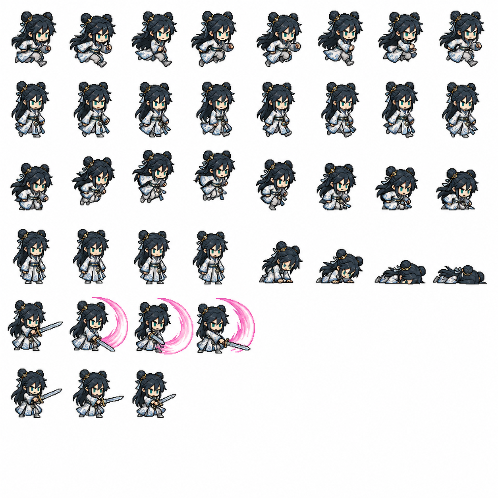

# Compact 8x8 Action Platformer Sheet Prompt Profile

## Example

Original reference input:


Generated output:



## Purpose

Generate a compact, game-ready 2D pixel-art character spritesheet with a fixed 8x8 animation grid.

The prompt profile specializes in simple, high-contrast, functional character designs and a default action-game animation set: run, walk, jump, idle, die, and two sword attacks.

## Usage Mode

- Mode: Hybrid
- Text-only generation: Supported. Provide character body-part descriptions and action parameters.
- Uploaded reference image: Supported as a visual anchor for character shape, palette, and style.
- Best for: creating a compact action-platformer spritesheet from either text or an uploaded character reference.

## Default Output Specification

- Format: pixel-art spritesheet for a 2D action-game character.
- Canvas size: 256x256 px.
- Canvas ratio: 1:1 square output.
- Layout: strict 8 rows x 8 columns, 64 cells total.
- Cell size: 32x32 px.
- Effective content rows: rows 1-6.
- Blank rows: rows 7-8 stay empty to preserve the 8x8 square layout.
- Background: pure white by default, or a single specified chroma-key color such as green.
- Direction: all animations face right by default.
- Style: clear, high-contrast, retro 2D pixel art.
- Character design: minimalist, functional, multi-color block design with readable head, body, limbs, and effects.
- Asset restrictions: no text, no numbers, no visible grid lines, no UI elements.

## Default Row Order

1. Row 1: run right, 8-frame smooth loop.
2. Row 2: walk right, 8-frame smooth loop.
3. Row 3: jump, 8-frame full sequence: crouch, takeoff, rise, apex, fall, landing.
4. Row 4: idle and die, first 4 frames idle with subtle breathing, last 4 frames death/fall sequence.
5. Row 5: attack A, first 4 frames valid, sword attack with a large crescent energy slash effect; last 4 frames blank.
6. Row 6: attack B, first 3 frames valid, compact sword attack without energy slash; last 5 frames blank.
7. Row 7: blank.
8. Row 8: blank.

## Inferred Rules

- Keep every frame centered inside its 32x32 cell.
- Align animation anchors so loops do not jitter.
- Use the exact 8x8 grid even when some action rows use fewer than 8 active frames.
- Keep rows 7 and 8 fully blank, normally pure white.
- For row 5 and row 6, only the specified active frames should contain animation; the unused cells in those rows should remain blank.
- Use a solid background rather than transparency for cleaner chroma-key extraction.
- Design should stay readable at 32x32 px; avoid tiny details that cannot survive the cell size.
- Head, torso, limbs, weapon, and attack effects should be strongly color-separated.
- If the user does not specify otherwise, preserve the right-facing action-game template.

## English Migration Template

```text
Create a professional pixel-art spritesheet for a 2D action-game character, strictly arranged in an 8x8 grid on a 256x256 pixel square canvas. Each cell is exactly 32x32 pixels.

The background is solid [BACKGROUND_COLOR], with no text, no numbers, no visible grid lines, no UI elements, and no logos.

The style is crisp, high-contrast, retro 2D pixel art with smooth, high-quality animation frames. The character design is minimalist, functional, and based on clear multi-color blocks, with readable head, torso, limbs, weapon, and effects. All frames face right by default.

Character design:
Head: [HEAD_DESCRIPTION]
Torso: [TORSO_DESCRIPTION]
Limbs and details: [LIMBS_AND_DETAILS]
Weapon or prop: [WEAPON_OR_PROP]
Overall principle: keep strong color separation and readable silhouettes at 32x32 pixels.

Animation layout, row by row:
Row 1: 8-frame running loop to the right. The poses must be clear, flowing, and energetic.
Row 2: 8-frame walking loop to the right. The motion is steadier and slower than running, but still smooth.
Row 3: 8-frame jump sequence. Show crouch before takeoff, rise, apex, fall, and landing in order. Each phase must be visually readable.
Row 4: 4 idle frames followed by 4 death frames. Frames 1-4 show a subtle breathing idle loop. Frames 5-8 show a death/fall sequence ending with the character lying on the ground.
Row 5: Attack A. Only frames 1-4 are active; frames 5-8 remain blank. Show a dynamic sword attack with a large clean [EFFECT_COLOR] crescent energy slash effect.
Row 6: Attack B. Only frames 1-3 are active; frames 4-8 remain blank. Show a different, compact melee sword attack or ready stance without any energy slash effect.
Rows 7 and 8: completely blank solid-background space, preserving the 8x8 square layout.

Quality constraints:
Every frame must be centered inside its 32x32 cell. Animation anchors must stay aligned to avoid jitter. The final image must be clean and directly usable as a game development asset.
```

## Filled Example

```text
Create a professional pixel-art spritesheet for a 2D action-game character, strictly arranged in an 8x8 grid on a 256x256 pixel square canvas. Each cell is exactly 32x32 pixels.

The background is solid pure white, with no text, no numbers, no visible grid lines, no UI elements, and no logos.

The style is crisp, high-contrast, retro 2D pixel art with smooth, high-quality animation frames. The character design is minimalist, functional, and based on clear multi-color blocks, with readable head, torso, limbs, weapon, and effects. All frames face right by default.

Character design:
Head: a red spherical helmet with a small gray visor.
Torso: compact blue armor body.
Limbs and details: gray arms and legs, brown boots, high-contrast simple shapes.
Weapon or prop: a short sword.
Overall principle: keep strong color separation and readable silhouettes at 32x32 pixels.

Animation layout, row by row:
Row 1: 8-frame running loop to the right. The poses must be clear, flowing, and energetic.
Row 2: 8-frame walking loop to the right. The motion is steadier and slower than running, but still smooth.
Row 3: 8-frame jump sequence. Show crouch before takeoff, rise, apex, fall, and landing in order. Each phase must be visually readable.
Row 4: 4 idle frames followed by 4 death frames. Frames 1-4 show a subtle breathing idle loop. Frames 5-8 show a death/fall sequence ending with the character lying on the ground.
Row 5: Attack A. Only frames 1-4 are active; frames 5-8 remain blank. Show a dynamic sword attack with a large clean pink crescent energy slash effect.
Row 6: Attack B. Only frames 1-3 are active; frames 4-8 remain blank. Show a different, compact melee sword attack or ready stance without any energy slash effect.
Rows 7 and 8: completely blank solid-background space, preserving the 8x8 square layout.

Quality constraints:
Every frame must be centered inside its 32x32 cell. Animation anchors must stay aligned to avoid jitter. The final image must be clean and directly usable as a game development asset.
```

## Variables

- `BACKGROUND_COLOR`: pure white, pure green, magenta, or another solid chroma-key color.
- `HEAD_DESCRIPTION`: head shape, helmet, face mark, hair, or mask.
- `TORSO_DESCRIPTION`: body color, armor, shirt, coat, or silhouette.
- `LIMBS_AND_DETAILS`: arm/leg colors, boots, gloves, side asymmetry, or back details.
- `WEAPON_OR_PROP`: sword, staff, shield, tool, or no weapon.
- `EFFECT_COLOR`: attack A energy slash color, usually pink unless changed.
