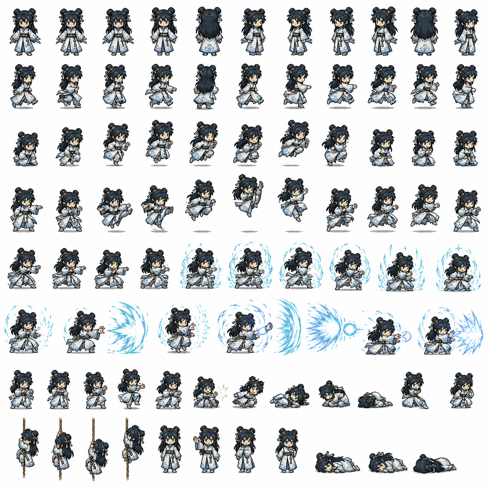

# Comprehensive Character Action Grid Prompt Profile

## Example

Original reference input:


Generated output:



## Purpose

Generate a comprehensive pixel-art action library for one character in a single organized spritesheet.

The prompt profile specializes in broad character animation coverage: idle, walk, run, jump, melee attacks, kicks, skills, defense, damage, climbing, greeting, and death poses. It is intended for game-development planning and rapid creation of full character motion sets.

## Usage Mode

- Mode: Hybrid
- Text-only generation: Supported through a detailed character description.
- Uploaded reference image: Supported through an uploaded standing pose, existing sprite, or character reference as the authoritative visual reference.
- Best for: building a full 10x10 action library from either a new character description or an uploaded reference.

## Default Output Specification

- Format: PNG spritesheet.
- Scope: one specific character only, not multiple different characters.
- Canvas ratio: strict 1:1 square output.
- Common canvas scale: large square pixel matrix such as 2048x2048 or 4096x4096.
- Default layout: strict 10 rows x 10 columns, exactly 100 frames.
- Background: solid pure white or pure green; no alpha transparency by default.
- Style: advanced 32-bit / GBA-style pixel art with a compact 16-bit feeling.
- Pixel quality: crisp pixels, clean linework, controlled but rich palette, rich color shading, no excessive dithering, no messy pixels.
- Default weapon policy: no held weapon unless explicitly requested.
- Asset restrictions: no text, no numbers, no visible grid lines, no labels, no UI elements.

## Default Action Rows

1. Row 1: idle / standing / breathing, including multi-direction standing frames.
2. Row 2: walking loops, commonly front, back, left, and right.
3. Row 3: running loops, commonly front, back, left, and right.
4. Row 4: jump / airborne / fall / landing sequence.
5. Row 5: unarmed melee combo, such as left punch, right punch, kick, uppercut.
6. Row 6: additional unarmed or ability attacks, such as uppercut or side kick.
7. Row 7: ability / skill charge poses.
8. Row 8: ability / skill release poses.
9. Row 9: defense and damage states, such as guarding, hurt, falling, getting up.
10. Row 10: special actions, such as climbing, waving/greeting, and death poses.

## Direction Coverage

The prompt profile defaults to broad direction support when the action type calls for it:

- Front
- Back
- Left
- Right
- Front-left
- Front-right
- Back-left
- Back-right

For walk and run cycles, the default is usually 8 frames per direction when space allows.

## Inferred Rules

- Use the supplied reference image or standing pose as the authoritative reference for identity, palette, silhouette, clothing, and proportions.
- Keep one character consistent across all frames and actions.
- Keep each action row logically grouped and easy to slice.
- Preserve consistent animation anchors and scale across the sheet.
- Use pure solid background instead of transparency for easier post-processing.
- Avoid weapons unless explicitly requested; default attacks are unarmed or based on inherent abilities.
- Put abilities and special skills into dedicated rows so they do not pollute movement rows.
- The layout should be dense but readable, optimized for later cropping into animation clips.

## English Migration Template

```text
Create a comprehensive full-action pixel-art spritesheet for [CHARACTER_NAME].

Character definition:
Use [REFERENCE_IMAGE_OR_DESCRIPTION] as the authoritative reference for the character design.
The character has [DETAILED_APPEARANCE_DESCRIPTION].

Style:
Advanced 32-bit GBA-style pixel art with a compact 16-bit feeling. Crisp and precise pixels, clean linework, controlled but rich color palette, rich color shading, no excessive dithering, no messy pixels, no anti-aliased blur, no non-pixel brush strokes.

Layout and format:
Strict 1:1 square canvas.
Solid [BACKGROUND_COLOR] background, no alpha transparency.
Strictly organized 10x10 row/column grid, exactly 100 frames.
No text, no numbers, no labels, no visible grid lines, no UI elements.
One character only. Do not include multiple different characters.
No held weapon by default unless specified; use the character's body movement and inherent abilities.

Detailed action rows:
Row 1: idle and standing poses, breathing animation, multi-direction standing frames.
Row 2: walking cycles, front, back, left, and right, ideally 8 frames per direction.
Row 3: running cycles, front, back, left, and right, faster and more energetic than walking.
Row 4: jump, airborne, falling, and landing sequence.
Row 5: unarmed melee combo, such as left punch, right punch, kick, and uppercut.
Row 6: additional unarmed or ability-based attacks, such as uppercut, side kick, or dash attack.
Row 7: ability or skill charge poses, such as energy gathering or power-up stance.
Row 8: ability or skill release poses, such as forward punch, palm blast, or energy burst.
Row 9: defense and damage states, such as guard, hurt, knockback, falling down, and getting up.
Row 10: special actions, such as climbing, waving or greeting, and death pose.

Quality constraints:
Every row must contain a coherent action sequence. Keep the character's proportions, palette, silhouette, and pixel density consistent across all frames. The spritesheet must be clean, dense, readable, and suitable for slicing into animation clips for Unity, Godot, Unreal, or other game engines.
```

## Filled Example

```text
Create a comprehensive full-action pixel-art spritesheet for Gon Freecss from Hunter x Hunter.

Character definition:
Use the provided standing pixel-art reference as the authoritative reference for the character design.
The character has black spiky hair, a confident expression, a green outdoor jacket with collar, khaki shorts, brown boots, green gloves and sock cuffs, and a red backpack strap across the shoulder.

Style:
Advanced 32-bit GBA-style pixel art with a compact 16-bit feeling. Crisp and precise pixels, clean linework, controlled but rich color palette, rich color shading, no excessive dithering, no messy pixels, no anti-aliased blur, no non-pixel brush strokes.

Layout and format:
Strict 1:1 square canvas.
Solid pure white background, no alpha transparency.
Strictly organized 10x10 row/column grid, exactly 100 frames.
No text, no numbers, no labels, no visible grid lines, no UI elements.
One character only. Do not include multiple different characters.
No held weapon by default; use the character's body movement and Nen abilities.

Detailed action rows:
Row 1: idle and standing poses, breathing animation, multi-direction standing frames.
Row 2: walking cycles, front, back, left, and right, ideally 8 frames per direction.
Row 3: running cycles, front, back, left, and right, faster and more energetic than walking.
Row 4: jump, airborne, falling, and landing sequence.
Row 5: unarmed melee combo, left punch, right punch, kick, and uppercut.
Row 6: additional unarmed attacks, such as uppercut, side kick, and dash attack.
Row 7: Jajanken Rock and Paper charge poses, showing Nen energy gathering.
Row 8: Jajanken Rock and Paper release poses, including forward punch and palm energy release.
Row 9: defense and damage states, guard, hurt, knockback, falling down, and getting up.
Row 10: special actions, climbing, waving or greeting, and death pose.

Quality constraints:
Every row must contain a coherent action sequence. Keep the character's proportions, palette, silhouette, and pixel density consistent across all frames. The spritesheet must be clean, dense, readable, and suitable for slicing into animation clips for Unity, Godot, Unreal, or other game engines.
```

## Variables

- `CHARACTER_NAME`: target character name or archetype.
- `REFERENCE_IMAGE_OR_DESCRIPTION`: uploaded standing pose, existing sprite, or detailed text description.
- `DETAILED_APPEARANCE_DESCRIPTION`: hair, outfit, accessories, body type, palette, special visual traits.
- `BACKGROUND_COLOR`: pure white or pure green by default.
- `ABILITY_OR_SKILL`: inherent power, magic, energy, martial art, or special state.
- `WEAPON_POLICY`: default no weapon unless explicitly changed.
