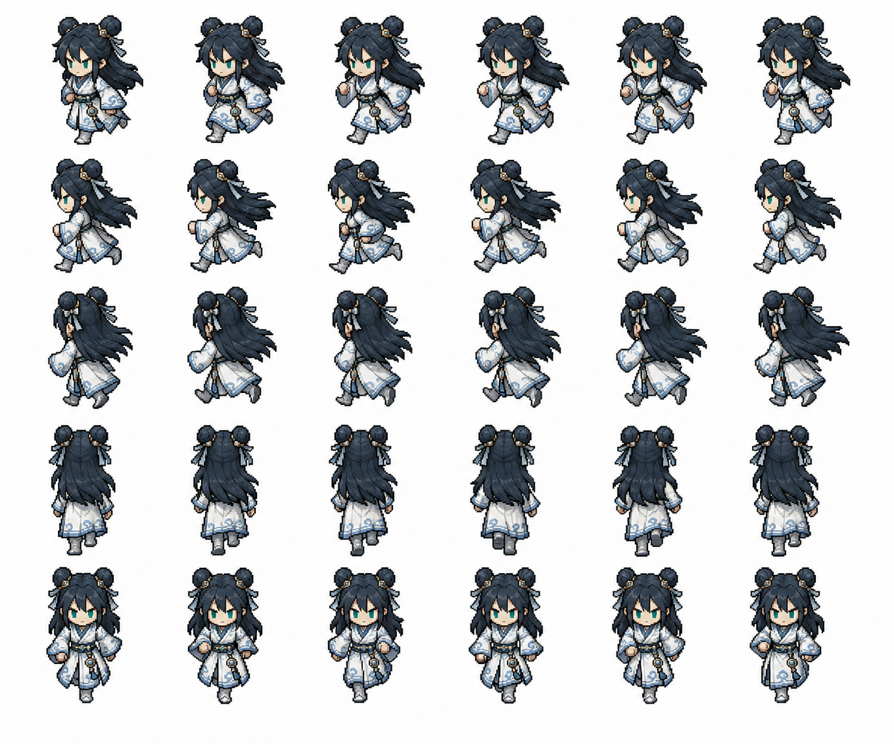

# Five-Direction JRPG Run Cycle Sheet Prompt Profile

## Example

Original reference input:


Generated output:



## Purpose

Generate game-ready pixel-art character animation spritesheets from a character description or reference image.

The prompt profile specializes in JRPG-style character motion sheets with consistent appearance, clean frame alignment, and row-by-row directional animation.

## Usage Mode

- Mode: Hybrid
- Text-only generation: Supported from a detailed character description.
- Uploaded reference image: Supported as a visual anchor for preserving character identity, outfit, palette, and pixel density.
- Best for: creating JRPG run-cycle sheets from either a new character idea or an uploaded character reference.

## Default Output Specification

- Style: 16-bit JRPG pixel art.
- Perspective: top-down / 3/4 JRPG view.
- Canvas ratio: 1:1 square output.
- Layout: 5 rows x 6 columns, 30 frames total.
- Frames per row: 6.
- Background: pure white by default, or another solid key color if requested.
- Grid: frames are arranged in a strict grid, but visible grid lines should not appear.
- Pixel quality: crisp pixels, clean lines, consistent palette, no anti-aliasing blur, no noisy artifacts.
- Asset restrictions: no text, no numbers, no logos, no UI, no visible guide lines.

## Default Row Order

1. Row 1: run down-left, 6 frames, front-left 3/4 isometric perspective.
2. Row 2: run left, 6 frames, strict side-profile view.
3. Row 3: run up-left, 6 frames, rear-left 3/4 isometric perspective.
4. Row 4: run up, 6 frames, strict full-rear view.
5. Row 5: run down, 6 frames, strict full-front view.

## Inferred Rules

- Preserve the reference character's silhouette, outfit, palette, and pixel density across every frame.
- Keep the character centered inside each cell.
- Keep foot position and animation anchor stable inside each row to avoid jitter during playback.
- If no reference image is provided, default to a classic 16-bit JRPG look similar to SNES-era JRPG sprites.
- Prefer a solid removable background over alpha transparency because direct AI-generated transparency may be unstable.
- If the user needs chroma keying, use a specified solid color such as pure white, pure green, or magenta.
- Avoid overly complex cloth patterns or tiny details that cannot survive low-resolution pixel art.

## English Migration Template

```text
A comprehensive, meticulous pixel art spritesheet, strictly arranged in a precise 6x5 grid, for [CHARACTER_DESCRIPTION].

The style is classic 16-bit JRPG pixel art, similar to Final Fantasy VI or Chrono Trigger, with high-quality clean pixel lines, crisp edges, a consistent palette, and no anti-aliasing. All character design elements must remain consistent across every frame.

The spritesheet features 30 distinct frames aligned within a clean grid for seamless animation. The background is solid [BACKGROUND_COLOR]. Each frame shows sequential animation steps.

Row 1: A 6-frame running loop moving diagonally bottom-left, in a front-left 3/4 isometric perspective.
Row 2: A 6-frame running loop moving directly left, in a strict side-profile view.
Row 3: A 6-frame running loop moving diagonally top-left, in a rear-left 3/4 isometric perspective.
Row 4: A 6-frame running loop moving directly up, in a strict full-rear back view.
Row 5: A 6-frame running loop moving directly down, in a strict full-front view.

Detailed character design:
[HAIR_STYLE]
[TOP_GARMENT]
[UNDER_GARMENT]
[PANTS_COLOR]
[BOOT_STYLE]
[ACCESSORIES_OR_WEAPON]

Output constraints:
Strictly no text, no grid lines, no numbers, no logos, no UI elements, and no messy artifacts. Pure pixel art game asset. The grid must be clean and usable for game development.
```

## Filled Example

```text
A comprehensive, meticulous pixel art spritesheet, strictly arranged in a precise 6x5 grid, for a male adventurer with black spiky hair.

The style is classic 16-bit JRPG pixel art, similar to Final Fantasy VI or Chrono Trigger, with high-quality clean pixel lines, crisp edges, a consistent palette, and no anti-aliasing. All character design elements must remain consistent across every frame.

The spritesheet features 30 distinct frames aligned within a clean grid for seamless animation. The background is solid pure white. Each frame shows sequential animation steps.

Row 1: A 6-frame running loop moving diagonally bottom-left, in a front-left 3/4 isometric perspective.
Row 2: A 6-frame running loop moving directly left, in a strict side-profile view.
Row 3: A 6-frame running loop moving diagonally top-left, in a rear-left 3/4 isometric perspective.
Row 4: A 6-frame running loop moving directly up, in a strict full-rear back view.
Row 5: A 6-frame running loop moving directly down, in a strict full-front view.

Detailed character design:
The character has black spiky hair.
They wear a brown leather jerkin over a yellow undershirt.
They wear white pants and dark boots.

Output constraints:
Strictly no text, no grid lines, no numbers, no logos, no UI elements, and no messy artifacts. Pure pixel art game asset. The grid must be clean and usable for game development.
```

## Variables

- `CHARACTER_DESCRIPTION`: overall character identity and silhouette.
- `BACKGROUND_COLOR`: pure white, pure green, magenta, solid black, or another key color.
- `HAIR_STYLE`: hair shape and color.
- `TOP_GARMENT`: armor, coat, shirt, robe, etc.
- `UNDER_GARMENT`: visible inner layer if any.
- `PANTS_COLOR`: pants/skirt/legwear description.
- `BOOT_STYLE`: footwear description.
- `ACCESSORIES_OR_WEAPON`: optional weapon, cape, hat, backpack, etc.
