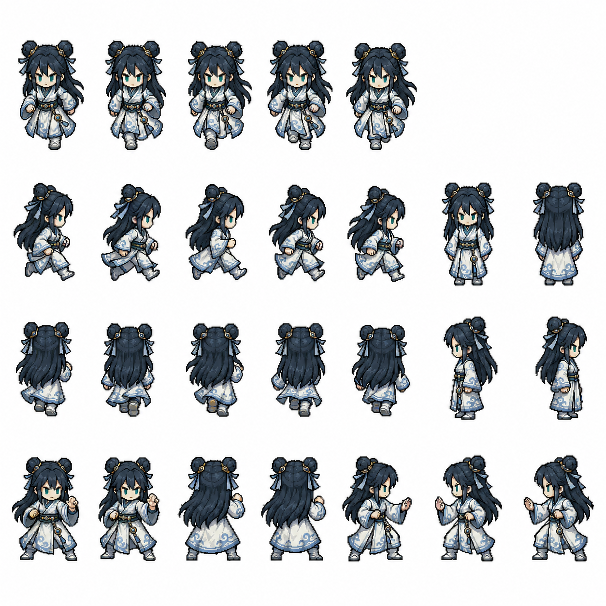

# Four-by-Eight JRPG Adventurer Sheet Prompt Profile

## Example

Original reference input:


Generated output:



## Purpose

Generate a preset 16-bit JRPG pixel-art character spritesheet for game development.

The prompt profile focuses on a compact 4x8 grid: directional running loops, single-frame idle direction poses, and a bottom row of battle-ready poses.

## Usage Mode

- Mode: Hybrid
- Text-only generation: Supported. Provide a detailed JRPG character description.
- Uploaded reference image: Supported as a visual anchor for character identity, outfit, palette, and style.
- Best for: creating a 4x8 JRPG adventurer motion sheet from either text or an uploaded character reference.

## Default Output Specification

- Format: PNG pixel-art spritesheet.
- Canvas ratio: 1:1 square.
- Layout: strict 4 rows x 8 columns, 32 cells total.
- Background: transparent preferred by the prompt profile in default-rule answers, but user templates commonly lock the output to pure white; green or another solid chroma-key color may also be used.
- Style: high-quality, detailed, clean 16-bit JRPG pixel art.
- Perspective: 3/4 down-view mixed isometric JRPG perspective.
- Character count: one consistent character only.
- Asset restrictions: no text, no numbers, no visible grid lines, no UI elements.
- Output type: static spritesheet image, not an animated GIF or video.

## Default Row Order

1. Row 1: downward running loop, 6 contiguous frames, character facing the viewer/front. Cells 7-8 are blank.
2. Row 2: rightward running loop, 6 contiguous frames, character in side profile facing right. Cell 7 is a downward-facing idle pose. Cell 8 is an upward-facing/back-facing idle pose.
3. Row 3: upward running loop, 6 contiguous frames, character facing away/back. Cell 7 is a left-facing idle pose. Cell 8 is a right-facing idle pose.
4. Row 4: 8 battle-ready or battle-idle preparation poses: frames 1-2 front battle-ready, frames 3-4 back battle-ready, frames 5-6 right-facing battle-ready, frames 7-8 left-facing battle-ready.

## Inferred Rules

- Preserve the exact 4x8 grid unless the user explicitly changes it.
- Keep row content and frame counts strict; do not replace blank cells or idle cells with unrelated poses.
- Keep the same character design across all cells: hair, outfit, proportions, color palette, weapon, and accessories.
- Keep every frame aligned to the same invisible grid and stable foot/anchor position.
- No visible helper grid should be drawn, even though the sprite cells must be grid-aligned.
- Use crisp pixel edges with no blurry anti-aliased look.
- Use a simple solid or transparent background depending on the target workflow.
- The prompt profile may describe a broader 4-direction 8-frame walk default in rule answers, but the stable template for this specific preset is the more precise 4x8 mixed layout above.

## English Migration Template

```text
Create a professional pixel-art spritesheet in a classic 16-bit JRPG style, with crisp pixel-perfect edges, clean readable silhouettes, and consistent character design across every frame.

Layout and specifications:
- Format: professional game-ready character spritesheet.
- Aspect ratio: 1:1 square canvas.
- Grid: strict 4 rows x 8 columns, 32 cells total.
- Background: [BACKGROUND_MODE, e.g. transparent, pure white, or pure green chroma-key].
- Perspective: 3/4 down-view mixed isometric JRPG perspective.
- Restrictions: no text, no numbers, no visible grid lines, no UI elements, no logos.
- Character consistency: the same single character must remain consistent in all frames.

Action sequences by row:
- Row 1: six contiguous frames forming a complete downward running loop, with the character facing the viewer/front. Cells 7 and 8 remain blank.
- Row 2: six contiguous frames forming a complete rightward running loop, side profile facing right. Cell 7 is a downward-facing static idle pose. Cell 8 is an upward-facing/back-facing static idle pose.
- Row 3: six contiguous frames forming a complete upward running loop, back view facing away. Cell 7 is a left-facing static idle pose. Cell 8 is a right-facing static idle pose.
- Row 4: eight distinct battle-ready or battle-idle preparation poses. Frames 1-2 are front battle-ready poses, frames 3-4 are back battle-ready poses, frames 5-6 are right-facing battle-ready poses, and frames 7-8 are left-facing battle-ready poses.

Character description:
[DETAILED_CHARACTER_DESCRIPTION: include hair style and color, face details, outfit, armor, pants, boots, belt, visible equipment, weapon or prop, accessories, and color palette.]

Quality constraints:
All frames must be aligned to the same invisible grid. The character anchor point must stay stable. Pixel edges must be sharp and not blurry. The final image must be clean and directly usable as a game asset.
```

## Filled Example

```text
Create a professional pixel-art spritesheet in a classic 16-bit JRPG style, with crisp pixel-perfect edges, clean readable silhouettes, and consistent character design across every frame.

Layout and specifications:
- Format: professional game-ready character spritesheet.
- Aspect ratio: 1:1 square canvas.
- Grid: strict 4 rows x 8 columns, 32 cells total.
- Background: pure white.
- Perspective: 3/4 down-view mixed isometric JRPG perspective.
- Restrictions: no text, no numbers, no visible grid lines, no UI elements, no logos.
- Character consistency: the same single character must remain consistent in all frames.

Action sequences by row:
- Row 1: six contiguous frames forming a complete downward running loop, with the character facing the viewer/front. Cells 7 and 8 remain blank.
- Row 2: six contiguous frames forming a complete rightward running loop, side profile facing right. Cell 7 is a downward-facing static idle pose. Cell 8 is an upward-facing/back-facing static idle pose.
- Row 3: six contiguous frames forming a complete upward running loop, back view facing away. Cell 7 is a left-facing static idle pose. Cell 8 is a right-facing static idle pose.
- Row 4: eight distinct battle-ready or battle-idle preparation poses. Frames 1-2 are front battle-ready poses, frames 3-4 are back battle-ready poses, frames 5-6 are right-facing battle-ready poses, and frames 7-8 are left-facing battle-ready poses.

Character description:
A medieval adventurer with medium-length fluffy dark brown hair, wearing a navy blue leather armor vest over a beige long-sleeved shirt, a utility belt with small pouches, dark brown trousers, and black leather boots. A sword hangs at the waist and a small crossbow is strapped to the back. The color palette is earthy and readable, with strong contrast between hair, armor, shirt, pants, and boots.

Quality constraints:
All frames must be aligned to the same invisible grid. The character anchor point must stay stable. Pixel edges must be sharp and not blurry. The final image must be clean and directly usable as a game asset.
```

## Variables

- `BACKGROUND_MODE`: transparent, pure white, pure green, or another solid chroma-key color.
- `DETAILED_CHARACTER_DESCRIPTION`: the full visual description of the character.
- `ROLE_TYPE`: character archetype such as assassin, mage, robot, dwarf warrior, adventurer.
- `EQUIPMENT`: sword, staff, bow, crossbow, shield, tool, backpack, belt pouches.
- `OTHER_DETAILS`: scar, necklace, emblem, gloves, cloak, color accents.
