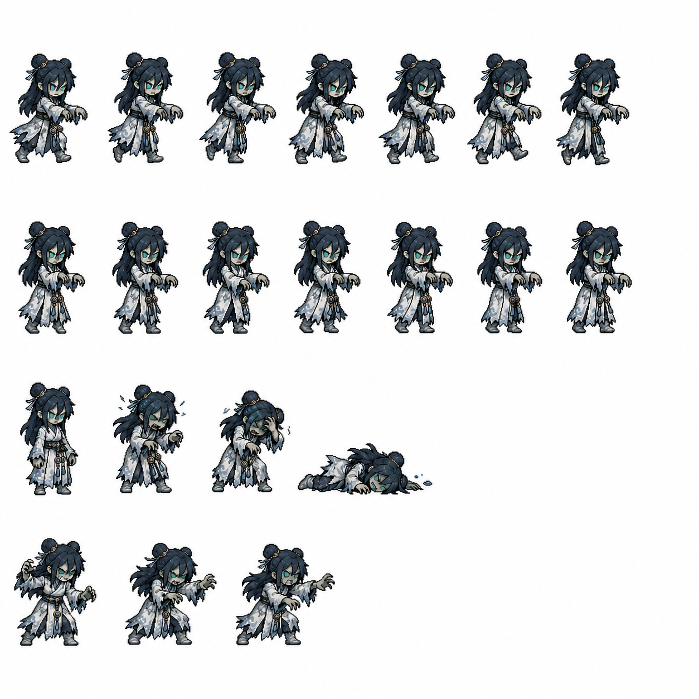

# Humanoid Enemy Action Spritesheet Prompt Profile

## Example

Original reference input:


Generated output:



## Purpose

Generate strict, game-ready pixel-art enemy spritesheets from a base frame or detailed enemy description.

The prompt profile specializes in enemy animation sheets, especially a right-facing uniformed undead reference style with walk, alternate walk/stand, hurt/death, and attack rows.

## Usage Mode

- Mode: Hybrid
- Text-only generation: Supported through a detailed enemy description.
- Uploaded reference image: Supported through a base frame or enemy reference image; the reference controls outfit, posture, palette, and key traits.
- Best for: generating enemy action sheets from either a new description or an uploaded base frame.

## Default Output Specification

- Format: high-resolution PNG spritesheet.
- Canvas ratio: 1:1 square.
- Layout: strict, uniform grid; each row is one complete action sequence.
- Cell size: unified and optimized for the largest frame, commonly 64x64 px per sprite when specified.
- Background: pure white `#FFFFFF` or pure green `#00FF00` chroma-key background.
- Style: pixel-perfect, low-resolution pixel art.
- Default orientation: follow the provided reference; if no reference is supplied, face right by default.
- Character count: one enemy character only.
- Props: no extra props or weapons unless explicitly requested; if the reference includes unwanted props, the prompt profile tends to remove them by default.
- Asset restrictions: no text, no numbers, no visible grid lines, no UI elements, no non-pixel-art elements.
- Output type: static spritesheet image, not an animated GIF or video.

## Default Action Order

The prompt profile gives two related action-order profiles:

1. Reference example layout:
   - Row 1: 8-frame right-facing walk loop.
   - Row 2: 8-frame alternate walk / front-side walk or stand variation.
   - Row 3: 4-frame hurt / fall / death sequence, including standing and head-holding hurt poses.
   - Row 4: 3-frame attack sequence, usually empty-handed arm swing.
2. General default order if actions are not specified:
   - Row 1: walk, usually 8 frames.
   - Row 2: attack, usually 3-4 frames.
   - Row 3: hurt, usually 4 frames.
   - Row 4: death, usually 4 frames.
   - Row 5: idle, usually 4 frames.

For this specific prompt profile profile, the reference example layout is the more important preset.

## Inferred Rules

- Preserve all important reference-character details: police hat, blue police uniform, green/yellow zombie skin, blood marks, empty hands, and zombie posture.
- Do not change the core identity of the character unless explicitly requested.
- Keep the character unarmed unless the user explicitly requests a prop or weapon.
- Keep each animation sequence on its own row.
- Keep all frames aligned inside a strict invisible grid.
- Use one consistent palette inherited from the reference or description.
- Use no anti-aliasing, no smooth blur, and no non-pixel texture.
- Keep the background a solid chroma-key color for easy extraction.
- Ensure each row is a usable animation sequence, not a collection of unrelated poses.

## English Migration Template

```text
Create a high-precision, pixel-perfect enemy character sprite sheet for game development.

Style specifications:
- Style: low-resolution pixel art.
- Sprite scale: unified cells, commonly around 64x64 px per sprite unless another cell size is specified.
- Background: solid [BACKGROUND_COLOR], such as pure white #FFFFFF or pure green #00FF00 chroma-key.
- Alignment: strict grid layout, with each row representing one complete animation sequence.
- Texture: pixel-perfect, clean, no anti-aliasing, crisp outlines, limited consistent palette.

Character specifications:
- Subject: [SUBJECT, e.g. zombie]
- Role / occupation: [ROLE, e.g. police officer]
- Clothing details: [CLOTHING, e.g. blue police uniform, peaked cap]
- Appearance details: [APPEARANCE, e.g. green/yellow zombie skin, blood marks, glowing eyes, empty hands]
- Reference fidelity: preserve all important traits from the provided reference frame, including hat, uniform, skin color, blood marks, posture, proportions, and empty hands.

Action sequence specifications, arranged row by row:
- Row 1: Walk cycle, 8 frames, facing right. A complete loop of the zombie enemy walking to the right.
- Row 2: Alternate walk / stand variation, 8 frames, facing right or front-side. A slightly different walk or front-side movement loop.
- Row 3: Hurt / fall / death transition, 4 frames, facing right. Include a standing pose, impact pose, head-holding hurt frames, and a falling or death transition.
- Row 4: Attack, 3 frames, facing right. Empty-handed arm-swing attack with clear follow-through. Do not add a weapon.

Layout and constraints:
- Canvas: 1:1 square spritesheet.
- Grid: strict uniform grid; all frames isolated in their cells.
- No text, no numbers, no visible grid lines, no UI, no non-pixel-art elements.
- No extra props or weapons unless explicitly requested.
- The same single enemy character must remain consistent across every frame.
```

## Filled Example

```text
Create a high-precision, pixel-perfect enemy character sprite sheet for game development.

Style specifications:
- Style: low-resolution pixel art.
- Sprite scale: unified cells, around 64x64 px per sprite.
- Background: solid pure white #FFFFFF chroma-key.
- Alignment: strict grid layout, with each row representing one complete animation sequence.
- Texture: pixel-perfect, clean, no anti-aliasing, crisp outlines, limited consistent palette.

Character specifications:
- Subject: undead.
- Role / occupation: police officer.
- Clothing details: blue police uniform, peaked police cap.
- Appearance details: greenish-yellow zombie skin, blood marks on the body and clothing, empty hands, hunched zombie posture.
- Reference fidelity: preserve all important traits from the provided reference frame, including hat, uniform, skin color, blood marks, posture, proportions, and empty hands.

Action sequence specifications, arranged row by row:
- Row 1: Walk cycle, 8 frames, facing right. A complete loop of the uniformed undead officer walking to the right.
- Row 2: Alternate walk / stand variation, 8 frames, facing right or front-side. A slightly different walk or front-side movement loop.
- Row 3: Hurt / fall / death transition, 4 frames, facing right. Include a standing pose, impact pose, two head-holding hurt frames, and a falling or death transition.
- Row 4: Attack, 3 frames, facing right. Empty-handed arm-swing attack with clear follow-through. Do not add a weapon.

Layout and constraints:
- Canvas: 1:1 square spritesheet.
- Grid: strict uniform grid; all frames isolated in their cells.
- No text, no numbers, no visible grid lines, no UI, no non-pixel-art elements.
- No extra props or weapons unless explicitly requested.
- The same single uniformed undead enemy must remain consistent across every frame.
```

## Variables

- `BACKGROUND_COLOR`: pure white `#FFFFFF`, pure green `#00FF00`, or another solid chroma-key color.
- `SUBJECT`: zombie, mutant, skeleton, robot, creature, infected worker.
- `ROLE`: police officer, guard, soldier, worker, scientist, prisoner.
- `CLOTHING`: uniform, hat, vest, boots, gloves, armor, torn clothes.
- `APPEARANCE`: skin color, blood marks, glowing eyes, wounds, posture.
- `ACTION_ROWS`: walk, alternate walk, attack, hurt, death, idle, or other enemy actions.
