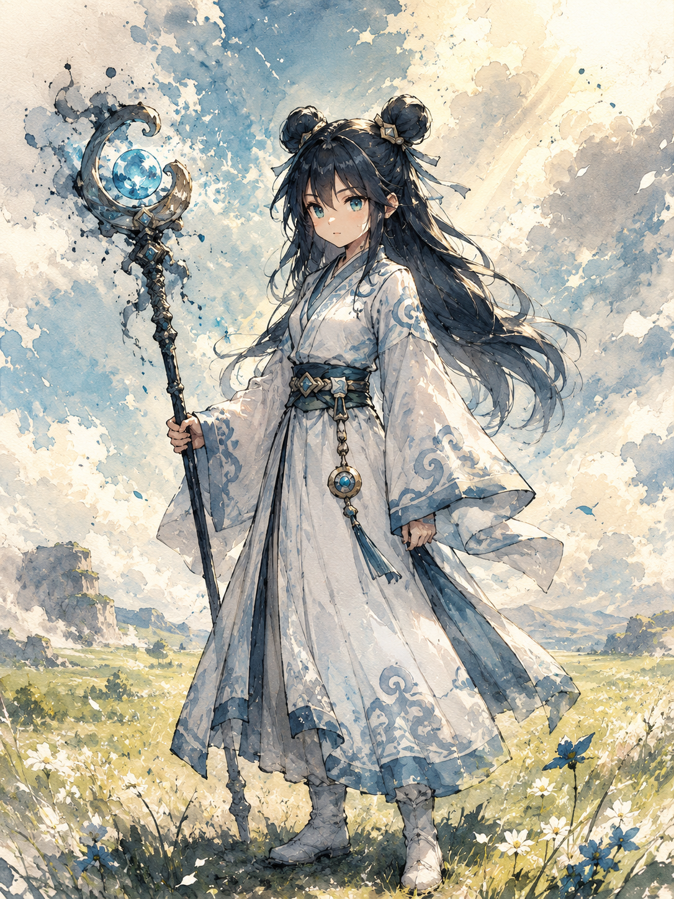

# Impasto Ink-Wash Character Concept Prompt Profile

## Example

Original reference input:


Generated output:



## Purpose

Generate high-quality static character concept art in a Japanese/Korean character-art style that blends heavy impasto painting with traditional ink-wash texture.

This prompt profile is for character illustration and concept design, not pixel art, not animation, and not spritesheets. It turns a character idea, text description, sketch, or reference image into a polished single-image character concept illustration.

## Usage Mode

- Mode: Hybrid
- Text-only generation: Supported through a character idea or detailed text brief.
- Uploaded reference image: Supported through sketches, reference images, previous generated images, or inspiration boards.
- Best for: creating a polished concept illustration from either text direction or uploaded visual references.

## Default Output Specification

- Format: one high-resolution static illustration.
- Subject: one main character by default; a small number of characters only if explicitly requested.
- Composition: full-body or upper-body character concept art.
- Default aspect ratio: portrait, usually close to 3:4.
- Style: Japanese/Korean JRPG character concept art.
- Technique: heavy impasto paint texture plus traditional ink-wash / sumi-e diffusion.
- Background: artistic parchment-like canvas, white or beige paper texture, with ink/watercolor blending.
- Border: irregular flying-white edge, watercolor bleeding, ink diffusion, unfinished painterly boundary.
- Lighting: dramatic light and shadow, often with Tyndall-effect light rays.
- Transparency: no transparent background by default.
- Text policy: no text, no title, no watermark, no signature.

## What This Prompt Profile Is Not

- Not a pixel-art generator.
- Not a spritesheet generator.
- Not an animation frame generator.
- Not a grid, rows, columns, or multi-action sheet generator.
- Not a flat anime cel-shading generator.
- Not a purely realistic painting generator.

If a user wants pixel spritesheets, animation grids, transparent backgrounds, or frame layouts, they should use a different prompt family.

## Style Profile

- High-quality JRPG character concept illustration.
- Japanese/Korean character art influence.
- Thick visible brushstrokes and paint buildup.
- Layered colors with artistic depth.
- Strategic ink diffusion and watercolor bleeding.
- Flying-white dry-brush edges.
- Parchment-paper texture canvas.
- Strong but painterly lighting.
- Detailed outfit, weapon, props, and texture materials.
- Refined concept-art quality while preserving hand-painted irregularity.

## Suitable Inputs

- Character name, class, identity, role, or archetype.
- Gender and personality vibe.
- Hair, eyes, face, age impression, scars, expression.
- Clothing, armor, materials, accessories, symbols, ornaments.
- Weapon, magical effect, skill effect, or unique prop.
- Pose, gesture, expression, and viewer interaction.
- Setting cues such as dungeon, town, wilderness, shrine, battlefield, or studio.
- Mood and atmosphere.
- Sketches, reference images, previous generated images, or inspiration boards.

## Inferred Rules

- Default to one well-defined character so the concept design remains clear.
- Keep the image static and illustrative; do not arrange frames or actions.
- Preserve the impasto and ink-wash fusion as the core style.
- Use background as part of the illustration, not as removable transparency.
- Keep environments suggestive rather than overly busy unless the user asks for complex background.
- Use no readable text or symbols that look like written language.
- Avoid modern clothes unless explicitly requested.
- Avoid clean vector lines, smooth gradients, flat cel shading, and glossy digital polish.

## English Migration Template

```text
A high-quality, full-body character concept art illustration in a Japanese/Korean JRPG character art style, blending heavy impasto painting and traditional ink-wash / sumi-e techniques.

Key visual features:
Visible thick paint texture, layered colors with artistic depth, strategic ink diffusion, watercolor bleeding, dramatic light and shadow with Tyndall-effect light rays, irregular flying-white dry-brush edges, and an artistic parchment-paper texture canvas. No smooth gradients or glossy digital polish. Painterly, textured, atmospheric, refined concept-art quality.

Style references:
Naoki Ikushima, Triangle Strategy official art, Octopath Traveler art. Masterpiece, high resolution.

Character description:
Core identity: [CORE_IDENTITY]
Gender and vibe: [GENDER_AND_MAIN_VIBE]
Hair and eyes: [HAIR_AND_EYES]
Facial features: [FACIAL_FEATURES]
Outfit materials: [OUTFIT_MATERIALS]
Outfit design: [OUTFIT_DESIGN]
Color palette: [COLOR_PALETTE]
Pose and interaction: [POSE_AND_INTERACTION]
Main weapon or prop: [MAIN_WEAPON_OR_PROP]
Special effects: [SPECIAL_EFFECTS]
Environment cues and mood: [ENVIRONMENT_AND_MOOD]

Composition:
Single static character illustration, full-body or upper-body as specified, portrait aspect ratio around 3:4, one main character, subtle background integrated into an irregular ink-wash border.

Negative prompt:
Low resolution, bad quality, pixel art, spritesheet, animation grid, rows and columns, text, watermark, signature, smooth gradients, clean vector lines, glossy digital polish, soft generic shading, photorealistic render, 3D render, flat cel shading, cheap anime clean lines, modern clothes unless specified, extra limbs, bad anatomy, deformed face, missing fingers, busy background, overly complex environment.
```

## Filled Example

```text
A high-quality, full-body character concept art illustration in a Japanese/Korean JRPG character art style, blending heavy impasto painting and traditional ink-wash / sumi-e techniques.

Key visual features:
Visible thick paint texture, layered colors with artistic depth, strategic ink diffusion, watercolor bleeding, dramatic light and shadow with Tyndall-effect light rays, irregular flying-white dry-brush edges, and an artistic parchment-paper texture canvas. No smooth gradients or glossy digital polish. Painterly, textured, atmospheric, refined concept-art quality.

Style references:
Naoki Ikushima, Triangle Strategy official art, Octopath Traveler art. Masterpiece, high resolution.

Character description:
Core identity: Female Spellblade Sorceress.
Gender and vibe: Female, elegant and dangerous.
Hair and eyes: Very long flowing deep violet hair, closed eyes.
Facial features: Mysterious expression, calm and controlled.
Outfit materials: Rich velvet robes mixed with worn leather straps.
Outfit design: Intricate gold filigree patterns, layered skirt, tattered hem, complex belt with pouches.
Color palette: Deep violet, black, warm gold, muted parchment tones.
Pose and interaction: Dynamic fighting pose, drawing a spell with her right hand, looking slightly off-screen.
Main weapon or prop: Left hand resting on an intricate sheathed sword.
Special effects: Arcane particles and ink bleeding from the spellcast.
Environment cues and mood: Ancient dusty arcane library background, mysterious and ancient feel.

Composition:
Single static character illustration, full-body, portrait aspect ratio around 3:4, one main character, subtle background integrated into an irregular ink-wash border.

Negative prompt:
Low resolution, bad quality, pixel art, spritesheet, animation grid, rows and columns, text, watermark, signature, smooth gradients, clean vector lines, glossy digital polish, soft generic shading, photorealistic render, 3D render, flat cel shading, cheap anime clean lines, modern clothes unless specified, extra limbs, bad anatomy, deformed face, missing fingers, busy background, overly complex environment.
```

## Variables

- `CORE_IDENTITY`: character class, role, profession, archetype, or title.
- `GENDER_AND_MAIN_VIBE`: gender presentation and emotional tone.
- `HAIR_AND_EYES`: hair length, color, shape, eye color, eye state.
- `FACIAL_FEATURES`: scars, age, expression, face structure.
- `OUTFIT_MATERIALS`: leather, silk, plate armor, cloth, fur, etc.
- `OUTFIT_DESIGN`: layering, symbols, ornament, hem, belts, pouches, embroidery.
- `COLOR_PALETTE`: main and accent colors.
- `POSE_AND_INTERACTION`: body pose, gaze direction, object interaction.
- `MAIN_WEAPON_OR_PROP`: weapon, book, staff, gun, artifact, tool, or none.
- `SPECIAL_EFFECTS`: magic, ink particles, light effects, smoke, runes.
- `ENVIRONMENT_AND_MOOD`: setting cues and atmosphere.
