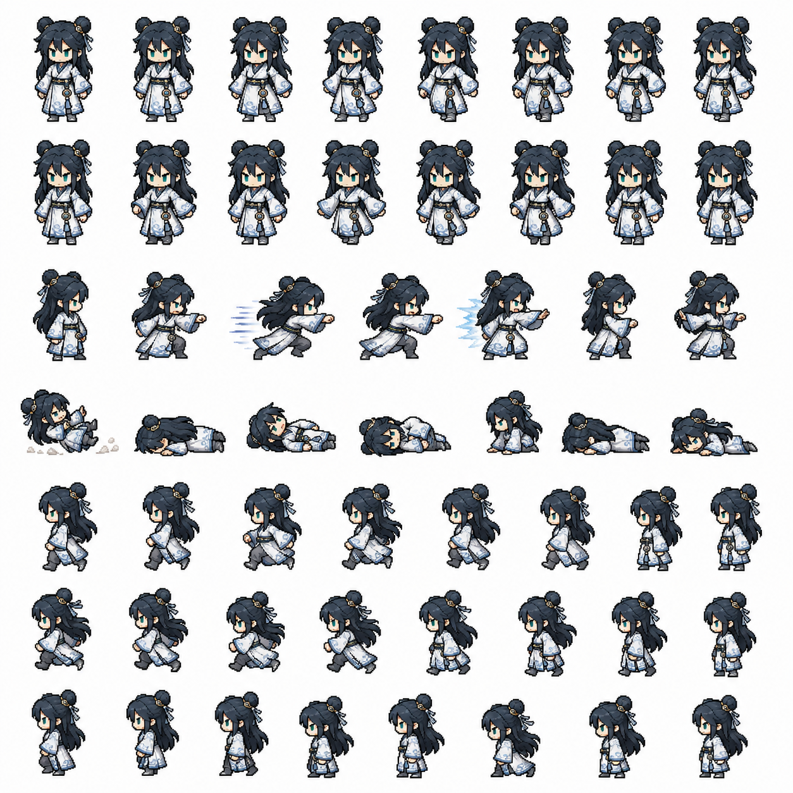

# Indie Character Grid Animation Sheet Prompt Profile

## Example

Original reference input:


Generated output:



## Purpose

Generate strict-grid pixel character spritesheets for 2D games, indie projects, and pixel-art animation workflows.

The prompt profile can create a new character from a text description or expand an existing character spritesheet / illustration into a broader action grid.

## Usage Mode

- Mode: Hybrid
- Text-only generation: Supported for defining a new character, action list, view set, and grid.
- Uploaded reference image: Supported for expanding an existing spritesheet, concept art, full-body illustration, or photo into an action grid.
- Best for: creating new indie character sheets or expanding an uploaded character reference into more actions.

## Default Output Specification

- Format: single PNG pixel-art spritesheet.
- Layout: strict predictable grid; each row or column represents a complete action sequence.
- Clean asset mode: strict 8x8 grid, 64 sprites total.
- Demonstration / labeled mode: strict 9x8 grid, often described as 32x32 px tiles and a 288x288 px sprite area before any external labels.
- Tile size: uniform, commonly 32x32 px, but may be 24x24, 48x48, or 64x64 if requested.
- Sprite placement: each sprite is centered inside a fixed-size tile with enough padding.
- Background: pure green `#00FF00` by default in the stable template; pure white or transparent can be requested.
- Palette: pixel-art-friendly limited palette, often under 256 colors.
- Style: modern indie pixel art, similar to Celeste or Shovel Knight, with JRPG-style clean outlines and detailed hand-placed pixels.
- Lighting: simple top-down or side lighting.
- Asset restrictions: no UI elements; clean asset mode should have no text.

## Supported Inputs

- Character text descriptions: race, gender, body type, hair, outfit, equipment, colors, props.
- Action requirements: walk, run, attack, dash, jump, death, idle, climb, knockdown.
- View requirements: front, side left/right, back, and 3/4 side views.
- Style requirements: classic JRPG, western retro, 8-bit NES, 16-bit SNES, modern high-detail pixel art.
- Reference images: existing spritesheets, character concept art, full-body illustrations, or photos for extracting key visual traits.

## Default Row Logic

The prompt profile exposes two related row structures. Use the clean 8x8 mode for production assets and the 9x8 labeled mode for demonstrations or documentation-style output.

### Clean 8x8 Asset Mode

1. Rows 1-3: front-facing idle and walking variations.
2. Row 4: side-view action, often attack, dash, or forward movement.
3. Row 5: knockdown / hurt / death poses from multiple angles.
4. Rows 6-8: side-view walking, including left and right movement.
5. Optional row 9: back-view idle and walking if the sheet is expanded beyond 8x8.

### 9x8 Demonstration Mode

1. Rows 1-3: front-view idle and walking loop.
2. Row 4: side combat / dash action.
3. Row 5: knockdown / dead poses.
4. Rows 6-8: side walk.
5. Row 9: back walk.
6. The prompt profile's migration answer includes optional visible title and row labels outside the grid. This conflicts with clean asset rules, so only use labels when a presentation sheet is desired rather than an engine-ready asset.

## Inferred Rules

- Keep all sprites inside uniform tiles.
- Keep a strict grid; do not create irregularly placed sprite collections.
- Use consistent frame counts within the same action row.
- Center the character inside each tile and preserve animation anchor stability.
- Use clear outlines and avoid excessive gradients.
- Keep the character design consistent across views and actions.
- Use a solid chroma-key background for reliability unless transparent PNG is explicitly requested.
- Avoid complex particle effects or highly detailed moving parts unless the user accepts reduced consistency.
- Clean production spritesheets should not contain text, labels, UI, or annotations.
- Labeled demonstration spritesheets may include a title and row labels only if explicitly requested.

## English Migration Template

```text
Create a strict-grid pixel-art character spritesheet in a modern indie game pixel-art style, similar to Celeste or Shovel Knight, with JRPG-style clean outlines, detailed hand-placed pixels, vibrant limited palette, simple top-down or side lighting, and no excessive gradients.

Grid and format:
- Mode: [MODE, choose clean production asset sheet or labeled demonstration sheet].
- Grid layout: [GRID_LAYOUT, e.g. strict 8 rows x 8 columns, or strict 9 rows x 8 columns].
- Tile size: [TILE_SIZE, e.g. 32x32 pixels] uniform tiles.
- Every sprite frame must be perfectly centered and aligned inside its own tile.
- Background: solid [SOLID_BACKGROUND_COLOR, e.g. pure green #00FF00], or transparent if explicitly requested.
- Palette: limited pixel-art-friendly palette, typically 16-32 colors or under 256 colors.
- No UI elements. For clean production mode: no text, no labels, no annotations.

Character definition:
- Character name: [CHARACTER_NAME]
- Race / gender / body type: [CHARACTER_RACE_GENDER_BODY_TYPE]
- Appearance details: [CHARACTER_APPEARANCE_DETAILS, including outfit, head, hair, props, colors, boots, equipment]
- Main item or prop: [ITEM_1]
- Optional item or prop: [ITEM_2]

Row-by-row action layout:
- Rows 1-3, front view: front idle and walking loop. Show leg and arm movement, with outfit and props subtly moving across frames.
- Row 4, side view action: side dash, combat, or attack loop. Show a dynamic forward-leaning action using [ITEM_1], with optional [FX_DETAILS].
- Row 5, knockdown / death: show hit reaction, falling backward, lying face-down, lying face-up, and side-lying poses.
- Rows 6-8, side walking: complete side walking loops for left and right movement.
- Optional Row 9, back view: back idle and walking loop, showing the back of the outfit and carried props.

Labeled demonstration mode only:
- Add an external title: "[SPRITESHEET_TITLE]".
- Add row labels outside the grid: "[FRONT_ACTION_LABEL]", "[SIDE_COMBAT_LABEL]", "[KNOCKDOWN_LABEL]", "[SIDE_WALK_LABEL]", "[BACK_WALK_LABEL]".
- Add a small external note such as "[TILE_SIZE] PIXEL TILE GRID. REPEAT COUNT: UNIFIED."
- Do not place labels inside the sprite cells.
```

## Filled Example

```text
Create a strict-grid pixel-art character spritesheet in a modern indie game pixel-art style, similar to Celeste or Shovel Knight, with JRPG-style clean outlines, detailed hand-placed pixels, vibrant limited palette, simple top-down or side lighting, and no excessive gradients.

Grid and format:
- Mode: clean production asset sheet.
- Grid layout: strict 8 rows x 8 columns.
- Tile size: 32x32 pixels uniform tiles.
- Every sprite frame must be perfectly centered and aligned inside its own tile.
- Background: solid pure green #00FF00.
- Palette: limited pixel-art-friendly palette, around 16-32 colors.
- No UI elements, no text, no labels, no annotations.

Character definition:
- Character name: Pixel Adventurer.
- Race / gender / body type: sturdy human adventurer.
- Appearance details: green winter parka, blue-lens goggles, textured hat, red scarf or vest, green pants, brown boots.
- Main item or prop: small travel pack.
- Optional item or prop: none.

Row-by-row action layout:
- Rows 1-3, front view: front idle and walking loop, including front idle and walking step variations.
- Row 4, side view action: side forward dash and swing action.
- Row 5, knockdown / death: falling backward, lying face-down, lying face-up, and side-lying poses.
- Rows 6-8, side walking: complete side walking loops for left and right movement.
```

## Variables

- `MODE`: clean production asset sheet or labeled demonstration sheet.
- `GRID_LAYOUT`: strict 8x8, strict 9x8, or another explicit row/column grid.
- `TILE_SIZE`: 24x24, 32x32, 48x48, 64x64, or another uniform tile size.
- `SOLID_BACKGROUND_COLOR`: pure green `#00FF00`, pure white, or another chroma-key color.
- `CHARACTER_NAME`: character or project name.
- `CHARACTER_RACE_GENDER_BODY_TYPE`: race, gender, silhouette, and body type.
- `CHARACTER_APPEARANCE_DETAILS`: outfit, hair, headgear, colors, boots, equipment.
- `ITEM_1` / `ITEM_2`: staff, goggles, sword, pack, tool, cloak, hat, or none.
- `FX_DETAILS`: leaf particles, energy slash, dust, small sparks, or no effect.
- `SPRITESHEET_TITLE`: optional external title for demonstration mode only.
