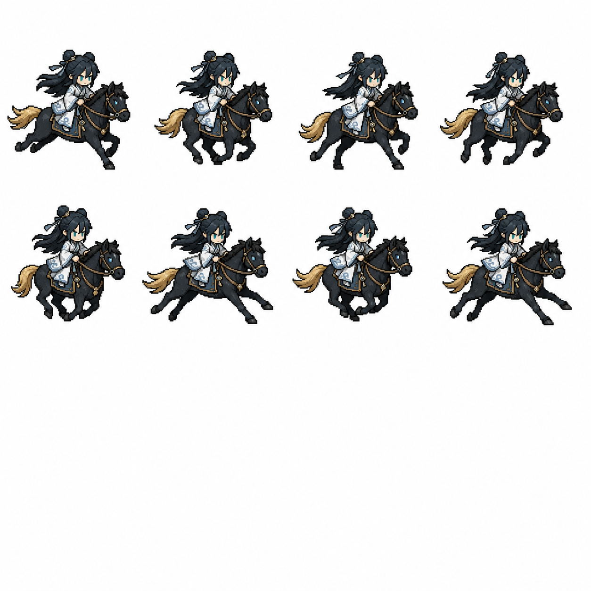

# Mounted Character Gallop Sheet Prompt Profile

## Example

Original reference input:


Generated output:



## Purpose

Generate pixel-art animation spritesheets of a character riding a horse.

The prompt profile specializes in side-view horse-riding loops, especially right-facing galloping or walking animation cycles laid out as a strict grid.

## Usage Mode

- Mode: Hybrid
- Text-only generation: Supported. Provide rider, horse, outfit, tack, and riding action descriptions.
- Uploaded reference image: Supported as a visual anchor for rider identity, horse design, palette, and riding style.
- Best for: creating a mounted character gallop sheet from either text or an uploaded character/horse reference.

## Default Output Specification

- Format: pixel-art riding animation spritesheet.
- Canvas ratio: 1:1 square output.
- Default layout: 4 rows x 4 columns, 16 frames total.
- Alternative layouts: user may specify 3x4, 3x6, 8x2, or another `N x M` frame matrix.
- Default action: full-speed galloping loop.
- Default direction: horse and rider face right in a clean side-profile view.
- Frame order: chronological order, read left-to-right, top-to-bottom.
- Background: solid flat color, usually pure white or pure green.
- Transparency: not supported by default; use solid chroma-key background instead.
- Pixel quality: precise pixel art, sharp edges, no anti-aliasing, no blur, no smooth gradients.
- Asset restrictions: no text, no numbers, no visible grid lines, no UI elements.

## Default Animation Behavior

- The horse's gait should read as a complete galloping cycle.
- Each sequential frame should show a distinct stage of the horse's leg movement.
- The rider's posture should move naturally with the horse while keeping the character identity consistent.
- The frame spacing should be even and minimal.
- All frames should be aligned in a clean, strict grid.

## Inferred Rules

- Preserve the rider's outfit, silhouette, hair, weapon, and color palette across all frames.
- Preserve the horse's color, mane, tail, tack, and saddle details across all frames.
- Keep the horse and rider centered inside each cell.
- Keep the animation anchor stable, especially the horse's body baseline, to reduce playback jitter.
- Prefer 4x4 / 16 frames for a smoother gallop than 3x4 / 12 frames.
- Use a pure solid background because generated alpha transparency tends to create blurry or dirty edges.
- If the user does not specify a rider, the prompt profile may default to a Tanjiro-like Japanese swordsman with a green checkered haori riding a gray horse.
- Avoid non-pixel-art styles, single static images, text labels, visible grid lines, and decorative backgrounds.

## English Migration Template

```text
[DETAILED_CHARACTER_DESCRIPTION] riding a [DETAILED_HORSE_DESCRIPTION], precise pixel art style, inspired by classic 16-bit JRPG game assets such as Chrono Trigger or Final Fantasy VI, but optimized for modern clarity.

Strictly organized pixel-art animation spritesheet, presented in a perfect grid layout of [ROWS] rows and [COLUMNS] columns, containing a total of [TOTAL_FRAMES] individual frames. Each frame must be distinct, evenly spaced, and aligned within its grid cell.

Animation details:
A full, fluid, looping [RIDING_ACTION] animation cycle. The view is a strict clean profile side view, with the horse and rider always moving to the right. Each sequential frame shows a precise stage of the horse's leg movement and the rider's posture during a full stride.

Technical specs:
1:1 aspect ratio, square canvas, consistent pixel scaling, sharp pixel edges, zero anti-aliasing, clean pixel-perfect lines. Vibrant but limited and coherent color palette.

Background:
Solid, flat, uniform [BACKGROUND_COLOR] background. No gradients, no textures, no noise.

Negative prompt:
Text, numbers, labels, grid lines, UI elements, blurry pixels, smooth shading, 3D render, photographic elements, anti-aliasing, jagged lines, chaotic layout, inconsistent frame sizes, extra limbs, decorative background.
```

## Filled Example

```text
A young Japanese swordsman wearing a distinctive black and green checkered haori jacket over a dark uniform, with dark spiky hair and a determined expression, riding a powerful gray warhorse with a black mane and tail, simple brown leather tack and saddle, precise pixel art style, inspired by classic 16-bit JRPG game assets such as Chrono Trigger or Final Fantasy VI, but optimized for modern clarity.

Strictly organized pixel-art animation spritesheet, presented in a perfect grid layout of 4 rows and 4 columns, containing a total of 16 individual frames. Each frame must be distinct, evenly spaced, and aligned within its grid cell.

Animation details:
A full, fluid, looping galloping animation cycle. The view is a strict clean profile side view, with the horse and rider always moving to the right. Each sequential frame shows a precise stage of the horse's leg movement and the rider's posture during a full stride.

Technical specs:
1:1 aspect ratio, square canvas, consistent pixel scaling, sharp pixel edges, zero anti-aliasing, clean pixel-perfect lines. Vibrant but limited and coherent color palette.

Background:
Solid, flat, uniform pure white background. No gradients, no textures, no noise.

Negative prompt:
Text, numbers, labels, grid lines, UI elements, blurry pixels, smooth shading, 3D render, photographic elements, anti-aliasing, jagged lines, chaotic layout, inconsistent frame sizes, extra limbs, decorative background.
```

## Variables

- `DETAILED_CHARACTER_DESCRIPTION`: rider identity, outfit, hair, expression, weapon, and role.
- `DETAILED_HORSE_DESCRIPTION`: horse color, breed, mane, tail, saddle, tack, and armor if any.
- `ROWS`: number of grid rows, commonly 4.
- `COLUMNS`: number of grid columns, commonly 4.
- `TOTAL_FRAMES`: rows x columns, commonly 16.
- `RIDING_ACTION`: galloping loop, walking loop, idle breathing loop, charge attack loop, etc.
- `BACKGROUND_COLOR`: pure white, pure green, black, or another solid chroma-key color.
