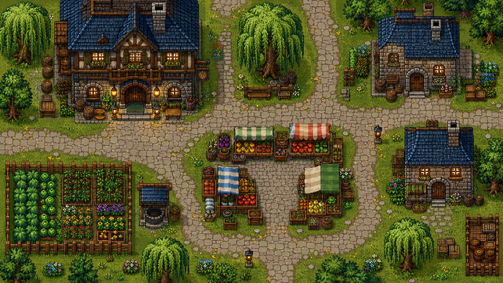

# Orthographic Topdown Pixel Scene Prompt Profile

## Example



## Purpose

Generate high-quality topdown pixel-art panoramic scenes for games, concept design, tileset planning, and environmental asset ideation.

The prompt profile specializes in straight-down topdown scene images with no characters. It can also simulate two utility modes through Chinese trigger keywords: object extraction and object removal.

## Usage Mode

- Mode: Text-to-image
- Text-only generation: Primary mode. Provide environment, terrain, object, atmosphere, and utility-mode instructions.
- Uploaded reference image: Not part of the core workflow; this profile is designed for text-described scene generation and asset/ground variants.
- Best for: creating new straight-down pixel scenes, object sheets, or clean terrain plates from text.

## Default Output Specification

- Format: one static pixel-art scene image.
- Aspect ratio: 16:9 panoramic widescreen.
- Perspective: topdown, straight-down, orthographic-like view.
- Style: pure pixel art.
- Characters: absolutely no human characters, humanoid NPCs, or character-like creatures.
- Animation: none; static image only.
- Default arrangement: natural scene distribution, not a grid.
- Transparency: none by default.
- Pixel quality: crisp, aligned pixels, no anti-aliasing, no blur.
- Palette: limited and harmonious pixel-art color palette.

## Supported Modes

### 1. Complete Scene Mode

Triggered when the user provides a normal scene description without special keywords.

- Output is a complete 16:9 topdown pixel panorama.
- Includes ground texture, buildings, trees, props, lighting, decoration, and atmosphere.
- Objects are naturally distributed according to the environment.
- No strict rows or columns.
- No transparent background.

### 2. Object Extraction Mode

Triggered by including the keyword:

```text
object extraction mode
```

- Output is an asset sheet rather than a natural scene.
- Extracts or generates individual scene objects, including trees, props, small objects, and environmental assets.
- Objects are placed on a pure black background.
- Objects are arranged in orderly rows and columns with clear spacing.
- Intended for later manual extraction.
- No transparent background.

### 3. Object Removal / Ground-Only Mode

Triggered by including the keyword:

```text
ground-only mode
```

- Output is a clean base environment.
- Removes all non-ground objects, including trees, buildings, props, and other objects.
- Keeps only ground texture such as grass, dirt, sand, stone, ice, water, or lava.
- No strict rows or columns.
- No transparent background.

## Suitable Inputs

- Environment type: forest, desert, town, dungeon, ice field, future city, ancient ruins, etc.
- Ground texture: grass, dirt, stone path, sand, ice, water, lava, mud, road, etc.
- Buildings and objects: houses, towers, trees, bushes, rocks, rivers, bridges, vehicles, crates, crystals, signs, fences, lanterns.
- Details and atmosphere: lighting, flowers, vines, banners, statues, smoke, steam, falling leaves, glowing mushrooms, small decorations.
- Optional mode keyword: `object extraction mode` or `ground-only mode`.

## Inferred Rules

- Always preserve the straight-down topdown perspective.
- Avoid isometric, side view, perspective view, 3D, or realistic rendering.
- Never include player characters, human figures, humanoid NPCs, or similar character-like subjects.
- Use pixel techniques for all lighting and detail.
- In full-scene mode, distribute objects naturally.
- In extraction mode, switch to a black-background asset sheet.
- In ground-only mode, keep only base terrain texture and remove structures/props.
- Avoid readable text, signs with words, UI overlays, or labels.

## English Migration Template: Complete Scene

```text
pixel art, topdown view, straight-down perspective, high quality, detailed, crisp pixels, no antialiasing, harmonious color palette, panoramic, 16:9 aspect ratio, zero human figures, no humanoid NPCs

Main scene:
A detailed pixel-art topdown view of [ENVIRONMENT_AND_GROUND_TEXTURE].

Buildings and objects:
Featuring [BUILDINGS_AND_OBJECTS].

Details and atmosphere:
Details include [DETAILS_AND_ATMOSPHERE].

Negative prompt:
human, character, figure, humanoid, npc, isometric, side view, 3d, realistic, blurry, anti-aliasing, fuzzy pixels, low resolution, unaligned pixels, background blur, depth of field, text, labels, UI.
```

## English Migration Template: Asset Sheet

```text
pixel art asset sheet, topdown view, straight-down perspective, individual objects, arranged in orderly rows and columns, pure black background, ready for extraction, detailed, crisp pixels, no antialiasing, zero human figures

Object list:
Featuring an assortment of pixel-art topdown objects from a [THEME] theme, including [OBJECT_LIST]. Each item is a separate object with its own pixel size and clear spacing.

Negative prompt:
human, character, figure, humanoid, npc, isometric, side view, 3d, realistic, blurry, anti-aliasing, fuzzy pixels, low resolution, text, labels, UI, connected objects, overlapping objects.
```

## English Migration Template: Ground-Only

```text
pixel art clean ground floor, topdown view, straight-down perspective, seamless textures, high quality, clear pixels, no antialiasing, panoramic, 16:9 aspect ratio, zero human figures, zero objects, no structures, no props

Main scene:
A detailed pixel-art clean ground floor showing only the textures of [GROUND_TEXTURE_DESCRIPTION]. Just the ground floor.

Negative prompt:
human, character, figure, humanoid, npc, isometric, side view, 3d, realistic, blurry, anti-aliasing, fuzzy pixels, low resolution, objects, structures, buildings, trees, props, text, labels, UI.
```

## Filled Example: Complete Scene

```text
pixel art, topdown view, straight-down perspective, high quality, detailed, crisp pixels, no antialiasing, harmonious color palette, panoramic, 16:9 aspect ratio, zero human figures, no humanoid NPCs

Main scene:
A detailed pixel-art topdown view of a bustling pixel town street with stone pavement and patches of grass.

Buildings and objects:
Featuring a double-story tavern, two small stone houses, a central marketplace with fruit and vegetable stalls, a winding stone path, several willow trees, and a small fenced garden.

Details and atmosphere:
Details include lanterns with warm light at the tavern entrance, scattered leaves on the path, crates and barrels in the market, pixelated flowers in the garden, and small grass tufts near the road.

Negative prompt:
human, character, figure, humanoid, npc, isometric, side view, 3d, realistic, blurry, anti-aliasing, fuzzy pixels, low resolution, unaligned pixels, background blur, depth of field, text, labels, UI.
```

## Variables

- `ENVIRONMENT_AND_GROUND_TEXTURE`: environment type plus terrain material.
- `BUILDINGS_AND_OBJECTS`: structures, trees, roads, props, water, cliffs, bridges.
- `DETAILS_AND_ATMOSPHERE`: lighting, weather, decoration, small visual effects.
- `THEME`: object extraction theme, such as forest, town, desert, dungeon, ice.
- `OBJECT_LIST`: individual assets to place on the black-background sheet.
- `GROUND_TEXTURE_DESCRIPTION`: terrain-only visual description.
