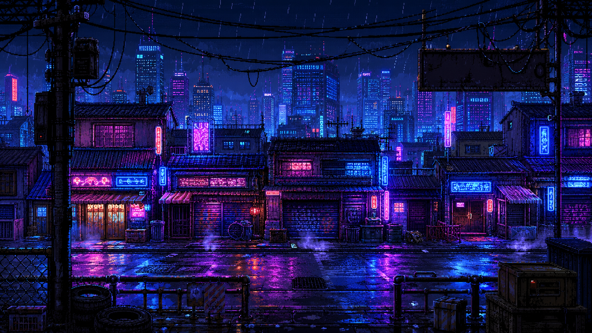

# Parallax Side-View Arcade Environment Prompt Profile

## Example



## Purpose

Generate high-quality 2D side-scrolling arcade pixel-art backgrounds.

The prompt profile specializes in static panoramic level backgrounds inspired by classic 16-bit and 32-bit arcade action/fighting games such as Street Fighter, King of Fighters, Metal Slug, and Final Fight. It emphasizes horizontal level flow, parallax depth, rich atmosphere, and environmental storytelling without characters or UI.

## Usage Mode

- Mode: Text-to-image
- Text-only generation: Primary mode. Provide scene theme, lighting mood, parallax layers, effects, and props.
- Uploaded reference image: Not part of the core workflow; this profile generates new side-view arcade backgrounds from text.
- Best for: creating new side-scrolling arcade pixel environments with layered parallax from text.

## Default Output Specification

- Format: PNG static image.
- Aspect ratio: 16:9 widescreen by default.
- Common resolution: 1920x1080-like output while preserving pixel-art clarity.
- Perspective: strict 2D side-scrolling / side-view arcade perspective.
- Composition: panoramic level background with horizontal flow.
- Style: classic 16-bit / 32-bit arcade pixel art, CPS2/CPS3/Neo Geo-like aesthetic.
- Layers: far background, midground playable area, foreground parallax elements.
- Lighting: dramatic environmental lighting, neon, lasers, explosions, rain, smoke, or other strong arcade atmosphere.
- Characters: no playable characters, NPCs, enemies, humans, animals, or creatures.
- UI: no HUD, health bars, score, timer, dialogue boxes, button prompts, or interface elements.
- Text: no readable text; signs may use abstract/illegible pixel marks only.
- Transparency: not applicable; full opaque scene.
- Animation: none; single static background image.

## Core Layer Logic

### Far Background

Builds depth and world scale. Usually simplified and atmospheric:

- City skylines
- Giant moon
- Distant ships
- Far mountains
- Deep space
- Distant machinery
- Ruins silhouettes

### Midground / Playable Area

Main level path and interactive-looking area. This is the detail-rich layer:

- Streets, platforms, factory floors, corridors
- Buildings and doors
- Ladders, conveyors, railings
- Wet asphalt, metal floors, stone paths
- Props and obstacles

### Foreground

Closest parallax layer for depth/speed:

- Utility poles and cables
- Rails
- Broken vehicles
- Hanging signs without readable text
- Broken glass
- Pipes
- Passing machinery

## Suitable Inputs

- Scene name/theme: neon rainy street, rusty underground factory, ancient jungle ruins, damaged spaceship corridor, steampunk factory, underground temple, etc.
- Main color and lighting mood: blue/purple neon, orange explosion afterglow, red alarm light, green moss and torchlight, black/blue laser glow.
- Far background details.
- Midground playable path and main structures.
- Foreground fast-passing/depth elements.
- Atmosphere and effects: rain, smoke, steam, sparks, lasers, dust, drifting fog.
- Key props: graffiti wall, vending machine, broken machinery, rusty railing, crates, cables, reflective puddles.

## Inferred Rules

- Always use strict 2D side-view, not topdown, isometric, 3D, or first-person.
- Design for horizontal scrolling and level progression.
- Use explicit foreground/midground/background parallax structure.
- Keep the midground most readable as the implied playable path.
- Use vivid saturated arcade colors and dramatic environmental lighting.
- Avoid readable text, even on signs and graffiti.
- Never include characters, creatures, animals, humans, or UI.
- Avoid tile-based tile-based sandbox-style cross-section unless explicitly requested; this prompt profile is arcade-stage background, not block-map slice.

## English Migration Template

```text
(detailed pixel art:1.4), (16-bit arcade game style:1.3), (CPS2 CPS3 Neo Geo aesthetic:1.2), strict 2D side-scrolling perspective, panoramic landscape level design, emphasized horizontal level flow, no characters, environment only.

Scene and mood:
Scene of [SCENE_THEME], [COLOR_AND_LIGHTING_MOOD].

Multiple depth layers for parallax scrolling effect:
Background Layer / far distance:
[FAR_BACKGROUND]

Midground Layer / playable area:
[MIDGROUND_PLAYABLE_AREA]

Foreground Layer / closest to camera:
[FOREGROUND_ELEMENTS]

Details and effects:
[ENVIRONMENT_EFFECTS], [KEY_PROPS_AND_DECORATION], illegible stylized pixel signs simulating text, high saturation colors, vibrant, dramatic atmosphere, retro gaming nostalgia.
```

## Negative Prompt

```text
(character:1.5), (person:1.5), (human:1.5), (NPC:1.5), (enemy:1.5), (player:1.5), (animal:1.4), creature,
(UI:1.5), (HUD:1.5), (health bar:1.5), (score:1.5), (timer:1.5), (dialogue box:1.5), (button prompts:1.5),
(legible text:1.4), (readable writing:1.4), (specific letters:1.4), (real-world logos:1.4),
3D render, realistic, photorealistic, isometric perspective, top-down view, first-person perspective, vertical composition, modern graphics, smooth shading, blurry, low quality, low resolution.
```

## Filled Example

```text
(detailed pixel art:1.4), (16-bit arcade game style:1.3), (CPS2 CPS3 Neo Geo aesthetic:1.2), strict 2D side-scrolling perspective, panoramic landscape level design, emphasized horizontal level flow, no characters, environment only.

Scene and mood:
Scene of a neon rainy Japanese street at night, cold blue neon and purple reflections with dramatic environmental lighting.

Multiple depth layers for parallax scrolling effect:
Background Layer / far distance:
A dense, blurred skyline of skyscrapers with flickering neon lights, partially obscured by rain mist.

Midground Layer / playable area:
Wet asphalt road with clear neon reflections, old Japanese storefront buildings facing the camera, abstract neon signs with no readable text, graffiti-like pixel patterns, trash bins, and rusty railings.

Foreground Layer / closest to camera:
Utility poles, crossing cables, a hanging blank billboard, broken car tires, and close railings passing in front of the scene for parallax depth.

Details and effects:
Fine pixel rain, steam rising from sewer grates, flickering neon glow, reflective puddles, scattered crates, illegible stylized pixel signs simulating text, high saturation colors, vibrant, dramatic atmosphere, retro gaming nostalgia.
```

## Filled Example Negative Prompt

```text
(character:1.5), (person:1.5), (human:1.5), (NPC:1.5), (enemy:1.5), (player:1.5), (animal:1.4), creature,
(UI:1.5), (HUD:1.5), (health bar:1.5), (score:1.5), (timer:1.5), (dialogue box:1.5), (button prompts:1.5),
(legible text:1.4), (readable writing:1.4), (specific letters:1.4), (real-world logos:1.4),
3D render, realistic, photorealistic, isometric perspective, top-down view, first-person perspective, vertical composition, modern graphics, smooth shading, blurry, low quality, low resolution.
```

## Variables

- `SCENE_THEME`: scene name and level theme.
- `COLOR_AND_LIGHTING_MOOD`: main palette and atmospheric light.
- `FAR_BACKGROUND`: distant simplified parallax background.
- `MIDGROUND_PLAYABLE_AREA`: main walkable or interactive-looking area.
- `FOREGROUND_ELEMENTS`: closest parallax props.
- `ENVIRONMENT_EFFECTS`: rain, smoke, steam, lasers, dust, sparks, fog.
- `KEY_PROPS_AND_DECORATION`: graffiti, signs, vending machines, crates, rails, broken machines, puddles.
