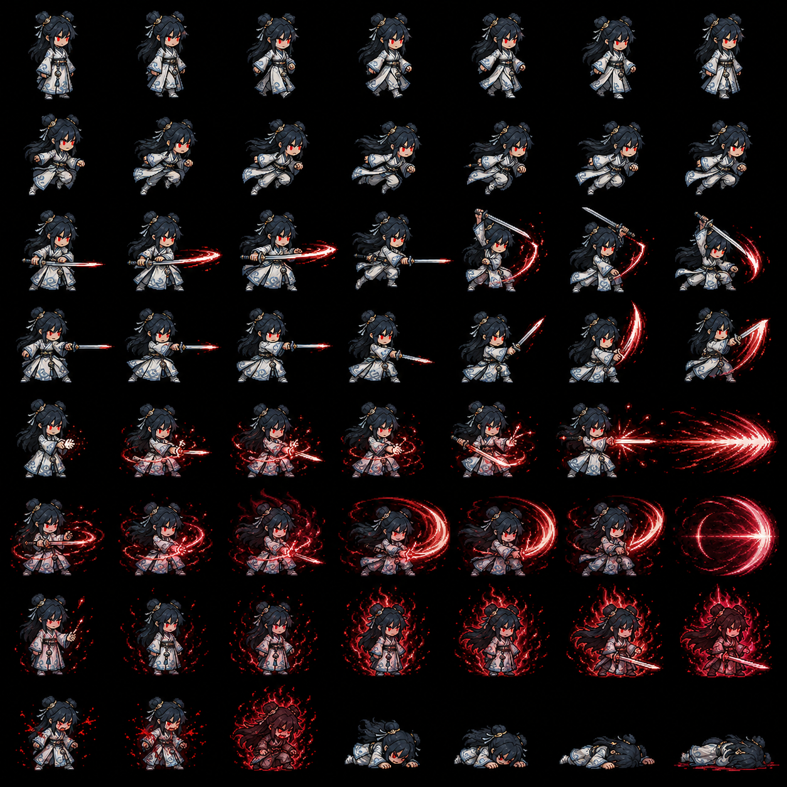

# Reference-Based Side-View Action Sheet Prompt Profile

## Example

Original reference input:


Generated output:



## Purpose

Generate and expand side-scrolling pixel character action sheets for game development.

The prompt profile is designed around extending a reference swordsman sprite sheet: preserve the original character's visual anchors, retain important existing actions when possible, and add new smooth action rows such as running, sword attacks, charge attacks, hurt frames, and death sequences.

## Usage Mode

- Mode: Reference-guided
- Text-only generation: Limited. Text is mainly used to specify extra actions, effects, and grid size.
- Uploaded reference image: Primary mode. Upload a side-view character action sheet or character reference as the strict visual baseline.
- Best for: extending or refining an uploaded side-view character action sheet.

## Default Output Specification

- Format: PNG action spritesheet.
- Canvas ratio: 1:1 square by default.
- Layout: clean, organized grid; each row is a coherent action type and each column is a frame from left to right.
- Grid size: dynamic based on the requested action set, with examples such as 8x8, 8x6, 12x8, 16x12, or 16x16.
- Background: pure black by default in the stable template; pure green may also be used for extraction.
- Style: strict 16-bit or 8-bit pixel art.
- Default orientation: right-facing side-view, following the reference.
- Character count: one consistent swordsman character only.
- Asset restrictions: no text, no numbers, no visible grid lines, no high-resolution smoothing, no non-pixel art, no UI elements.

## Visual Anchor

This profile's stable template is built around a supplied side-view reference action sheet.

The visual anchor should be preserved unless the user explicitly overrides it:

- Brown / orange hat.
- Green clothing.
- White sword.
- Simple pixel-block eyes.
- Cartoon-like expression and proportions.
- Limited, clean 16-bit palette.
- Right-facing side-view action style.

## Default Action Logic

- Preserve existing core sequences from the reference when grid size allows: walking, running, core attacks, hurt, and death.
- Add new actions by inserting logical new rows rather than disrupting existing rows.
- Each row should represent one coherent action, such as walk, run, standard attack, combo, charge attack, sword-wave attack, hurt, death, or special state.
- Each row reads left to right as animation time.
- New actions should be visually seamless with the reference sprites.
- Effects such as blue sword waves may be added, but they must stay inside frame boundaries and not spill into neighboring cells.

## Inferred Rules

- Do not change the core character design: hat, clothes, eyes, proportions, and sword must remain consistent.
- Do not generate mirrored left-facing frames unless explicitly requested.
- Prefer a larger organized grid when the requested action set needs more frames.
- Keep all frames aligned to an invisible grid with stable anchors.
- Keep the background clean and flat.
- Do not include labels, titles, frame numbers, or drawn grid lines in the final asset.
- Use no anti-aliasing, no high-resolution smooth rendering, and no non-pixel effects.
- If expanding an existing sheet, preserve important old rows before adding new rows.

## English Migration Template

```text
Create a clean, organized side-scrolling pixel-art action spritesheet for a reference-based swordsman character.

Reference anchor:
Use the supplied side-view swordfighter reference sprite sheet as the strict visual baseline. Preserve the character's brown/orange hat, green clothing, white sword, simple pixel-block eyes, cartoon-like proportions, limited palette, and clean 16-bit pixel-art style.

Output format:
- PNG spritesheet.
- 1:1 square canvas by default.
- Clean grid layout with no visible grid lines.
- Background: solid [BACKGROUND_COLOR, e.g. pure black or pure green].
- No text, no numbers, no labels, no UI.
- No anti-aliasing, no high-resolution smoothing, no non-pixel rendering.

Grid and layout:
- Grid size: [GRID_SIZE, e.g. 8x6, 12x8, 16x12, 16x16].
- Each row represents one coherent action type.
- Each column represents a sequential animation frame, reading left to right.
- Preserve the reference's core action rows when grid size allows, then add new action rows logically.
- Default orientation is right-facing side-view. Do not add left-facing mirror frames unless explicitly requested.

Action requirements:
[ACTION_SEQUENCE_DESCRIPTION: describe which old actions to preserve and which new actions to add, such as walk cycle, run cycle, standard sword slash, upward slash, combo attacks, charge-up stance, blue sword-wave release, hurt frames, red-state frame, knockback, death fall, lying-down frame, or tombstone transformation.]

Special effects:
[SPECIAL_EFFECTS: e.g. blue magic sword-wave effects matching the reference slide slash, no new effects, or specific effect colors and shapes.]

Placement:
[FRAME_PLACEMENT: specify row locations for new actions if needed.]

Quality constraints:
The character design must remain identical across all frames. New motions must look seamless with the original sprite sheet. Any magic or sword effects must stay inside their own frame cells and not cover neighboring frames.
```

## Filled Example

```text
Create a clean, organized side-scrolling pixel-art action spritesheet for a reference-based swordsman character.

Reference anchor:
Use the supplied side-view swordfighter reference sprite sheet as the strict visual baseline. Preserve the character's brown/orange hat, green clothing, white sword, simple pixel-block eyes, cartoon-like proportions, limited palette, and clean 16-bit pixel-art style.

Output format:
- PNG spritesheet.
- 1:1 square canvas.
- Clean grid layout with no visible grid lines.
- Background: solid pure black.
- No text, no numbers, no labels, no UI.
- No anti-aliasing, no high-resolution smoothing, no non-pixel rendering.

Grid and layout:
- Grid size: 12x8 frames.
- Each row represents one coherent action type.
- Each column represents a sequential animation frame, reading left to right.
- Preserve the reference's core walking, running, attack, hurt, and death rows when possible, then add new action rows logically.
- Default orientation is right-facing side-view.

Action requirements:
Preserve the existing walking and core attack rows. Add two new rows of charged magic sword attacks: standing charge-up for 2 frames, fully charged glow for 1 frame, release a large horizontal blue sword-wave for 3 frames, then add an upward slash for 3 frames. In the final row, add two extra hurt frames, one knockback frame, and one lying-on-ground revival-omen frame.

Special effects:
All new magic sword-wave effects are blue and match the reference's sliding slash style while using different shapes.

Placement:
Place the new charge sequences in rows 7 and 8. Place the new hurt and lying-down frames in the final row.

Quality constraints:
The character design must remain identical across all frames. New motions must look seamless with the original sprite sheet. Any magic or sword effects must stay inside their own frame cells and not cover neighboring frames.
```

## Variables

- `BACKGROUND_COLOR`: pure black, pure green, or another flat extraction color.
- `GRID_SIZE`: 8x6, 10x8, 12x8, 16x12, 16x16, or another explicit frame grid.
- `ACTION_SEQUENCE_DESCRIPTION`: the action rows to preserve, refine, or add.
- `SPECIAL_EFFECTS`: blue sword wave, magic charge glow, slash arc, dust, no new effect.
- `FRAME_PLACEMENT`: exact rows or final-row placement instructions.
- `REFERENCE_NAME`: a supplied side-view swordfighter reference sheet or another supplied reference.
