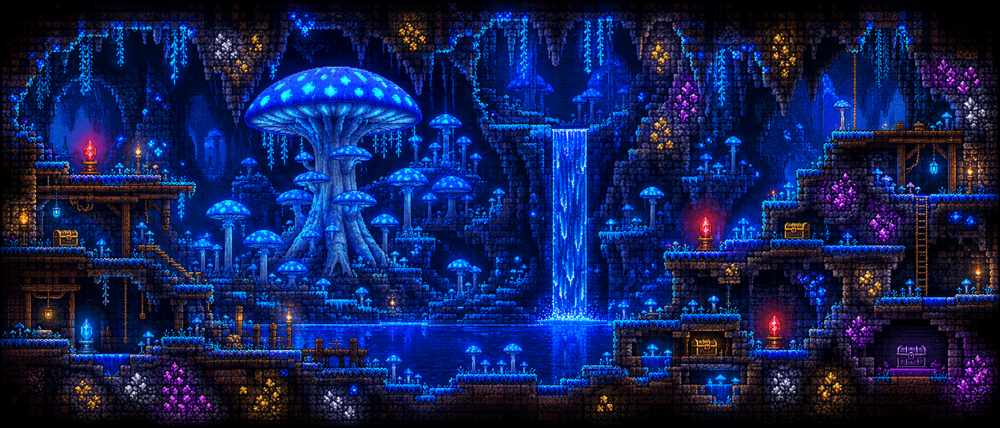

# Tile-Based Side-View Pixel Environment Prompt Profile

## Example



## Purpose

Generate tile-based sandbox-style 2D side-scrolling pixel-art panorama scenes.

The prompt profile specializes in static cross-section environment images that show terrain, biome structure, background walls, foreground blocks, lighting, ores, props, and atmosphere in a side-view game scene.

## Usage Mode

- Mode: Text-to-image
- Text-only generation: Primary mode. Provide biome, scene structure, foreground blocks, details, and lighting.
- Uploaded reference image: Not part of the core workflow; this profile generates new side-view environments from text.
- Best for: creating new tile-based side-view cross-section pixel environments from text.

## Default Output Specification

- Format: PNG static image.
- View: strict 2D side-view cross-section / side-scrolling perspective.
- Composition: wide or ultrawide panoramic landscape.
- Common aspect ratios: 16:9, 21:9, 32:9, or similarly wide panorama.
- Typical resolution: high-resolution pixel panorama such as 3200x900 or comparable.
- Style: tile-based side-view sandbox pixel art.
- Texture system: 16x16 and 32x32 tile-based blocks and walls.
- Transparency: none by default; full scene with background.
- Arrangement: continuous environment, not a grid or asset sheet.
- Animation: none; static scene only.
- Characters: no players, NPCs, enemies, monsters, animals, or creatures.
- UI: no inventory, map, health bar, item slots, crosshair, labels, or text.

## Core Scene Layers

### Background

- Sky, clouds, moon, stars, mountains, distant biome silhouettes for surface scenes.
- Underground wall tiles, cave wall textures, distant rock silhouettes for cave scenes.
- Background walls and far environmental silhouettes.

### Midground

- Trees, ruins, temples, buildings, cave formations, dungeon walls, background decorations.
- Large biome-defining structures such as mushroom trees, hive walls, dungeon entrance, floating island structures.

### Foreground / Playable Blocks

- Blocks and platforms the player could stand on.
- Dirt, stone, grass, jungle mud, dungeon bricks, sand, ice, lava, water.
- Ores, vines, chests, traps, torches, furniture, plants, life crystals, platforms.

## Suitable Inputs

- Biome: forest, jungle, corruption, crimson, dungeon, underworld, sky island, glowing mushroom, ocean, desert, snow, hallow, granite/marble cave, hive, etc.
- Terrain and structure: giant trees, waterfalls, lava rivers, floating islands, ruins, temples, village buildings, dungeon entrance, abyss, underground cave networks, cliffs.
- Details and objects: glowing ores, gems, torches, chests, statues, furniture, background walls, vines, spikes, life fruits, mana crystals, platforms.
- Time and mood: daytime, night, sunset, rain, snow, sandstorm, mysterious, dangerous, calm.
- Color bias: purple corruption, red crimson, green jungle, blue mushroom, golden desert, etc.

## Inferred Rules

- Always use strict 2D side-view cross-section; never topdown, isometric, 3D, or realistic perspective.
- Treat the scene like a playable tile-map slice, showing background, midground, and foreground.
- Make terrain tile-based and blocky, using 16x16 or 32x32 tile logic.
- Preserve vibrant biome-specific color palettes.
- Use strong environmental lighting from torches, lava, crystals, ores, glowing plants, magic biomes, etc.
- Never include characters, creatures, UI, item overlays, health bars, text, or modern non-biome objects.
- Do not generate character spritesheets or animation frames.

## English Migration Template

```text
Strict 2D cross-section side-scrolling perspective panorama, ultrawide landscape view, tile-based sandbox pixel art, 16x16 and 32x32 tile-based textures, intricate layered composition with deep foreground, detailed midground, and complex background, vibrant saturated colors, intense environmental lighting and glowing effects, bioluminescent plants and ores casting strong colored light halos and bloom.

Biomes and theme:
[BIOME_AND_THEME]

Main structure:
[MAIN_STRUCTURE]

Details by layer:
Background:
[BACKGROUND_LAYER]

Midground:
[MIDGROUND_LAYER]

Foreground / playable blocks:
[FOREGROUND_LAYER]

Atmosphere and lighting:
[ATMOSPHERE_AND_LIGHTING]

No smoothing, crisp pixel edges, tile-based appearance, rich environmental details.

Negative prompt:
No characters, no players, no NPCs, no enemies, no monsters, no animals, no creatures, no UI, no health bars, no item slots, no mini-map, no crosshairs, no text, no modern objects, no photorealism, no 3D elements, no isometric view, no topdown view, no high-poly assets, no vector art.
```

## Filled Example

```text
Strict 2D cross-section side-scrolling perspective panorama, ultrawide landscape view, tile-based sandbox pixel art, 16x16 and 32x32 tile-based textures, intricate layered composition with deep foreground, detailed midground, and complex background, vibrant saturated colors, intense environmental lighting and glowing effects, bioluminescent plants and ores casting strong colored light halos and bloom.

Biomes and theme:
Glowing Mushroom Biome with deep blue hues, underground cave environment.

Main structure:
A massive glowing mushroom tree dominates the midground, with smaller mushroom trees forming a dense forest. A large waterfall cascades down a central rock face and collects in a lake below.

Details by layer:
Background:
Intricate underground rock wall with veins of gold, silver, and amethyst ores. Small pockets of bioluminescent blue spots and distant shadowy rock structures.

Midground:
Elaborate background walls made of glowing moss and stone, multiple smaller mushroom caps, detailed cave formations, overgrown vines, and layered cavern silhouettes.

Foreground / playable blocks:
Playable blocks made of blue mushroom grass and dirt with exposed ores, detailed wooden platforms, life crystals with strong red halos, gold and shadow chests, unique glowing plants, torches with soft warm glow, and small puddles of blue water.

Atmosphere and lighting:
The entire scene is bathed in a strong pulsing blue bioluminescent glow, with warm accents from gold and life crystals. Magically illuminated water and strong colored pixel halos.

No smoothing, crisp pixel edges, tile-based appearance, rich environmental details.

Negative prompt:
No characters, no players, no NPCs, no enemies, no monsters, no animals, no creatures, no UI, no health bars, no item slots, no mini-map, no crosshairs, no text, no modern objects, no photorealism, no 3D elements, no isometric view, no topdown view, no high-poly assets, no vector art.
```

## Variables

- `BIOME_AND_THEME`: core biome plus visual tone.
- `MAIN_STRUCTURE`: dominant landmark or terrain composition.
- `BACKGROUND_LAYER`: sky/background walls/far silhouettes.
- `MIDGROUND_LAYER`: trees, ruins, caves, buildings, wall details.
- `FOREGROUND_LAYER`: playable blocks, platforms, ores, chests, traps, plants.
- `ATMOSPHERE_AND_LIGHTING`: time, weather, lighting emitters, color mood.
