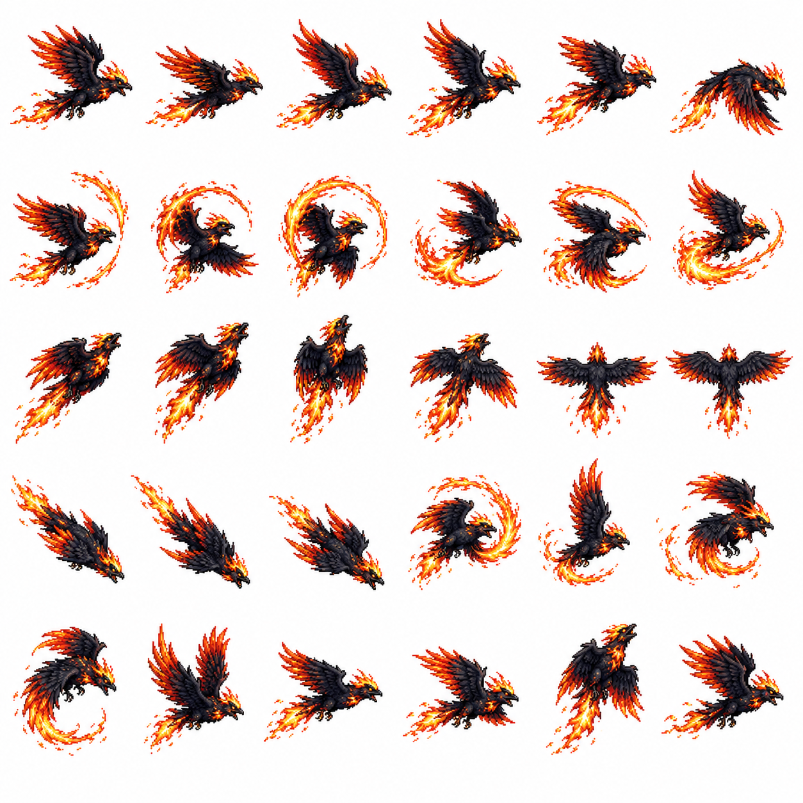

# 飞行生物动作精灵表

## 示例



## 用途

用于生成 5x6 飞行生物怪物精灵表，强调侧视、侧前、侧后和后视角飞行动作，并避免完全正面视图。

## 使用场景

- 模式：纯文字生成
- 纯文字生成：主要模式。提供生物描述和动画布局要求即可。
- 上传参考图：此档案不依赖上传图；如提供图片，只建议作为灵感参考，而不是严格视觉基准。
- 最适合：从文字生成新的飞行生物动作精灵表。

## 中文用户模板：

```text
飞行火焰生物稳定输入模板

基本设置：
类型：高分辨率像素艺术怪物动画精灵表。
布局：严格 5 行 x 6 列，总计 30 帧。
画布比例：1:1 正方形。
背景：纯白色背景，或指定为透明 / 纯黑 / 洋红色背景。背景必须纯净。
限制：无任何文字、数字、坐标、水印、网格线、场景背景或装饰元素。

主体设计：
怪物主体：像素风黑体火焰飞行生物。
核心细节：黑色身体，发光的橙色和黄色羽毛尖端，发光眼睛，动态火焰尾迹。
调色板：炭黑、鲜艳橙、亮黄色、深红色；有限调色板，颜色块清晰，少量或无渐变。

风格与视角限制：
风格：复古 16-bit JRPG 风格的高分辨率像素艺术。边缘清晰，像素完美，无抗锯齿。
视角限制：必须包含侧视图、侧前视图、侧后视图和完全后视图。
关键限制：严格避免完全正面视图，除非特别要求。

动作集：
动作组 A（第 1-2 行）：动态侧视图飞行、圆周飞行、俯冲式 sweeping 火焰攻击。
动作组 B（第 3 行）：侧视图爬升和平飞，完全后视图向前飞行。
动作组 C（第 4 行）：更多动态侧视图和侧后视图俯冲、侧转和俯仰。
动作组 D（第 5 行）：包含一个地面待机姿态，以及各种侧面、后视图飞行和圆周飞行。

质量要求：
火焰纹理必须清晰且有体积感。
所有帧之间的过渡必须合乎逻辑。
怪物在每个网格单元中的重心和锚点保持稳定。
如果某一行动作未指定，不要擅自填补不符合上下文的内容，可保持空白。
```
