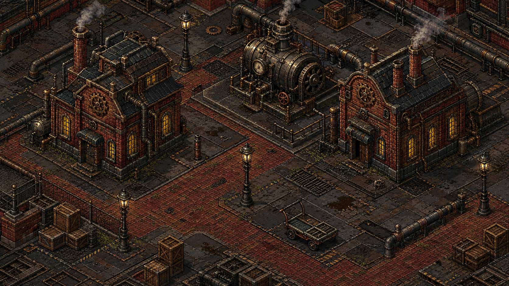

# 斜俯视像素场景

## 示例



## 用途

用于生成 16:9 斜俯视像素场景，并支持完整场景、资产表和纯地面模式。

## 使用场景

- 模式：纯文字生成
- 纯文字生成：主要模式。提供场景主题、地面基础、物件清单和装饰细节。
- 上传参考图：不是核心流程；此档案用于文字描述的斜俯视场景和变体。
- 最适合：从文字生成 45 度斜俯视像素全景、资产表或干净地面图。

## 中文用户模板：Complete Scene

```text
生成一个 Top-down 45 度视角、16:9 全景、高分辨率的像素风场景。

场景主题：
[简要概括场景，例如：中世纪繁华市集、神秘魔法森林遗迹、复古蒸汽朋克工业区街道。]

地面与环境基础：
[详细描述地面。例如：青石板铺设的街道、长满青草和杂草的泥土地、红砖地面、带发光纹路的金属地板。]

主要建筑与物件清单：
[具体列出静态物件和建筑，最好带数量。例如：3 座两层高红瓦白墙中世纪房屋；5 个挂彩色布幔的木质摊位；10 棵具有 45 度倾斜感的橡树；2 个石井；数个木桶和货架。]

风格细节与装饰：
[描述氛围和细节。例如：摊位上摆满水果和织物，街道旁有复古路灯，地面有落叶，建筑墙面有青苔，窗户透出暖黄色光。]

强制约束：
必须是 Top-down 45 度视角，建筑和物件朝向固定为 45 度。
必须是 16:9 全景，高分辨率，清晰像素颗粒感。
不出现人物、不出现 NPC、不出现动物、不出现生物。
不出现山体、山丘、天空或云。
不出现文字、数字、UI 或标签。
```

## 中文用户模板：Object Extraction

```text
提取物件

生成一个 Top-down 45 度视角、16:9 全景、高分辨率的像素风场景，并将其中物件提取出来展示。

场景主题：
[例如：神秘魔法森林遗迹。]

地面与环境基础：
[例如：长满深绿色青草和苔藓的泥土地，中间有碎石小径。]

主要建筑与物件清单：
[具体列出要生成并提取的静态物件和建筑。例如：1 座残缺古老石拱门、3 座魔法图腾石柱、8 棵蓝紫色魔法树、彩色发光蘑菇和魔法花卉。]

风格细节与装饰：
[例如：遗迹石块上有神秘符号，发光植物发出幽蓝光，像素光影清晰。]

提取要求：
将场景中的物件、建筑和树木单独提取出来。
提取物件大小与原场景一致。
提取物件有序排列，彼此保持距离，避免重叠和混淆。
提取部分使用与物件有区别的纯色背景。

强制约束：
Top-down 45 度视角，16:9，高分辨率。
不出现人物、NPC、动物、生物、山体、山丘、天空或云。
不出现文字、数字、UI 或标签。
```

## 中文用户模板：Ground-Only

```text
去除物件

生成一个 Top-down 45 度视角、16:9 全景、高分辨率的像素基础场地。

场景主题：
[描述原始场景主题，用来定义地面 context。例如：中世纪繁华市集。]

地面与环境基础：
[详细描述保留的地面。例如：不规则石板铺设，边缘过渡为压实泥土地和青草。]

原本可能存在的物件：
[列出需要被去除的物件。例如：木质摊位、房屋、树木、木桶、路灯。]

要求：
只保留地面和草地 / 基础场地。
去除所有物件、建筑、树木、家具、道具和装饰。

强制约束：
Top-down 45 度视角，16:9，高分辨率。
不出现人物、NPC、动物、生物、山体、山丘、天空或云。
不出现文字、数字、UI 或标签。
```
