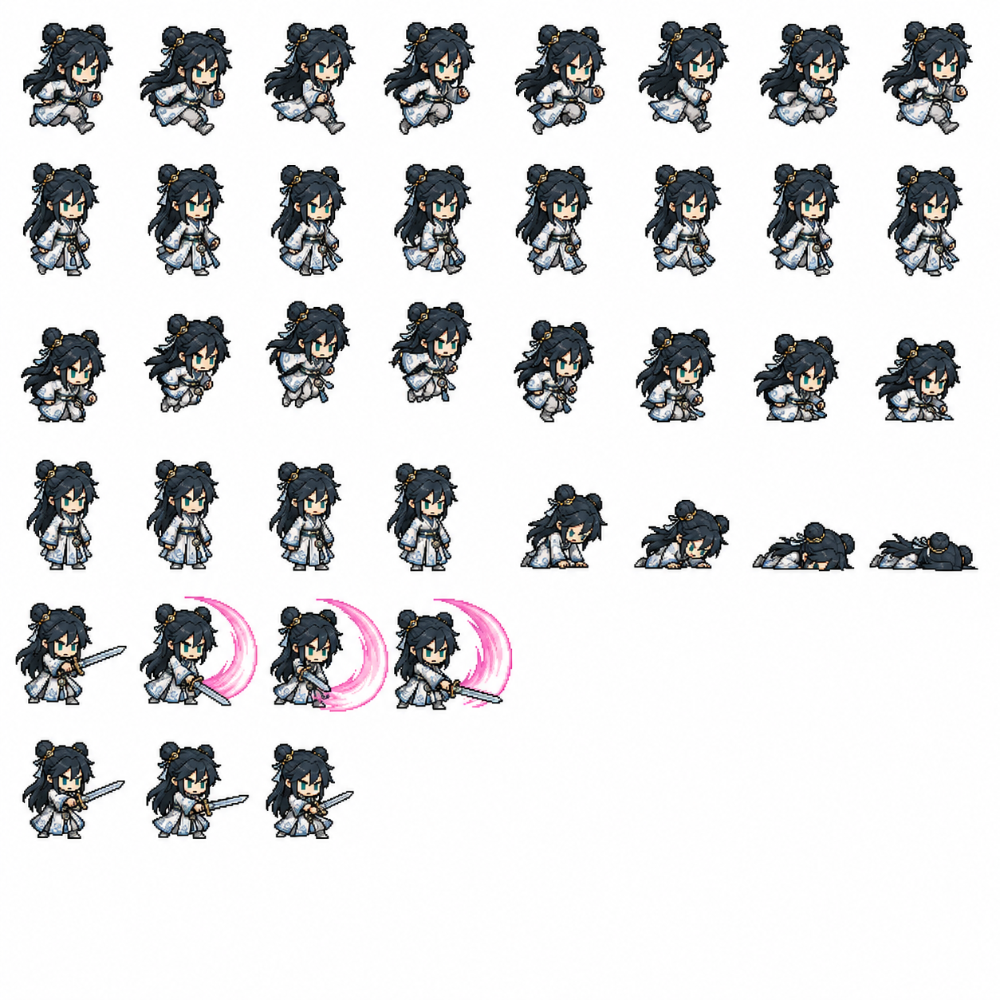

# 8x8 紧凑动作平台角色精灵表

## 示例

原始参考图：


生成结果：



## 用途

用于生成 256x256、8x8 网格的动作平台角色精灵表，包含跑动、行走、跳跃、待机、死亡和两类攻击动作。

## 使用场景

- 模式：两者兼备
- 纯文字生成：支持，可通过角色部件描述和动作参数生成。
- 上传参考图：支持，可作为角色形体、配色和风格的视觉锚点。
- 最适合：通过文字或上传角色参考图生成紧凑动作平台角色精灵表。

## 中文用户模板：

```text
你作为一个专业的像素动画师，请根据以下详细规范，生成一个完整的、严格按照网格布局的像素角色动画精灵图（spritesheet）。

基本参数：
图像规格：256x256 像素，1:1 正方形比例。
网格布局：严格的 8 行 x 8 列网格，每个帧 cell 是 32x32 像素。
背景：纯白色背景，无任何文字、网格线或数字。
风格要求：清晰、高对比度的复古 2D 像素艺术，具有流畅、高质量的动画帧。
角色风格：极简主义、功能性、多色块设计；头部、躯干和四肢必须清晰可辨。
默认朝向：所有动画帧角色都面向右侧。

角色外观描述：
头部：[在这里描述角色头部，例如：一个蓝色的球形头部。]
躯干：[在这里描述角色躯干，例如：一个橙色/棕色的身体。]
四肢和细节：[在这里描述四肢、武器、装备和颜色区分，例如：绿色左侧四肢、紫色右侧四肢，背面有少量细节。]
总体原则：保持高对比度颜色区分，肢体和头部形状优化以便识别。

动画序列：
第 1 行 R1：向右跑动，8 帧。生成一个平滑的 8 帧向右奔跑动画循环，姿势必须清晰、流动、有速度感。
第 2 行 R2：向右走动，8 帧。生成一个平滑的 8 帧向右行走动画循环，动作比跑动更稳健，但同样流畅。
第 3 行 R3：跳跃，8 帧。生成完整跳跃动作序列，按顺序包括：起跳前蹲伏、上升、到达顶点、下降、落地。每个阶段必须清晰可辨。
第 4 行 R4：Idle / Die 混合，4+4 帧。前 4 帧是带有微妙呼吸动作的静止站立循环；后 4 帧是死亡动画，显示角色倒地并最终平躺。
第 5 行 R5：挥剑攻击 A，前 4 帧有效，后 4 帧留空。生成一个动态挥剑攻击动画，带有巨大、清晰的 [特效颜色，例如：粉色] 新月形剑光能量特效。
第 6 行 R6：挥剑攻击 B，前 3 帧有效，后 5 帧留空。生成一个不同的、更紧凑的近身挥剑攻击或准备姿势，不带光刃特效。
第 7 行 R7 和第 8 行 R8：完全留空，保持纯白色空白空间。

质量与约束：
所有动画帧必须居中放置在各自 32x32 像素 cell 内。
所有帧必须严格对齐，以确保循环或序列播放时动画平滑。
最终图像必须干净清晰，没有文字、数字、网格线、标志、UI 元素或杂乱像素。
```
