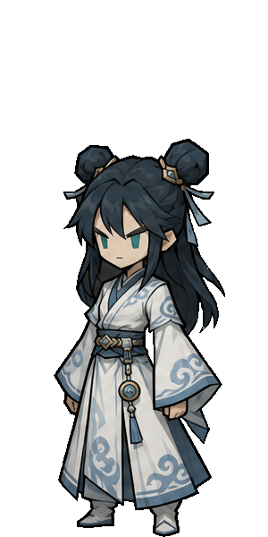
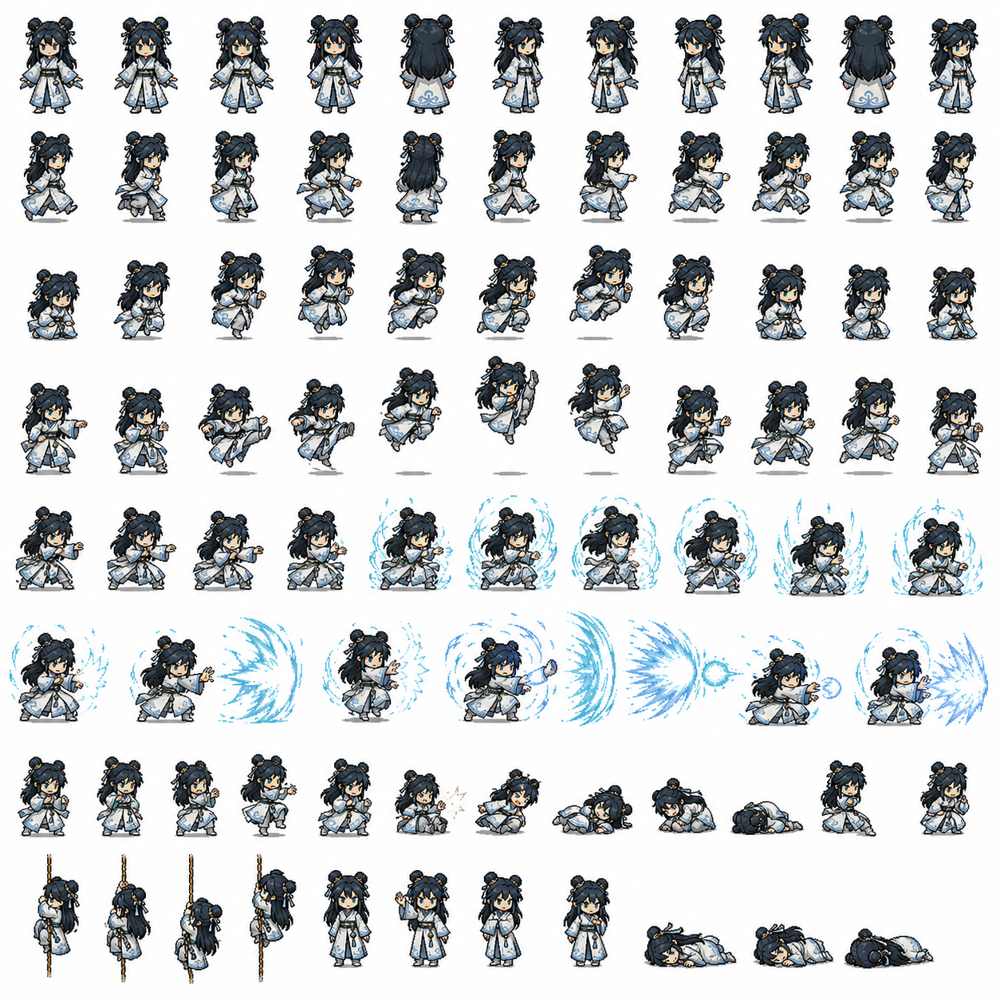

# 10x10 全动作角色精灵表

## 示例

原始参考图：



生成结果：



## 用途

用于生成单个角色的完整动作库，包含移动、攻击、技能、防御、受伤、死亡和特殊动作等多个行级序列。

## 使用场景

- 模式：两者兼备
- 纯文字生成：支持，可通过详细角色描述生成。
- 上传参考图：支持，可上传站立姿势、已有精灵或角色参考图作为权威视觉参考。
- 最适合：从新角色描述或上传参考图生成 10x10 全动作角色库。

## 中文用户模板：

```text
请生成一张 [角色名称] 的全面动作像素精灵表。

角色定义：
核心角色：[角色名称]
基础参考：[参考图名称或“使用上传的单帧站立像素图作为角色参考”]
外观细节：[详细描述角色核心外观，例如：发型、脸部特征、上衣、下衣、鞋子、背包、手套、配饰、能力视觉特征。]

风格规定：
高级 32-bit / GBA 风格像素艺术。
像素点清晰、精确，线条干净，受限但丰富的色板，具有丰富的色彩阴影。
保持紧凑的 16 位感觉。
绝对不要过度抖动、杂乱像素、抗锯齿模糊或非像素化笔触。

布局和格式：
画布比例：严格的 1:1 正方形。
背景颜色：纯白色背景或纯绿色背景，不包含透明通道。
网格结构：严格组织的 10x10 行列网格，共 Exactly 100 帧。
限制条件：精灵图中不得出现任何文字、数字、标签、网格线或 UI 元素。
角色数量：只生成一个特定角色，不要生成多个不同角色。
武器规则：角色手里默认不拿武器，除非我明确指定武器；优先使用角色固有能力和肢体动作。

动作集列表：
第 1 行：站立 / 待机。呼吸动画、待机姿势、各向站立帧。
第 2 行：行走循环。完整的各向行走循环，包括前、后、左、右；每个方向尽量保持 8 帧循环。
第 3 行：跑步循环。完整的各向跑步循环，包括前、后、左、右；步伐比行走更快更有动势。
第 4 行：跳跃 / 坠落。跳跃、空中、坠落、着陆序列。
第 5 行：徒手攻击连击。三连击组合，例如左拳、右拳、踢击或上勾拳。
第 6 行：其他攻击。其他徒手或能力攻击，例如上勾拳、侧踢、冲刺攻击。
第 7 行：能力 / 技能蓄力。角色固有能力的蓄力姿势，例如聚气、能量聚集、准备动作。
第 8 行：能力 / 技能释放。角色固有能力的释放动作，例如前冲拳、掌波、能量爆发。
第 9 行：防御 / 受伤。防御姿势、受击、后仰、倒地、起身状态。
第 10 行：特殊动作。攀爬、打招呼或挥手、死亡姿势。

质量要求：
每一行都应包含一个完整、逻辑清楚的动作序列。
所有帧必须保持角色比例、外观、调色板和像素密度一致。
所有动作必须易于后续裁剪并导入 Unity、Godot、Unreal 或其他游戏引擎。
```
