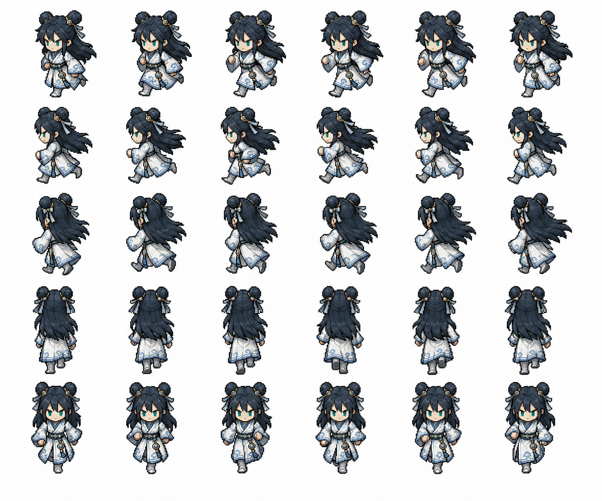

# 五方向 JRPG 跑动循环精灵表

## 示例

原始参考图：


生成结果：



## 用途

用于生成 5 行 x 6 列的 JRPG 风格角色跑动循环精灵表，强调方向顺序、角色一致性和可直接用于游戏开发的干净像素输出。

## 使用场景

- 模式：两者兼备
- 纯文字生成：支持，可通过详细角色描述生成。
- 上传参考图：支持，可作为视觉锚点，用来保持角色身份、服装、配色和像素密度。
- 最适合：从新角色设定或上传角色参考图生成 JRPG 跑动循环精灵表。

## 中文用户模板：

```text
生成一个 16-bit JRPG 风格的像素艺术动画雪碧图。

风格规范：
高细节像素艺术，清晰的线条，一致的调色板，JRPG 3/4 俯视等距透视。
无抗锯齿模糊，无噪点，无抖动。

布局：
严格的 5 行 x 6 列网格，总共 30 帧。
每一帧坐标对齐，角色居中，脚底锚点稳定。
帧之间可以有清晰像素间距，但不要画出可见网格线。

背景：
纯白色背景。

约束：
无文字，无数字，无标志，无 UI 元素，无网格线。
输出应是干净、可直接用于游戏开发的像素素材。

角色描述：
[在这里详细描述角色。例如：一个黑发刺猬头男性，穿棕色皮甲和黄色衬衫，白色裤子，黑色靴子。]

动画详细信息：
第一行：向左下运行，6 帧，前 3/4 等距视角。
第二行：向左运行，6 帧，完全侧面视角。
第三行：向左上运行，6 帧，后 3/4 等距视角。
第四行：向上运行，6 帧，完全背面视角。
第五行：向下运行，6 帧，完全正面视角。
```
