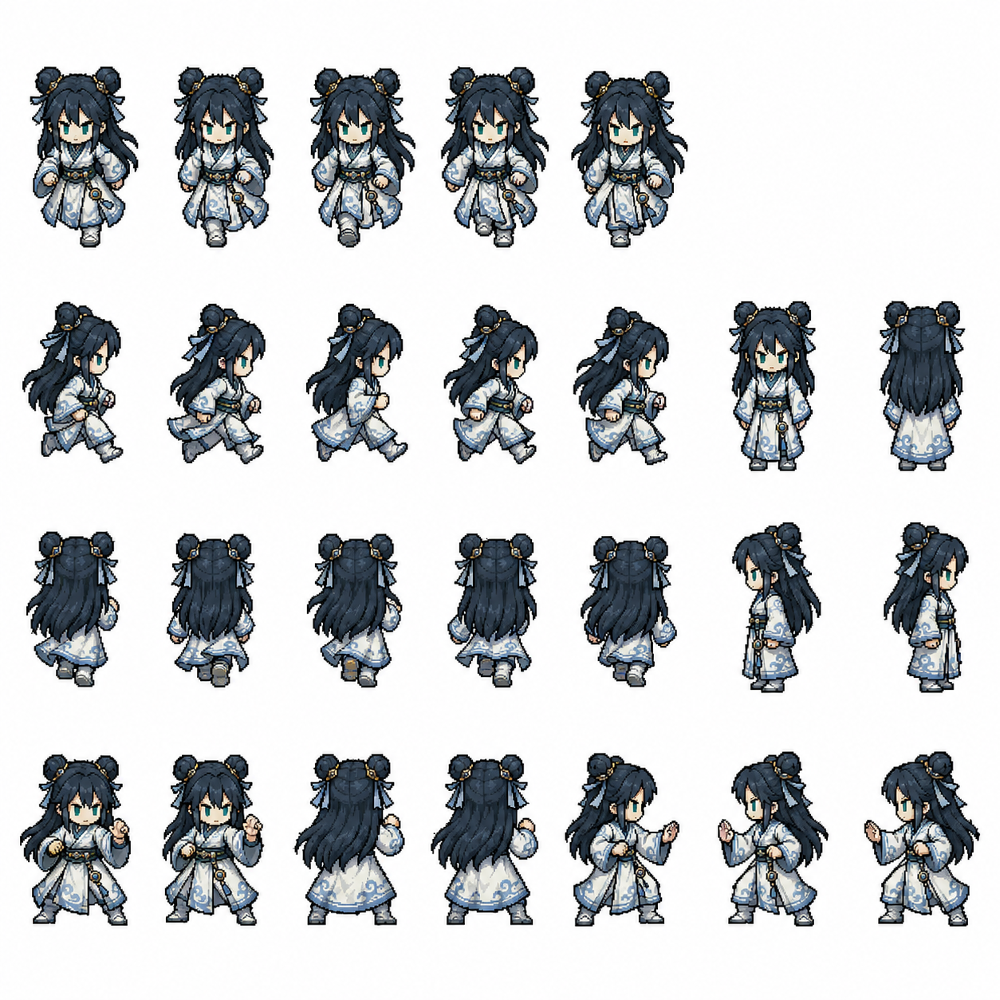

# 4x8 JRPG 冒险者动作精灵表

## 示例

原始参考图：


生成结果：



## 用途

用于生成 4 行 x 8 列的 JRPG 冒险者动作表，包含向下、向右、向上跑动，方向闲置帧和战斗准备姿态。

## 使用场景

- 模式：两者兼备
- 纯文字生成：支持，可提供详细 JRPG 角色描述。
- 上传参考图：支持，可作为角色身份、服装、配色和风格的视觉锚点。
- 最适合：通过文字或上传角色参考图生成 4x8 JRPG 冒险者动作精灵表。

## 中文用户模板：

```text
请生成一张 16-bit JRPG 风格的像素角色 spritesheet，用于游戏开发。

核心角色定义：
角色类型：[例如：男性刺客 / 女性法师 / 机器人 / 矮人战士]
核心特征：[一句话概括角色，例如：深棕色头发，海军蓝皮甲，米色衬衫]

视觉描述：
发型和颜色：[例如：深棕色，中等长度，蓬松]
服装：[详细描述上衣、护甲、下装、鞋子、腰带等。例如：海军蓝皮革护甲背心，米色衬衫，深棕色裤子，黑色靴子，多功能腰带]
装备/道具：[例如：腰间挂着一把剑，背着一个法杖或小弩]
其他细节：[可选，例如：右眼下方有疤痕，佩戴项链]

精灵表规范：
整体布局：严格的 4 行 x 8 列网格，共 32 个单元格。画面比例 1:1。
背景：纯白色背景，或指定为透明背景 / 纯绿色背景。
风格：高质量、详细、清晰的 16-bit JRPG 像素艺术。
视角：3/4 down-view 混合等轴视角。
限制：无文字、无数字、无可见网格线、无 UI、无标志。

行内容：
第 1 行：向下跑动循环，连续 6 帧，角色面向前景；第 7-8 格留空。
第 2 行：第 1-6 格是向右跑动循环，侧面面向右；第 7 格是向下闲置姿势；第 8 格是向上/背面闲置姿势。
第 3 行：第 1-6 格是向上跑动循环，背面面向背景；第 7 格是向左闲置姿势；第 8 格是向右闲置姿势。
第 4 行：8 个战斗就绪 / 战斗闲置准备姿态。第 1-2 格为正面战斗准备，第 3-4 格为背面战斗准备，第 5-6 格为向右战斗准备，第 7-8 格为向左战斗准备。

质量要求：
所有帧必须严格对齐在隐形网格中，角色锚点稳定，不抖动。
所有格子中的角色必须保持同一个角色设计，服装、发型、比例和颜色一致。
最终图像必须是干净、可直接导入游戏引擎的 PNG 像素图集。
```
