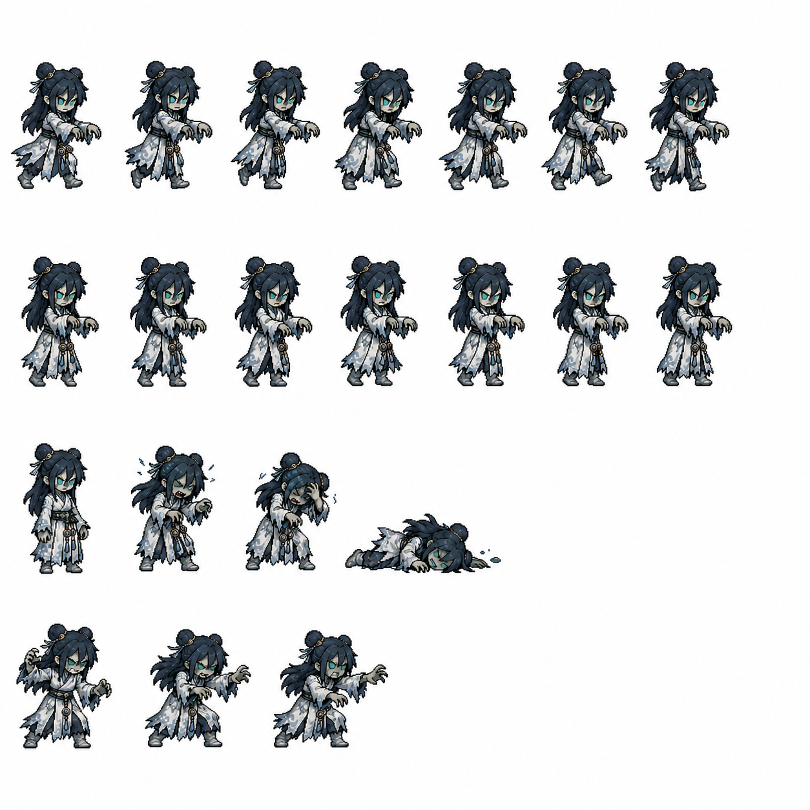

# 人形对手动作精灵表

## 示例

原始参考图：


生成结果：



## 用途

用于生成人形对手或怪物的动作精灵表，强调行走、替代行走、受击/倒下和攻击动作的行级组织。

## 使用场景

- 模式：两者兼备
- 纯文字生成：支持，可通过详细敌人描述生成。
- 上传参考图：支持，可通过基础帧或敌人参考图生成；参考图决定服装、姿态、配色和关键特征。
- 最适合：从新敌人描述或上传基础帧生成敌人动作表。

## 中文用户模板：

```text
核心指令：
请根据以下结构化规范，生成一个高精度、像素完美的像素艺术敌人精灵表（Sprite Sheet），用于游戏开发。

1. 风格规范：
样式：像素艺术 Pixel Art。
分辨率：低分辨率像素角色，例如每个精灵约 64x64px，或按整体画布自动统一单元格大小。
背景：纯白色色键 #FFFFFF，或指定为纯绿色 #00FF00。
对齐：严格网格布局，每一行是一个完整动作序列。
纹理：像素完美，干净，无抗锯齿，轮廓清晰。

2. 角色规范：
主体：[例如：僵尸]
角色 / 职业：[例如：警察]
服装细节：[例如：蓝色警服，大沿帽]
外观细节：[例如：绿色/黄色皮肤，身体上的血迹，发光的眼睛，空手姿态]
参考继承：[如果有参考图，请严格保留参考图中的帽子、制服、肤色、血迹、比例和姿态特征。]

3. 动作序列规范：
第 1 行：行走 Walk，8 帧，方向向右。动作描述：一个完整、可循环的僵尸行走动画。
第 2 行：替代行走 / 站立 Alt Walk / Stand，8 帧，方向向右或向前侧面。动作描述：稍微不同的行走姿势或前侧面行走循环。
第 3 行：受伤 / 倒下 Hurt / Fall，4 帧，方向向右。动作描述：包含站立姿势、受击、捂头和倒下 / 死亡过渡动作。
第 4 行：攻击 Attack，3 帧，方向向右。动作描述：空手挥舞手臂攻击，后续帧跟进，不添加武器。

4. 布局与限制：
画幅：1:1 正方形画布。
布局：严格网格对齐，所有帧在统一单元格中清晰隔离。
限制：严禁出现文字、数字、可见网格线、UI、非像素艺术元素。
手部：除非明确要求，所有手部姿态必须保持空置，无武器、无额外道具。
一致性：所有帧必须保持同一个敌人角色设计，服装、肤色、血迹、比例和调色板一致。
```
