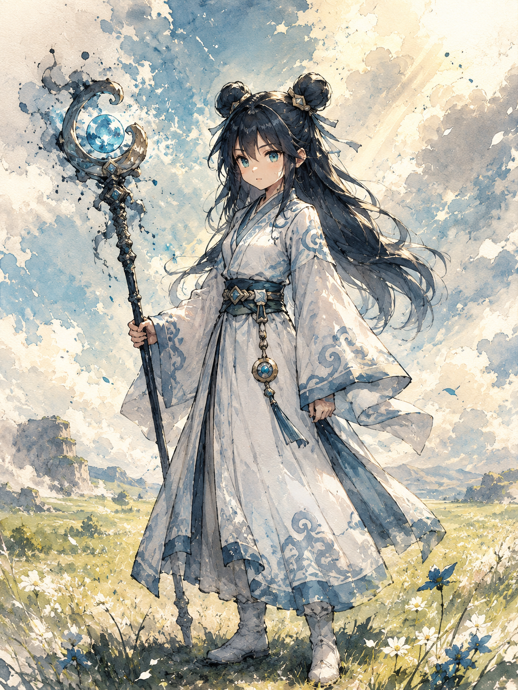

# 厚涂水墨风角色设定图

## 示例

原始参考图：


生成结果：



## 用途

用于生成日韩系角色设定原画，强调厚涂、水墨晕染、飞白边缘和静态单幅角色插画。

## 使用场景

- 模式：两者兼备
- 纯文字生成：支持，可通过角色想法或详细文字 brief 生成。
- 上传参考图：支持，可上传草图、参考图、既有生成图或灵感板。
- 最适合：通过文字方向或上传视觉参考生成完整角色设定插画。

## 中文用户模板：

```text
请生成一张高质量角色设定原画。

固定风格：
日韩系角色原画风格，融合厚涂质感与传统水墨 / 水彩晕染技法。
画面需要有明显的厚重笔触、颜料堆叠感、分层色彩、艺术性的水墨扩散、飞白边缘、不规则水彩渗化边界，以及类似纸张或羊皮纸的画布质感。
光影要有戏剧性，可以包含丁达尔效应光束。
整体质感应接近高品质 JRPG 角色设定图，而不是平涂、赛璐璐、纯写实或像素风。

角色信息：
核心身份：[例如：流浪女枪手、神圣法师、重甲骑士、沉默武僧、暗影盗贼]
性别与气质：[例如：女性，独立而危险；男性，沉稳严肃]
发型与眼睛：[例如：火红中长发扎起，锐利绿色眼睛]
面部特征：[例如：自信微笑、眼角细疤、年轻外貌、苍老睿智表情]

服装与装备：
材质：[例如：风化皮革、厚重丝绸、分段金属板甲、粗布斗篷]
设计细节：[例如：复杂腰带、多层衣摆、破损披风、金色纹样、特定徽记]
色彩倾向：[例如：深蓝和灰色为主，点缀鲜红；大地色和自然绿色]

姿势与互动：
姿势：[例如：准备拔枪的站姿、动态施法姿势、沉思站姿]
互动：[例如：看向观众、看向画面外、手持某个物品]

武器与特效：
主要武器：[例如：符文长剑、双左轮、木杖、巨斧]
特殊效果：[例如：冰霜魔法火花、符文微光、水墨粒子从武器边缘扩散]

环境与氛围：
环境提示：[例如：阴暗地下城、明亮旷野、古代图书馆、城镇集市]
氛围：[例如：孤独、神秘、紧张、希望、危险]

画面限制：
单幅静态插画，不要生成动作网格、分镜、spritesheet 或多帧排列。
默认纵向 3:4 构图。
图像中不得出现任何文字、标题、水印、签名或可读字符。
```
