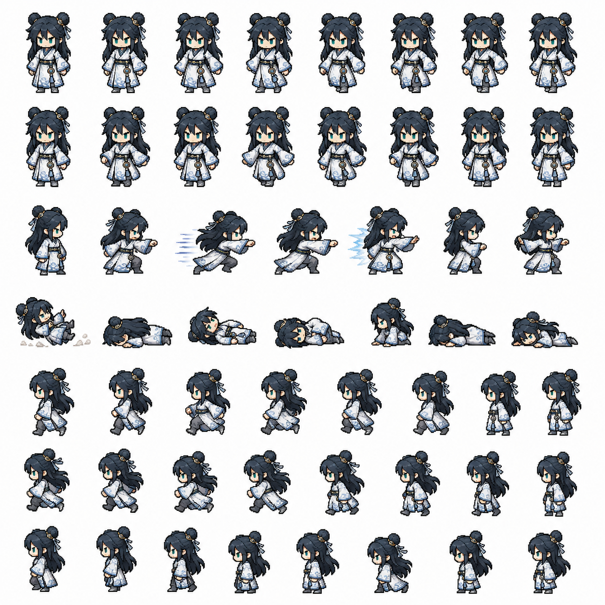

# 独立游戏角色网格动画表

## 示例

原始参考图：


生成结果：



## 用途

用于生成现代独立像素风角色动作表，支持 8x8 干净资产模式和 9x8 展示模式。

## 使用场景

- 模式：两者兼备
- 纯文字生成：支持，可定义新角色、动作列表、视角和网格。
- 上传参考图：支持，可将已有精灵图、设定图、全身图或照片扩展为动作网格。
- 最适合：新建独立游戏角色动作表，或基于上传参考扩展更多动作。

## 中文用户模板：

```text
[项目名称 / 角色名称] 严格 8x8 像素艺术精灵图模板

1. 核心角色描述：
种族 / 性别 / 体型：[例如：人类女性，中等体型]
外观细节：[详细描述服装、头部、道具和颜色。例如：穿着绿色冬季派克大衣，戴着带有蓝色镜片的护目镜，戴着有纹理的帽子，围着红色围巾，穿绿色裤子和棕色靴子。]
调色板：[可选。例如：受限制的复古调色板，约 16-32 色；主绿色，辅助红色，中性棕色/灰色。]

2. 精灵图规格：
布局：严格的 8 行 x 8 列单元格网格，总共 64 个精灵。
瓷砖尺寸：统一的 [例如：32x32 像素] 瓷砖。
背景颜色：纯绿色 #00FF00，或指定为纯白色 / 透明背景。

3. 按行排列的动作序列：
行 1-3（正面 / 前向视角）：正面待机和行走循环。可包含正面待机、正面行走步骤 1、正面行走步骤 2，以及轻微侧偏变化。
行 4（侧面视角 - 动作）：侧面攻击、冲刺或挥舞动作，例如侧面向前冲刺并挥动未指定物体。
行 5（击倒视角 - 受击 / 死亡）：不同角度的倒下和躺着，例如向后倒、面朝下、仰卧、侧躺。
行 6-8（侧面视角 - 行走）：侧面行走，包含向左和向右的完整行走动作。
可选行 9（背面视角）：如果需要扩展为 9x8，则加入背面待机和背面行走。

4. 风格和限制：
风格：现代独立游戏像素艺术风格，类似 Celeste 或 Shovel Knight，清晰轮廓、精细细节、不过度渐变。
光照：简单的自上而下或侧面光照，以定义体积。
限制：没有文本，没有 UI 元素，所有精灵必须在各自瓷砖内，严格对齐。
```
