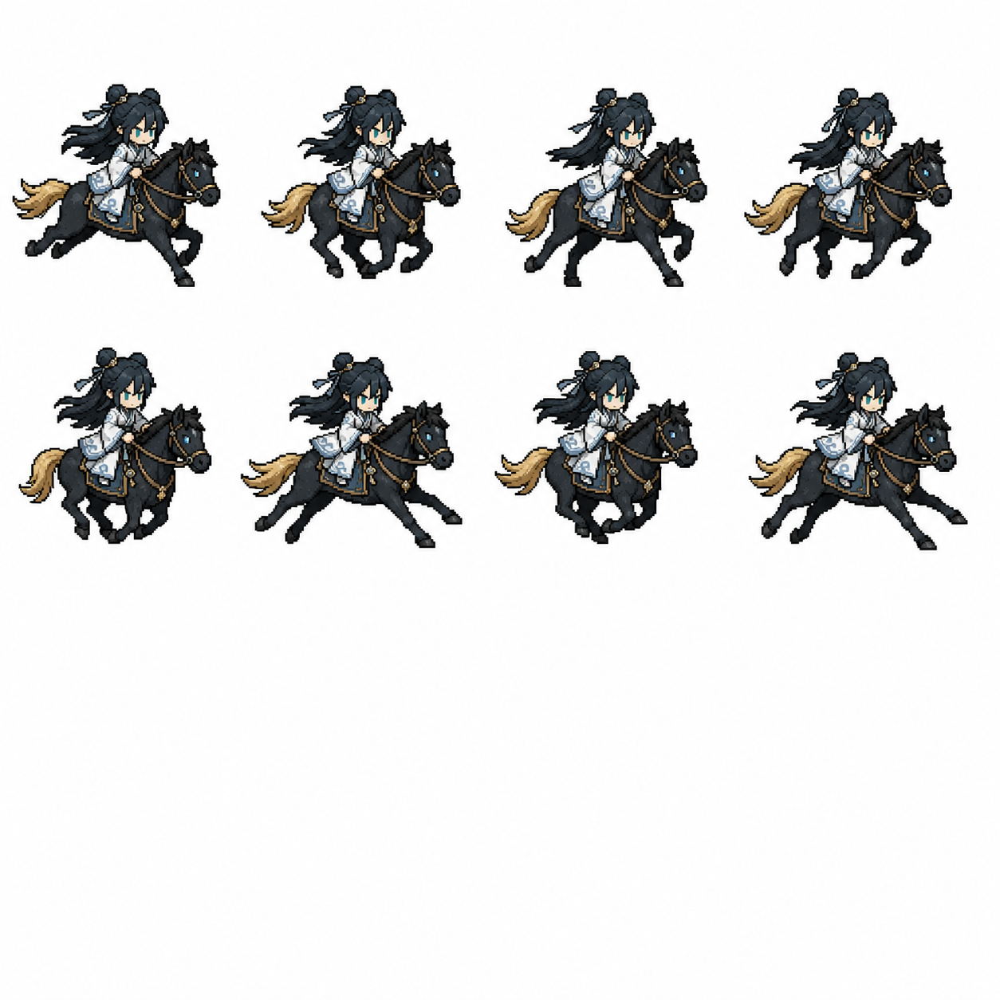

# 角色骑乘奔跑动画精灵表

## 示例

原始参考图：


生成结果：



## 用途

用于生成角色骑乘坐骑的奔跑或行走精灵表，强调侧面视角、连续帧和纯色背景。

## 使用场景

- 模式：两者兼备
- 纯文字生成：支持。提供骑手、马匹、服装、马具和骑行动作描述。
- 上传参考图：支持，可作为骑手身份、马匹设计、配色和骑行动作风格的视觉锚点。
- 最适合：通过文字或上传角色/坐骑参考图生成角色骑乘奔跑动画精灵表。

## 中文用户模板：

```text
一张 1:1 比例的像素艺术风格角色骑马动画 spritesheet。

核心风格：
使用 [像素精度，例如：16-bit 风格]，清洁、一致、边缘锐利的像素艺术。
禁止抗锯齿、模糊、平滑渐变、非像素化笔触或照片质感。

主体：
画面主体是一个正在进行 [动画类型，例如：全速奔跑循环] 动作的 [角色职业/描述] 角色。
该角色骑着一匹 [马匹描述] 马。
角色穿着 [服装/盔甲细节]，手持或携带 [武器/装备细节]。
马匹具有 [马匹颜色、鬃毛、尾巴、马鞍和缰绳细节]。

布局：
整个 spritesheet 必须严格按照 [网格布局，例如：4x4] 的整齐网格排列。
总共包含 [总帧数，例如：16] 个独立且间距均匀的帧。
所有动画帧按照时间顺序排列，阅读顺序为从左到右、从上到下。

动画：
生成一个完整、流畅、循环的骑马 [动画类型，例如：全速奔跑 / 慢速行走 / 冲锋攻击] 动画。
角色和马匹默认朝向右侧，使用干净的正侧面视图。
每一帧都必须展示马腿运动和骑手姿态的连续变化。

背景：
背景必须是纯粹、扁平、单一的 [背景颜色，例如：纯白色 #FFFFFF 或纯绿色 #00FF00]，没有任何纹理。
不要生成透明背景。

限制：
禁止出现任何文字、数字、标签、可视网格线、UI 元素或叠加层。
最终图像必须是干净、可用于游戏开发和后续色度键抠图的像素 spritesheet。
```
