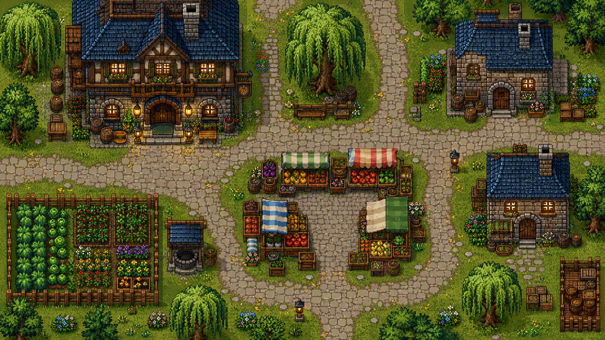

# 正俯视像素场景

## 示例



## 用途

用于生成 16:9 正俯视像素场景，并支持完整场景、物件提取和纯地面三种模式。

## 使用场景

- 模式：纯文字生成
- 纯文字生成：主要模式。提供环境、地形、物件、氛围和功能模式指令。
- 上传参考图：不是核心流程；此档案用于文字描述的场景生成、物件表和干净地面变体。
- 最适合：从文字生成正俯视像素场景、物件表或基础地面图。

## 中文用户模板：Complete Scene

```text
生成一个 16:9 全景、topdown 俯视正视角的像素场景。

主场景描述：
[描述整体环境类型和地面纹理。例如：一片深夜中的像素森林，地面是深绿色草地和泥土。]

包含建筑 / 物体：
[列出主要建筑、树木、岩石、河流、道路、桥梁、小道具等。例如：3 个像素帐篷、1 个中心篝火、几张木凳、几棵高大松树、1 条石板路。]

场景细节与氛围：
[描述灯光、小物体、装饰品、植被细节等。例如：篝火发出暖黄色光芒，帐篷前有灯笼，地上有背包和睡袋，松树下有发光蘑菇。]

硬性限制：
必须是纯像素艺术。
必须是正上方垂直俯视视角，没有透视变形。
画幅必须是 16:9 宽屏全景。
场景中绝对不要出现人类角色、人形 NPC、角色生物、文字、数字、UI 或标签。
```

## 中文用户模板：Object Extraction

```text
生成一个 16:9 全景、topdown 俯视正视角的像素场景资产表。

主题：
[描述环境主题。例如：繁华像素城镇、深夜森林营地、古埃及遗迹、冰原村庄。]

包含物件列表：
[列出要提取的物件。例如：松树、橡树、柳树、岩石、木箱、围栏、路灯、长椅、帐篷、篝火、井、市场摊位、花坛。]

排列要求：
提取物件
所有物件放在纯黑色背景上。
每个物件保持独立、原始像素大小，按整齐行列排列，物件之间有清楚间隔，便于后期提取。

硬性限制：
必须是纯像素艺术。
必须是 topdown 正俯视视角。
不要出现人类角色、人形 NPC、文字、数字、UI 或标签。
```

## 中文用户模板：Ground-Only

```text
生成一个 16:9 全景、topdown 俯视正视角的像素基础地面场景。

主场景描述：
[描述基础地面纹理。例如：一片荒凉沙漠，只有黄沙、裂土、碎石和风沙痕迹。]

模式：
去除物件

要求：
只保留基础地面纹理。
移除所有建筑、树木、石头、箱子、道具、装饰物和其他物件。
画面必须是完整干净的地面纹理，可作为后续地图底层。

硬性限制：
必须是纯像素艺术。
必须是 topdown 正俯视视角。
不要出现人类角色、人形 NPC、文字、数字、UI 或标签。
```
