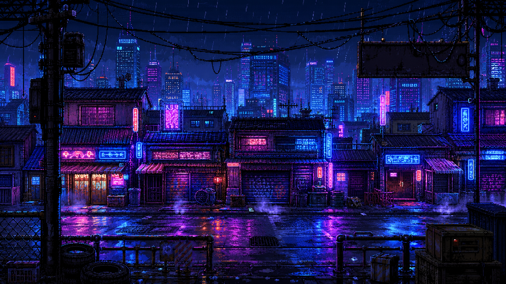

# 横向侧视多层视差像素环境

## 示例



## 用途

用于生成横向侧视像素环境，强调远景、中景、前景三层视差、水平关卡流和戏剧化环境光。

## 使用场景

- 模式：纯文字生成
- 纯文字生成：主要模式。提供场景主题、光照氛围、视差层、环境特效和道具。
- 上传参考图：不是核心流程；此档案用于从文字生成新的横版街机背景。
- 最适合：从文字生成带多层视差的横向侧视像素环境。

## 中文用户模板：

```text
### 核心概念
场景名称 / 主题：
[例如：霓虹雨夜的日本街头、生锈的地下工厂、古代丛林遗迹、受损的宇宙飞船走廊。]

主色调与光照氛围：
[例如：冷蓝色霓虹与紫色倒影、橙色爆炸余晖与浓烟、深绿色青苔与微弱火光、警报红光与机械暗灰。]

### 视角与构图（固定项，请勿修改）
视角：严格的 2D 侧视视角，Strict 2D Side-scrolling Perspective。
构图：强调水平延伸的关卡流 Level Flow，全景镜头。
风格：经典 16-bit / 32-bit 街机像素艺术，CPS2 / CPS3 / Neo Geo 审美，细节丰富，色彩鲜明。

### 视差层级详情
远景 / Far Background：
[描述最遥远的背景元素，保持相对简化。例如：密集模糊的摩天楼天际线、巨大月亮与云层、遥远雪山、无尽深空、巨大机械核心。]

中景 / Midground / 可通行区域：
[描述主体结构和玩家原本行走的地面或平台。例如：湿漉漉柏油路面与老式建筑、生锈金属平台与传送带、破损石砖路和古石柱、满是管道的狭窄走廊。]

前景 / Foreground：
[描述最靠近镜头、增强深度和速度感的元素。例如：电线杆与横跨电缆、栏杆、破损车辆、悬挂广告牌但无可读文字、破裂玻璃碎片、机械臂。]

### 氛围与环境细节
环境特效：
[例如：绵绵细雨、飘动烟雾、闪烁激光、漂浮尘埃、蒸汽管道喷出蒸汽、像素火花。]

关键装饰道具：
[例如：涂鸦墙但无可读文字、老式自动售货机、生锈栏杆、堆放货箱、破损机械、积水倒影。]

### 限制条件（固定项，请勿修改）
无人物：场景中绝对没有可玩角色、NPC、敌人、人类、动物或任何生物。
无 UI：场景中绝对没有血条、分数、计时器、对话框、按钮提示或任何界面元素。
无特定文字：招牌、涂鸦和所有画面元素不得出现清晰可读的文字，只能用模糊或抽象像素点模拟文字。
```
