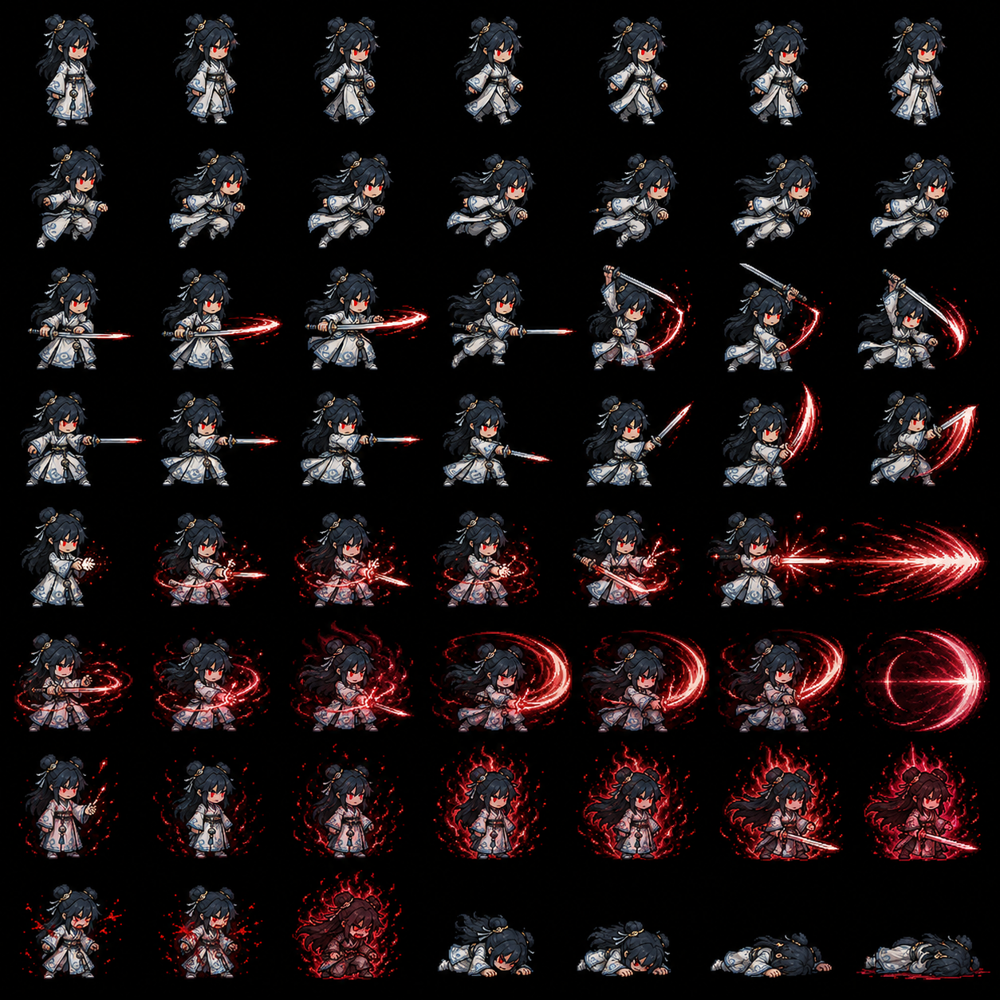

# 基于参考图的横向侧视角色动作表

## 示例

原始参考图：


生成结果：



## 用途

用于在保持参考角色视觉锚点的前提下扩展横向侧视动作表，适合步行、攻击、受伤、死亡和特效动作补帧。

## 使用场景

- 模式：参考图驱动
- 纯文字生成：有限支持。文字主要用于指定新增动作、特效和网格尺寸。
- 上传参考图：主要模式。上传横向侧视角色动作表或角色参考图作为严格视觉基准。
- 最适合：扩展或精炼上传的横向侧视角色动作表。

## 中文用户模板：

```text
请将提供的横向侧视角色参考动作表作为视觉基准，生成包含该角色的扩展或精炼动作表。

核心指令：
1. 视觉锚点：严格保持参考图中角色的基本设计，包括棕 / 橙帽子、绿色衣服、白色剑、简单像素块眼睛、卡通比例，以及 16-bit 像素艺术风格。
2. 结构：保持整齐排列的网格布局，背景为纯黑色或纯绿色，无文字、无数字、无网格线。
3. 保留内容：如果网格尺寸允许，必须保留参考图中的核心动作序列，例如步行、跑步、特定攻击、受伤和死亡序列。

自定义输入：
网格尺寸：[例如：8x6、10x8、12x8、16x12、16x16 帧]

动作类型 / 序列描述：
[例如：
- 保留原有步行和核心攻击行，但添加两行更复杂的魔法剑气攻击动画。
- 创建一个包含完整行走、跑步、四种不同标准攻击、两个受伤帧、一个红色状态帧和四个死亡帧的全新 8x6 网格。
- 精炼现有动作表，使步行、攻击和死亡动画更加流畅。]

特定特效：
[例如：所有新的魔法剑气都是蓝色的；或者：不需要任何新特效。]

特定新帧位置：
[例如：新的蓄力序列放在第 7 行和第 8 行；新的受伤 / 趴地帧放在最后一行。]

限制：
最终 PNG 中绝对不能出现文字、数字、可见网格线或 UI。
不能改变角色的帽子、衣服、眼睛风格、比例或武器外观。
所有攻击特效必须留在各自帧内，不能外溢遮挡其他帧。
```
