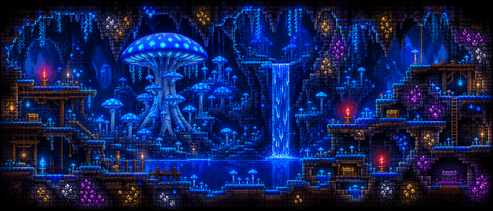

# 图块化横版侧切像素环境

## 示例



## 用途

用于生成图块化 2D 横版侧切环境，强调前景、中景、背景层次以及 16x16/32x32 图块质感。

## 使用场景

- 模式：纯文字生成
- 纯文字生成：主要模式。提供生物群落、场景结构、前景方块、细节和光影。
- 上传参考图：不是核心流程；此档案用于从文字生成新的横版侧视环境。
- 最适合：从文字生成图块化横版侧切像素环境。

## 中文用户模板：

```text
### 核心视角与风格（请勿修改）
严格的 2D 横版侧切全景视角，图块化沙盒像素艺术风格，16x16 和 32x32 图块纹理，层次丰富，色彩鲜明。

### 生物群落主题
[填入 1 个核心生物群落，例如：森林、丛林、腐化之地、血腥之地、发光蘑菇地、地牢、地狱、空岛、雪地、沙漠、海洋、蜂巢、花岗岩洞穴。]

### 场景结构
远景 / 背景层：
[描述天空或背景墙。例如：蓝天白云、夜空月亮和星星、地下岩层背景墙、地牢砖墙、远处森林轮廓。]

中景 / 环境主体：
[描述主要环境元素。例如：巨大树木、洞穴系统、蘑菇树林、废墟结构、地牢入口、蜂巢墙、瀑布、熔岩河。]

前景 / 可踩踏方块：
[描述玩家可踩踏或互动的方块。例如：草方块、泥土和石头、丛林泥土、地牢砖块、蓝色蘑菇草、木质平台、沙块、冰块。]

### 具体细节与物体
[列出装饰和可互动细节。例如：发光矿石、宝石、火把、宝箱、家具、蔓藤、尖刺陷阱、生命果、魔力水晶、雕像、背景墙纹理。]

### 时间与光影
[描述氛围。例如：白天明亮、夜晚月光、强烈蓝色生物发光、熔岩微光、火把暖光、雨天、雪天、沙尘暴。]

### 强制禁忌（请勿修改）
绝对不要出现角色、玩家、NPC、敌人、怪物、动物、生物、UI、血条、物品栏、小地图、准星或任何文字。
```
