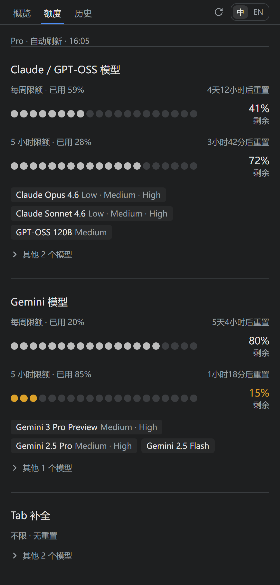

# Pulse · antigravity-pulse

[](https://github.com/Aoike123/antigravity-pulse/actions/workflows/ci.yml)
[](LICENSE)

**简体中文** · [English](#english)

Antigravity 2.0 桌面应用的 **Pulse** 实时用量侧边面板：上下文占用、输出速度、模型额度（每周 + 5 小时限额）、单会话累计、分类历史视图、自动对齐官方周额度占比与公开单价费用估算，一个面板全部看清。默认 100% 本机运行，刷新不消耗任何 Token。

## 截图

| 概览 | 额度 | 历史 |
| --- | --- | --- |
|  |  |  |

## 功能

面板分为三个标签页（**概览**、**额度**、**历史**）。顶栏提供统一的 SVG 刷新图标按钮与 `中 | EN` 分段切换按钮，并采用混合自动刷新机制：

- **概览**：可见时每 3 秒自动轮询。
- **额度 / 历史**：可见时每 65 秒静默自动刷新，窗口重新可见或获得焦点且数据超过 60 秒时自动更新；额度池倒计时归零约 3 秒后还会自动触发一次刷新。静默刷新不打断搜索框焦点或已展开的详情。

### 概览

- **上下文用量**：与 agy CLI 的 `/context` 相同的统计方式（从 CLI 二进制移植），读取 Antigravity 为每次模型调用记录的真实 Token 数据，而不是按字符数估算。
  - 标题：模型名称、已用 / 上限 Token 与百分比；模型名和上下文窗口来自应用的实时模型目录。
  - 点阵图：每个点代表上下文窗口的 1%。
  - 按类别的 Token 用量：用户消息、智能体回复、工具调用，以及非零时显示的系统提示词、系统工具、系统开销、规则、技能、子智能体、工作流、插件、MCP 工具等；剩余空间与检查点缓冲。
  - **请求预算**：超出请求预算（通常 256,000 tokens）后应用会裁剪较早历史，面板会提示。
  - 检查点、知识文件 / 产物文件 / 技能文件 / 自动加载的系统文件。
  - 「复制为文本」按 CLI 输出格式复制报告。
- **输出速度**：最近若干次调用的流式速度（自动过滤短回复与缓冲突发异常值）、端到端速度、首字延迟 TTFT、缓存命中率、柱状趋势图，以及本次回复的输出 Token（含思考 / 回复拆分）；同一会话中切换过多个模型时按模型分别展示速度与趋势。
- **本会话累计**：当前会话所有模型调用的输入、输出、缓存读取、思考 Token、调用次数、缓存命中率、时间跨度、公开价费用估算（同系列估算标 `≈`）与按模型拆分。

### 额度

- 通过应用本地语言服务器（`RetrieveUserQuotaSummary`、`GetUserStatus` 与 `GetAvailableModels`）获取模型额度，按类别分组：**Claude / GPT-OSS 模型**、**Gemini 模型**、**Tab 补全**、其他模型。
- 每个额度池自动展示**每周限额**与 **5 小时限额**（优先采用 `RetrieveUserQuotaSummary` 显式返回的官方限额桶；若接口未返回，则回退为按重置时间推断并标示 `≈`）、已用 / 剩余百分比、**20 点额度条**（每点 5%）与实时重置倒计时；无重置时间且剩余 100% 的池显示为「不限 · 无重置」。
- 模型列表按模型系列与思考档位去重展示，内部或非主力模型收在可折叠的「其他 N 个模型」中；同时显示当前套餐与等级。

### 历史

扫描本机所有桌面端与 CLI 会话，提供三个分类子视图，并支持**自动对齐官方周额度**与**可选同步公开官网价**：

- **按额度池自动对齐周额度**：
  - 自动通过同一本地语言服务器通道读取 `RetrieveUserQuotaSummary` 返回的官方周额度（Gemini、Claude/GPT），在「按总量」展示各额度池官方周已用比例，并按每个模型与会话在该池近 7 天的用量占比自动估算其官方周额度消耗（**`≈ 周额度 X%`**），无需手动填写。
  - 仅当语言服务器未提供周额度桶时，才回退为「按总量」中的可选手动校准（对照左下角 **View Usage** 弹窗填入，保存于本机 `localStorage` 的 `ctx.weeklyLeft`），或明确标注为近 7 天总用量占比（**`占近7天已用 X%`**）。
- **公开官网价费用估算与同步**：
  - 内置常见模型的公开官网单价表离线可用；点击历史页的 **「同步官网价」** 按钮可主动调用 `/api/pricing?refresh=true`，从 **LiteLLM** 公开价格库（失败时回退 **OpenRouter** 公开 API）拉取最新公开单价并在本机缓存 24 小时。
  - 已有公开单价的模型显示 `$x.xx`；未发布 / 预览模型（如 Gemini 4、Orchestrator、Claude 5.5）按同系列已发布模型的公开单价估算并明确标示 **`≈`**（若包含无单价模型则标示下限 `≥`）。
- **按总量**：`今天 / 7 天 / 30 天 / 全部` 周期切换胶囊、主指标与统计网格（输入、输出、缓存读取、调用、对话、费用估算与官方周额度状态）、随时间范围自适应疏密的活跃度热力图（今天按 24 小时、7 天 / 30 天 / 全部逐级变密），以及按显示名称合并的 Top 5 模型榜（悬浮查看原始模型 ID，支持展开其余模型）。
- **按会话**：按 Token 用量（输入 + 输出）降序排列，支持周期筛选（全部 / 近 30 天 / 近 7 天 / 今天）、`隐藏子智能体` 开关、比例条、分页，以及点击展开的详细拆分（输入 / 输出 / 缓存读取 / 思考、缓存命中率、调用次数、费用估算、周额度占比、时间跨度、来源与按模型明细）。
- **会话列表**：按时间线浏览会话，支持实时搜索（按标题 / 模型 / ID，静默刷新不丢焦点）、排序切换（最近活跃 / 按用量 / 按调用）、来源筛选（全部 / 桌面 / CLI，有 CLI 记录时显示）、`隐藏子智能体` 开关，以及同样的展开明细与分页；会话标题读取自应用自身的会话摘要数据库。

## 安装

需要 Antigravity 2.0 桌面应用，以及 `PATH` 中的 Python 3.10+（`python`、`py` 或 `python3`）。

1. 克隆到 Antigravity 插件目录：

   ```bash
   # macOS / Linux
   git clone https://github.com/Aoike123/antigravity-pulse.git ~/.gemini/config/plugins/antigravity-pulse
   ```

   ```powershell
   # Windows (PowerShell)
   git clone https://github.com/Aoike123/antigravity-pulse.git "$HOME\.gemini\config\plugins\antigravity-pulse"
   ```

2. 重启 Antigravity，打开 **Customizations → Installed**，启用 **Pulse**。
3. 打开一个会话，在右侧面板中打开 **Pulse**。

更新：在该目录中执行 `git pull`，然后在 Customizations 中关闭再重新启用插件。

## 工作原理

```
plugin.json                       插件清单
sidecars/context/
  sidecar.json                    注册侧边面板（用 Antigravity 自带的 Node 运行 main.mjs）
  main.mjs                        后端：提供面板页面与 /api/report、/api/quota、/api/history、/api/pricing
  index.html, app.js, styles.css  面板前端
  context_report.py               单会话解析器（上下文、输出速度、本会话累计）
  history_scanner.py              多会话历史扫描器（带增量缓存）
tests/                            Python 与 Node 测试
```

- 面板通过 Antigravity 的 sidecar 桥获取当前会话 ID 与工作区，每 3 秒请求一次 `/api/report`。
- 后端对静态资源返回 `Cache-Control: no-store, no-cache, must-revalidate`，并在提供 `index.html` 时按文件修改时间与大小自动为 `styles.css`、`app.js` 附加查询参数（`?v=...`），避免 WebView 缓存错配。
- 后端仅在会话数据库（`~/.gemini/antigravity/conversations/<id>.db`，只读打开）发生变化时运行 `context_report.py --json`，否则返回缓存。
- `/api/quota` 通过应用交给 sidecar 的语言服务器地址与 CSRF 令牌，调用 `RetrieveUserQuotaSummary`、`GetUserStatus` 与 `GetAvailableModels`，合并官方每周 / 5 小时限额与模型目录；模型目录每 10 分钟刷新一次，获取失败时回退到内置的上下文窗口表。
- `/api/history` 运行 `history_scanner.py`，扫描 `~/.gemini/antigravity/conversations` 与 `~/.gemini/antigravity-cli/conversations`，结果增量缓存在插件的数据目录中。
- `/api/pricing` 管理本机 `pricing-cache.json`（24 小时缓存）；当缓存存在时，后端通过 `--pricing-file` 传给解析器与扫描器使用。

## 隐私

- **默认 100% 本地**：所有会话统计都来自本机文件，不上传任何本地数据，没有遥测。
- **只读**：会话数据库与会话摘要数据库均以只读方式打开。
- **默认网络通信**：默认情况下，唯一的网络请求是发往应用自身的**本地**语言服务器（使用应用通过 sidecar 环境变量提供的地址与 CSRF 令牌），不访问任何外部服务。
- **可选的公开单价同步**：**仅当**你主动点击 **「同步官网价」** 时，后端才会发起一次只读的匿名 HTTPS `GET` 请求，从 LiteLLM（主源）或 OpenRouter（备用源）获取公开的模型单价 JSON；不携带认证信息，也不上传任何本地或个人数据。
- **不修改应用**：不修补 `app.asar`，不注入脚本，只使用官方插件 / sidecar 机制。
- 缓存（模型目录、已脱敏的额度原始响应、历史扫描缓存、公开单价缓存）只保存在 sidecar 的数据目录中；各额度池的周剩余校准值仅保存在前端 `localStorage` 中。

## 限制

- 额度数据来自应用语言服务器的非公开接口（`RetrieveUserQuotaSummary` / `GetUserStatus` / `GetAvailableModels`），字段与分组可能随应用更新而变化；若语言服务器未返回周额度桶，则回退为按重置时间推断限额类型（标示 `≈`）以及手动校准或 `占近7天已用 %`。
- 美元费用基于公开 API 单价（内置表或同步自 LiteLLM / OpenRouter）估算，预览模型按同系列公开单价估算并标示 `≈`，仅供参考，不代表实际订阅账单。
- Token 统计依赖应用在会话数据库中记录的元数据，旧版本或损坏的数据库可能无法读取。

## 开发与测试

只需 Python 标准库与 Node.js：

```bash
# Python 测试（构造合成会话数据库并端到端检查）
python -m unittest discover tests

# Node 后端辅助函数测试（Node 18+）
node tests/test_main_helpers.mjs

# 语法检查
node --check sidecars/context/main.mjs
node --check sidecars/context/app.js

# 命令行单独运行解析器 / 扫描器
python sidecars/context/context_report.py                     # 最近活跃的桌面会话
python sidecars/context/context_report.py --conversation-id <uuid> --json
python sidecars/context/history_scanner.py --json
```

贡献指南见 [CONTRIBUTING.md](CONTRIBUTING.md)，版本记录见 [CHANGELOG.md](CHANGELOG.md)。

## 许可证

[MIT](LICENSE)

## 致谢

Originally derived from [dimitr-io/antigravity-desktop-context](https://github.com/dimitr-io/antigravity-desktop-context) (MIT).

---

<a id="english"></a>

# English

**Pulse** — a live telemetry and usage side panel for the **Antigravity 2.0 desktop app**: context window usage, output speed, model quota (Weekly + 5-hour limits), per-conversation totals, categorized usage history, automatic official weekly quota attribution, and public-price USD cost estimates in one panel. 100% local by default, and refreshing costs zero tokens.

## Screenshots

| Overview | Quota | History |
| --- | --- | --- |
|  |  |  |

## Features

The panel has three tabs (**Overview**, **Quota**, **History**). The top bar provides a unified inline SVG refresh button, a segmented `中 | EN` language toggle, and hybrid auto-refresh:

- **Overview**: polls every 3 seconds while visible.
- **Quota & History**: silently auto-refresh every 65 seconds while visible, plus on tab visibility / window focus when stale (>60s); Quota also triggers a one-shot refresh ~3 seconds after a pool's reset countdown reaches 0. Silent refreshes preserve search focus and expanded disclosures.

### Overview

- **Context usage**, computed like the agy CLI's `/context` (accounting ported from the CLI binary) from the token breakdown Antigravity records for every model call, not estimated from characters.
  - Header: model name, used / limit tokens and percentage; model name and context window come from the app's live model catalog.
  - Usage grid: each dot is 1% of the context window.
  - Token usage by category: user messages, agent responses, tool calls, plus system prompt, system tools, system overhead, rules, skills, subagents, workflows, plugins, MCP tools when non-zero; free space and checkpoint buffer.
  - **Request budget**: past the per-request budget (usually 256,000 tokens) the app trims older history, and the panel flags it.
  - Checkpoints, knowledge / artifact / skill files and auto-loaded system files.
  - **Copy as text** copies the report as the CLI prints it.
- **Output Speed**: streaming speed (filtering out short/buffered-burst outliers), end-to-end speed, time to first token (TTFT), cache hit rate, recent-call bar chart, and this reply's output tokens (thinking / response split), plus a per-model breakdown with expandable trends when multiple models were used in the conversation.
- **This conversation**: input, output, cache-read and thinking tokens, calls, cache hit rate, time span, public-price USD cost estimate (`≈` for same-family preview estimates), and per-model breakdown summed over every model call of the open conversation.

### Quota

- Model quota from the app's local language server (`RetrieveUserQuotaSummary`, `GetUserStatus`, and `GetAvailableModels`), grouped by category: **Claude / GPT-OSS models**, **Gemini models**, **Tab completion**, and other models.
- Each pool automatically displays both its **Weekly** and **5-hour** limits (preferring explicit official buckets from `RetrieveUserQuotaSummary`, falling back to reset-time inference marked `≈` when unavailable), used / remaining percentage, a **20-dot meter** (1 dot = 5%) and a live reset countdown. A pool with no reset time and 100% left shows "Unlimited · no reset".
- Models are grouped into deduplicated families with thinking levels, internal models sit in a collapsible "Other N models" disclosure, and the current tier and plan are shown.

### History

Scans desktop and CLI conversations on this machine across three categorized sub-views, with **automatic official weekly quota attribution** and **opt-in public pricing sync**:

- **Per-pool weekly quota**:
  - Automatically queries `RetrieveUserQuotaSummary` via the same local language server channel to read each pool's official weekly remaining percentage (`Gemini`, `Claude/GPT`), showing live official weekly usage in **Totals** and auto-calibrating each model / conversation's estimated share of that pool's weekly quota (**`≈ X% weekly`**) proportionally from its 7-day pool usage.
  - Falls back to optional manual calibration (from Antigravity's **View Usage** popup, saved in `localStorage` as `ctx.weeklyLeft`) or unambiguous 7-day usage share (**`X% of 7d usage`**) only if the language server does not expose weekly buckets.
- **Public pricing & opt-in sync**:
  - Ships with a built-in offline table of published model list prices. Click **Sync prices** in History to call `/api/pricing?refresh=true`, fetching public pricing from **LiteLLM** (primary) with **OpenRouter** as fallback, cached locally for 24 hours.
  - Published models show `$x.xx`; preview / unreleased models (e.g. Gemini 4, Orchestrator, Claude 5.5) are estimated from their released same-family public price and clearly marked **`≈`** (`≥` marks a lower bound when unpriced calls are included).
- **Totals**: 4-pill period selector (`Today / 7d / 30d / All`), hero total (excl. cache read) and stat grid (Input, Output, Cache read, Calls, Conversations, Cost estimate & live weekly quota status), period-adaptive activity heatmap (hourly for Today, progressively denser across 7d / 30d / All), and merged Top 5 models (duplicate display names merged, raw model IDs in tooltip, expandable for the rest).
- **By session**: conversations ranked by usage (`input + output`), with period filter (`All / 30d / 7d / Today`), hide-subagents toggle, proportional bars, pagination, and click-to-expand breakdowns (input / output / cache read / thinking, cache hit %, calls, cost estimate, weekly quota %, time span, source and per-model breakdown).
- **Session list**: chronological conversation list with live search (by title / model / ID, keeping focus across silent refreshes), sort switch (Recent / By usage / By calls), conditional Desktop / CLI source filter, hide-subagents toggle, pagination and expandable breakdowns. Titles come from the app's own conversation summaries database.

## Installation

Requires the Antigravity 2.0 desktop app and Python 3.10+ on your `PATH` (`python`, `py` or `python3`).

1. Clone this repository into your Antigravity plugins folder:

   ```bash
   # macOS / Linux
   git clone https://github.com/Aoike123/antigravity-pulse.git ~/.gemini/config/plugins/antigravity-pulse
   ```

   ```powershell
   # Windows (PowerShell)
   git clone https://github.com/Aoike123/antigravity-pulse.git "$HOME\.gemini\config\plugins\antigravity-pulse"
   ```

2. Restart Antigravity, open **Customizations → Installed**, and turn **Pulse** on.
3. Open a conversation and open **Pulse** in the right-side pane.

To update, run `git pull` inside that folder, then turn the plugin off and on again.

## How it works

```
plugin.json                       plugin manifest
sidecars/context/
  sidecar.json                    registers the side panel (runs main.mjs with Antigravity's Node)
  main.mjs                        backend: serves the panel and /api/report, /api/quota, /api/history, /api/pricing
  index.html, app.js, styles.css  panel front end
  context_report.py               per-conversation parser (context, output speed, this-conversation usage)
  history_scanner.py              multi-conversation history scanner (incremental cache)
tests/                            Python and Node tests
```

- The panel gets the open conversation's ID and workspace from Antigravity's sidecar bridge and asks the backend for `/api/report` every 3 seconds.
- Static assets are served with `Cache-Control: no-store, no-cache, must-revalidate`, and `/` dynamically stamps `styles.css` and `app.js` URLs with their current mtime/size (`?v=...`) to prevent stale WebView asset mismatches.
- The backend runs `context_report.py --json` on the conversation database (`~/.gemini/antigravity/conversations/<id>.db`, opened read-only) only when it has changed; otherwise it returns the cached report.
- `/api/quota` calls `RetrieveUserQuotaSummary`, `GetUserStatus`, and `GetAvailableModels` on the app's local language server, using the address and CSRF token the app hands the sidecar, merging official Weekly / 5-hour buckets with the model catalog. The model catalog refreshes every 10 minutes; if it fails, the parser falls back to a built-in context window table.
- `/api/history` runs `history_scanner.py` over `~/.gemini/antigravity/conversations` and `~/.gemini/antigravity-cli/conversations`, with an incremental cache in the plugin's data directory.
- `/api/pricing` manages a local `pricing-cache.json` (24-hour cache); when present, the backend passes `--pricing-file` to both the parser and the scanner.

## Privacy

- **100% local by default**: all usage data comes from local files on your machine. No local or personal data is ever uploaded, and there is no telemetry.
- **Read-only**: conversation and conversation-summary databases are opened read-only.
- **Default network traffic**: by default, the only network requests go to the app's own **local** language server, through the address and CSRF token the app provides to the sidecar. No external services are contacted.
- **Opt-in public pricing sync**: **only** when you click **Sync prices** does the backend perform an unauthenticated, read-only HTTPS `GET` to fetch the public model price list from LiteLLM (with OpenRouter as fallback) and cache it locally in `pricing-cache.json`. Zero local data is sent.
- **No app patching**: no `app.asar` modification and no script injection; only the official plugin / sidecar mechanism.
- Caches (model catalog, redacted raw quota response, history scan cache, public price list cache) live only in the sidecar's data directory; per-pool weekly calibration values live only in panel `localStorage`.

## Limitations

- Quota data comes from undocumented language-server RPCs (`RetrieveUserQuotaSummary` / `GetUserStatus` / `GetAvailableModels`), so its fields and grouping may change with app updates. If `RetrieveUserQuotaSummary` does not expose weekly buckets, the panel falls back to reset-time inference (marked `≈`) and manual calibration or `X% of 7d usage`.
- USD cost figures are estimates from public API list prices (built-in or synced from LiteLLM / OpenRouter); preview models use same-family estimates marked `≈` and do not represent your actual subscription bill.
- Token counts depend on the metadata the app writes to its conversation databases; old or damaged databases may not be readable.

## Development and testing

Only the Python standard library and Node.js are needed:

```bash
# Python tests (build synthetic conversation databases and check end to end)
python -m unittest discover tests

# Node backend helper tests (Node 18+)
node tests/test_main_helpers.mjs

# Syntax checks
node --check sidecars/context/main.mjs
node --check sidecars/context/app.js

# Run the parser / scanner on the command line
python sidecars/context/context_report.py                     # most recently active desktop conversation
python sidecars/context/context_report.py --conversation-id <uuid> --json
python sidecars/context/history_scanner.py --json
```

See [CONTRIBUTING.md](CONTRIBUTING.md) to contribute and [CHANGELOG.md](CHANGELOG.md) for release notes.

## License

[MIT](LICENSE)

## Acknowledgements

Originally derived from [dimitr-io/antigravity-desktop-context](https://github.com/dimitr-io/antigravity-desktop-context) (MIT).
