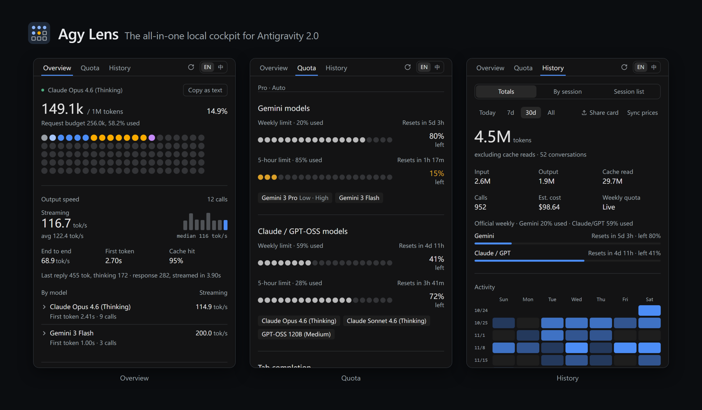
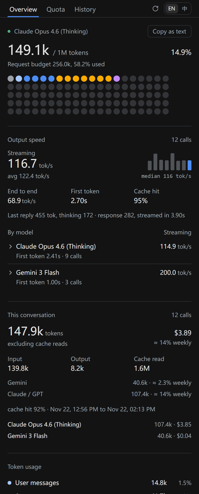
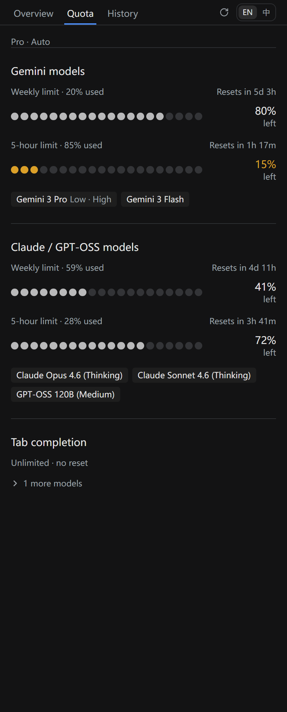
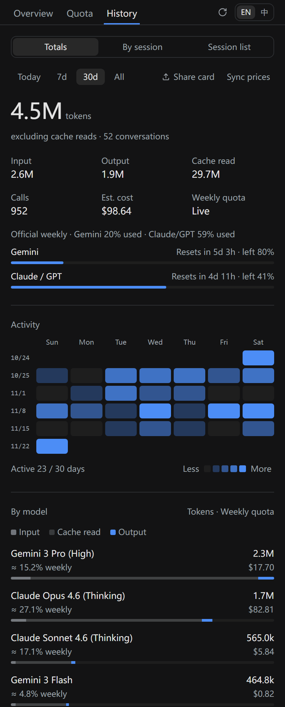
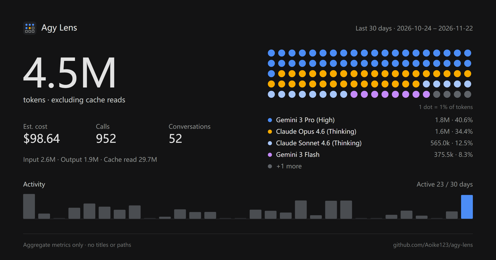

<div align="center">


# Agy Lens

**The all-in-one local cockpit for Antigravity 2.0.**<br>
Context window, live tok/s, 5-hour & weekly quotas, and token spend in one zero-dependency side panel.

[](https://github.com/Aoike123/agy-lens/actions/workflows/ci.yml)
[](https://github.com/Aoike123/agy-lens/releases/latest)
[](LICENSE)


**English** · [简体中文](README.zh-CN.md)



</div>

Never get surprised by a 5-hour rate limit or a silently trimmed context again. Agy Lens reads the data Antigravity already keeps on your machine and shows it live, next to your conversation. Refreshing costs zero tokens and nothing leaves your computer.

## Why Agy Lens?

| | Agy Lens | [desktop-context](https://github.com/dimitr-io/antigravity-desktop-context) | [agy-context](https://github.com/ahmetdotsh/agy-context) + [agy-usage](https://github.com/ahmetdotsh/agy-usage) | Quota-only extensions |
| --- | :---: | :---: | :---: | :---: |
| Context window by category | ✅ | ✅ | ✅ | — |
| Streaming tok/s, TTFT, cache hit | ✅ | — | partial | — |
| Official 5-hour **and** weekly quotas with countdowns | ✅ | — | — | ✅ |
| Desktop + CLI history, cost estimate, per-pool weekly attribution | ✅ | — | partial | — |
| Sanitized share card (SVG / PNG) | ✅ | — | — | — |
| Terminal summary CLI | ✅ | — | — | — |
| Plugins to install | **1** | 1 | 2 | 1 |
| Runtime dependencies | **0** (built-in Node 24) | Python | 0 | IDE extension host |

## Install (30 seconds)

You only need the **Antigravity 2.0 desktop app**. It ships Node.js 24 with built-in `node:sqlite`, so there is nothing else to install.

**Windows (PowerShell)**

```powershell
irm https://raw.githubusercontent.com/Aoike123/agy-lens/main/scripts/install.ps1 | iex
```

**macOS / Linux**

```bash
curl -fsSL https://raw.githubusercontent.com/Aoike123/agy-lens/main/scripts/install.sh | bash
```

Then restart Antigravity, turn on **Agy Lens** under **Customizations → Installed**, and open it from the right-side pane of any conversation.

<details>
<summary>Other ways to install</summary>

**Antigravity CLI**

```bash
agy plugin install https://github.com/Aoike123/agy-lens
```

**Release ZIP (no terminal):** download `agy-lens.zip` from the [latest release](https://github.com/Aoike123/agy-lens/releases/latest) and extract it so that `plugin.json` sits at:

- Windows: `%USERPROFILE%\.gemini\config\plugins\agy-lens\plugin.json`
- macOS / Linux: `~/.gemini/config/plugins/agy-lens/plugin.json`

**From source**

```bash
git clone https://github.com/Aoike123/agy-lens.git ~/.gemini/config/plugins/agy-lens
```

The installers replace the files atomically and clean up folders left by older versions, so you don't get duplicate panels.

</details>

## What you get

<details>
<summary>Full-size screenshots</summary>

| Overview | Quota | History |
| --- | --- | --- |
|  |  |  |

</details>

### Overview: the open conversation

- **Context window**, counted the same way as the agy CLI's `/context` from the token data Antigravity records for each model call, not estimated from characters. A 100-dot grid shows the breakdown: user messages, agent replies, tool calls, system prompt, rules, skills, MCP tools and more.
- **Request budget** warning before Antigravity starts trimming older history.
- **Output speed**: streaming tok/s (outliers filtered), end-to-end speed, time to first token, cache hit rate, recent-call trend, split by model.
- **This conversation**: input, output, cache-read and thinking tokens, estimated public-price cost, and its share of your weekly quota.

### Quota: before you hit the wall

- Official **weekly** and **5-hour** limits for each model pool (Claude / GPT-OSS, Gemini, Tab completion), read from the app's local language server.
- 20-dot meters, used / remaining percentage and live reset countdowns.

### History: where your tokens went

- Desktop **and** CLI conversations (including archived usage from pruned conversations and multi-level subagent trees), with `Today / 7d / 30d / All` totals, an activity heatmap and a model leaderboard.
- Each model's and project's size expressed in units of your official weekly quota (`cost ÷ implied 100% weekly value`), plus a week-over-week weekly quota value history to spot quota shrinkage across reset cycles.
- Top-level conversation tree rankings (subagent spend rolled up by level) and a searchable session list.
- **Share card**: export an aggregate usage card as SVG or PNG. Conversation titles and file paths are never included.



### Terminal CLI

Get the same numbers in your terminal (requires Node.js 24+):

```bash
npx github:Aoike123/agy-lens          # summary of the latest conversation + history
npx github:Aoike123/agy-lens --json   # machine-readable output
```

## Privacy

- **Local by default.** All numbers come from files on your machine. No telemetry, no uploads.
- **Read-only.** Conversation databases are opened read-only. The app is never patched; Agy Lens only uses the official plugin/sidecar mechanism.
- **One optional network call.** Prices are estimated from a built-in table. Only if you click **Sync prices** does Agy Lens download the public LiteLLM price list (with OpenRouter as fallback). No credentials or local data are sent.

## FAQ

<details>
<summary>The panel doesn't show up under Customizations → Installed</summary>

Make sure `plugin.json` is directly inside the plugin folder (`~/.gemini/config/plugins/agy-lens/plugin.json`, not nested one level deeper), then fully restart Antigravity.

</details>

<details>
<summary>Quota says "unavailable"</summary>

Sign in to Antigravity, then turn Agy Lens off and on again so the sidecar receives the language server address and token.

</details>

<details>
<summary>Does it cost tokens or slow the agent down?</summary>

No. It never calls a model. It only reads local databases and asks the local language server for quota.

</details>

<details>
<summary>Are the dollar amounts my bill?</summary>

No. They are estimates at public API list prices, useful for comparing models and sessions. Preview models are estimated from their released siblings and marked `≈`.

</details>

## Contributing

Issues and pull requests are welcome, in English or Chinese. The architecture, data sources and protocol notes are in [docs/architecture.md](docs/architecture.md); the dev setup is in [CONTRIBUTING.md](CONTRIBUTING.md).

```bash
node --test tests/*.mjs          # unit tests
node tests/e2e/run.mjs           # end-to-end suite
node scripts/build-release.mjs   # build dist/agy-lens.zip
```

If Agy Lens saves you from a rate-limit surprise, a ⭐ helps other Antigravity users find it.

## License

[MIT](LICENSE). Originally derived from [dimitr-io/antigravity-desktop-context](https://github.com/dimitr-io/antigravity-desktop-context) (MIT).
