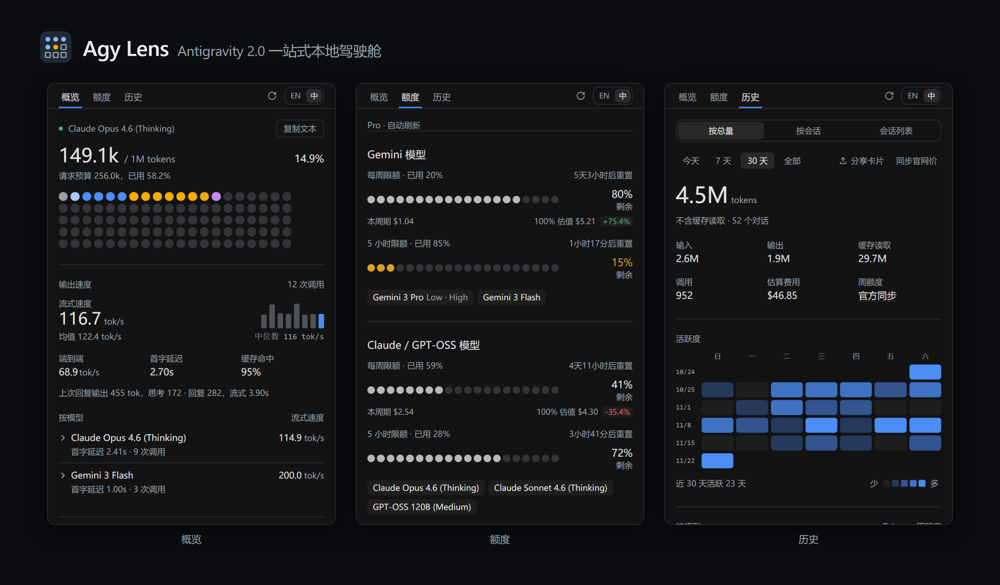
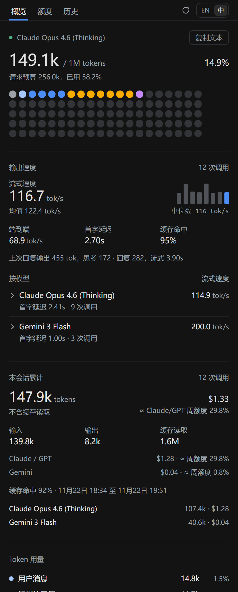
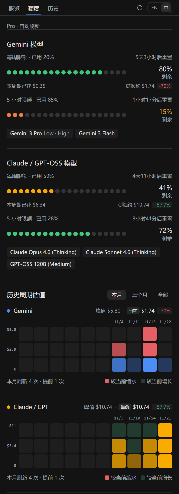
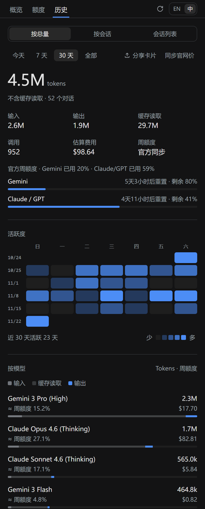

<div align="center">


# Agy Lens

**Antigravity 2.0 的一站式本地驾驶舱与终端 CLI。**<br>
精确上下文拆解、实时 tok/s、5 小时与每周额度、100% 周额度总价值追踪与项目级周额度占比 — 一个零依赖侧边面板全部看清。

[](https://github.com/Aoike123/agy-lens/actions/workflows/ci.yml)
[](https://github.com/Aoike123/agy-lens/releases/latest)
[](https://github.com/Aoike123/agy-lens/stargazers)
[](LICENSE)


[English](README.md) · **简体中文** · [30 秒安装](#安装30-秒) · [功能一览](#功能) · [终端命令](#终端命令) · [架构文档](docs/architecture.md)



</div>

再也不会被 5 小时限额突然卡住，也不会在不知情的情况下被裁掉上下文或悄悄缩水周额度。Agy Lens 直接只读解析 Antigravity 保存在你电脑上的本地数据，并对接本地语言服务器 —— 刷新不消耗任何 Token，数据不出本机。

## 为什么选 Agy Lens

| | Agy Lens | [desktop-context](https://github.com/dimitr-io/antigravity-desktop-context) | [agy-context](https://github.com/ahmetdotsh/agy-context) + [agy-usage](https://github.com/ahmetdotsh/agy-usage) | 仅额度类扩展 |
| --- | :---: | :---: | :---: | :---: |
| 上下文按类别拆解（与 `/context` 同口径） | ✅ | ✅ | ✅ | — |
| 流式 tok/s、首字延迟、缓存命中（分模型） | ✅ | — | 部分 | — |
| 官方 5 小时 **与** 每周额度及重置倒计时 | ✅ | — | — | ✅ |
| 100% 周额度美元估值与历周缩水环比监控 | ✅ | — | — | — |
| 多级子智能体树汇总、旧对话归档与单项目周额度占比 | ✅ | — | 部分 | — |
| 脱敏分享卡片（SVG / PNG）与终端 CLI | ✅ | — | — | — |
| 需要安装的插件数 | **1** | 1 | 2 | 1 |
| 运行时依赖 | **0**（内置 Node 24） | Python | 0 | IDE 扩展宿主 |

## 安装（30 秒）

只需要 **Antigravity 2.0 桌面应用**。它自带 Node.js 24 和内置的 `node:sqlite`，不用再装任何东西。

**Windows（PowerShell）**

```powershell
irm https://raw.githubusercontent.com/Aoike123/agy-lens/main/scripts/install.ps1 | iex
```

**macOS / Linux**

```bash
curl -fsSL https://raw.githubusercontent.com/Aoike123/agy-lens/main/scripts/install.sh | bash
```

然后重启 Antigravity，在 **Customizations → Installed** 中打开 **Agy Lens**，在任意对话右侧边栏打开它即可。

<details>
<summary>其他安装方式</summary>

**Antigravity CLI**

```bash
agy plugin install https://github.com/Aoike123/agy-lens
```

**发布包（不用命令行）**：从 [最新发布](https://github.com/Aoike123/agy-lens/releases/latest) 下载 `agy-lens.zip` 并解压，确保 `plugin.json` 位于：

- Windows：`%USERPROFILE%\.gemini\config\plugins\agy-lens\plugin.json`
- macOS / Linux：`~/.gemini/config/plugins/agy-lens/plugin.json`

**源码安装**

```bash
git clone https://github.com/Aoike123/agy-lens.git ~/.gemini/config/plugins/agy-lens
```

安装脚本会原子替换文件，并清理旧版本留下的目录，避免出现重复面板。

</details>

## 功能

三个页签职责清晰、互不重复：

| 概览 | 额度 | 历史 |
| --- | --- | --- |
|  |  |  |

### 概览：当前对话

- **上下文窗口**：与 agy CLI 的 `/context` 统计方式一致，读取 Antigravity 为每次模型调用记录的真实 Token 数据，而不是按字符估算。100 个点展示用户消息、智能体回复、工具调用、系统提示词、规则、技能、MCP 工具等的占比。
- **请求预算**提醒：在 Antigravity 开始裁剪较早历史之前就能看到。
- **输出速度**：流式 tok/s（已过滤缓冲突发与离群值）、端到端速度、首字延迟、缓存命中率、近期趋势，并按模型拆分。
- **本会话累计**：输入、输出、缓存读取、思考 Token（同时包含在盘及已归档子智能体），按公开价估算的费用，以及本项目占每周额度的比例（`≈ 周额度 X%`）。

### 额度：限额与周额度价值监控

- 从应用本地语言服务器读取各模型池（如 Gemini、Claude / GPT-OSS 或按套餐拆分的独立 Claude Opus / Sonnet 池，以及 Tab 补全）的官方**每周**与 **5 小时**限额，20 点额度条与实时重置倒计时。
- **100% 周额度美元估值**：严格按官方 7 天固定重置周期 `[reset_time - 7d, reset_time)` 对齐本地消耗反算（带 5% 最低用量门槛与饱和前高水位锁，避免用尽后的 AI Credits 污染基准）。
- **历周额度估值记录**：自动归档历史周期的 100% 周额度估值并计算环比变化，一眼看清账号周额度是否缩水。

### 历史：Token 都花在哪了

- 覆盖桌面端**和** CLI 会话，提供 `今天 / 7 天 / 30 天 / 全部` 汇总、自适应活跃度热力图与**按所选时段同步切片的模型排行**（输入/输出/缓存、费用与 `≈ 周额度 X%`）。
- **旧对话归档与精确记账**：自动保留 Antigravity 清理掉的旧会话用量（首次运行还可导入旧缓存）、跨库解析压缩摘要模型枚举，并按响应 ID 精确绑定调用时间戳。
- **按会话（项目树排行）**：顶层主对话汇总多级子智能体树用量、展示分级对比（自身 vs 子智能体）、分模型池美元明细，并保留每个项目的 **`≈ 周额度 X%`** 估算（不截断 100%，方便评估跨周大项目）。
- **分享卡片**：一键复制脱敏的当前时段聚合用量卡片（PNG 图片或 SVG）到剪贴板，直接粘贴分享；绝不包含对话标题和文件路径。


### 终端命令

在终端里看同样的数字（需要 Node.js 24+）：

```bash
npx github:Aoike123/agy-lens          # 最近一次对话 + 历史汇总 + 当前额度
npx github:Aoike123/agy-lens --json   # 机器可读输出
```

## 隐私

- **默认完全本地**：所有数字都来自本机文件，没有遥测，不上传任何数据。
- **只读**：会话数据库以只读方式打开；不修改应用本身，只使用官方插件 / sidecar 机制。
- **唯一可选的网络请求**：费用按内置价格表估算。只有你点击 **同步官网价** 时，才会下载公开的 LiteLLM 价格表（失败时回退 OpenRouter），不发送任何凭据或本地数据。

## 常见问题

<details>
<summary>Customizations → Installed 里看不到面板</summary>

确认 `plugin.json` 直接位于插件目录第一层（`~/.gemini/config/plugins/agy-lens/plugin.json`，不要多套一层），然后完全重启 Antigravity。

</details>

<details>
<summary>额度页显示「暂不可用」</summary>

先登录 Antigravity，然后把 Agy Lens 关闭再打开，让 sidecar 重新拿到语言服务器地址和令牌。

</details>

<details>
<summary>会消耗 Token 或拖慢智能体吗？</summary>

不会。它从不调用模型，只读取本地数据库，并向本地语言服务器查询额度。

</details>

<details>
<summary>美元金额和周额度估值是精确账单吗？</summary>

不是。美元金额按公开 API 价格估算（预览模型标 `≈`）；100% 周额度估值基于「官方扣额大致与本机公开价消费成正比」的假设，若不同周期模型搭配变化或存在多设备使用，估值会有正常波动，仅作参考。

</details>

## 参与贡献

欢迎用中文或英文提交 Issue 和 Pull Request。架构、数据来源和协议说明见 [docs/architecture.md](docs/architecture.md)，开发环境见 [CONTRIBUTING.md](CONTRIBUTING.md)。

```bash
node --test tests/*.mjs          # 单元测试
node tests/e2e/run.mjs           # 端到端测试
node scripts/build-release.mjs   # 构建 dist/agy-lens.zip
```

如果 Agy Lens 帮你躲过了一次限额突袭或看清了项目真实用量，欢迎去 GitHub 点个 **⭐ Star**，让更多 Antigravity 用户看到它！

## 许可证

[MIT](LICENSE)。最初派生自 [dimitr-io/antigravity-desktop-context](https://github.com/dimitr-io/antigravity-desktop-context)（MIT）。
