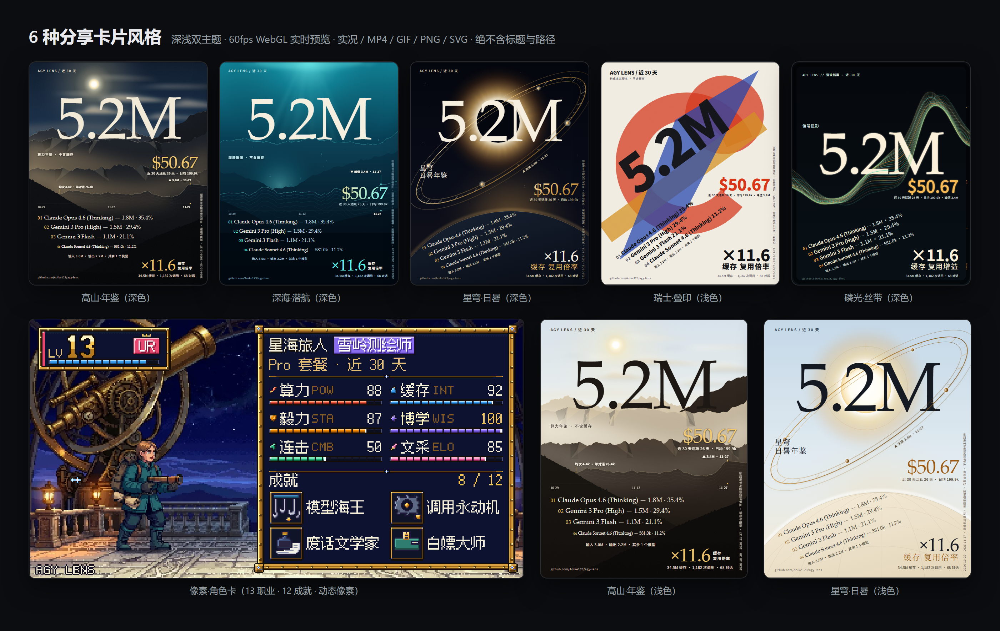

<div align="center">


# Agy Lens

**Antigravity 2.0 的一站式本地驾驶舱与终端 CLI。**<br>
精确上下文拆解、实时 tok/s、5 小时与每周额度、多周期额度利用率与美元估值追踪、项目级子智能体耗量，以及 6 种 WebGL / 像素风分享卡片 — 一个零依赖侧边面板全部看清。

[](https://github.com/Aoike123/agy-lens/actions/workflows/ci.yml)
[](https://github.com/Aoike123/agy-lens/releases/latest)
[](https://github.com/Aoike123/agy-lens/stargazers)
[](LICENSE)


[English](README.md) · **简体中文** · [30 秒安装](#安装30-秒) · [功能一览](#功能) · [分享卡片](#分享卡片6-种风格与动图导出) · [终端命令](#终端命令) · [架构文档](docs/architecture.md)


</div>

再也不会被 5 小时限额突然卡住，也不会在不知情的情况下被裁掉上下文、悄悄缩水周额度，或忘了激活新周期的倒计时。Agy Lens 直接只读解析 Antigravity 保存在你电脑上的本地数据，并对接本地语言服务器 —— 刷新零 Token、默认纯只读、数据不出本机。

## 为什么选 Agy Lens

| | Agy Lens | [desktop-context](https://github.com/dimitr-io/antigravity-desktop-context) | [agy-context](https://github.com/ahmetdotsh/agy-context) + [agy-usage](https://github.com/ahmetdotsh/agy-usage) | 仅额度类扩展 |
| --- | :---: | :---: | :---: | :---: |
| 上下文按类别拆解（与 `/context` 同口径） | ✅ | ✅ | ✅ | — |
| 流式 tok/s、首字延迟、缓存命中（分模型） | ✅ | — | 部分 | — |
| 官方 5 小时 **与** 每周额度、倒计时及可选自动唤醒 | ✅ | — | — | 部分 |
| 100% 周额度估值、缩水环比、周期内分段下钻与多周期浪费统计（`已用 / 总可用`） | ✅ | — | — | — |
| 按项目归类、多级子智能体树汇总、旧对话归档与分段锁定周额度占比 | ✅ | — | 部分 | — |
| 6 种 WebGL 与像素角色分享卡片（实况 / MP4 / GIF / PNG / SVG）与终端 CLI | ✅ | — | — | — |
| 面板内一键更新（SHA-256 校验 + 自动回滚） | ✅ | — | — | — |
| 需要安装的插件数 | **1** | 1 | 2 | 1 |
| 运行时依赖 | **0**（内置 Node 24） | Python | 0 | IDE 扩展宿主 |

## 安装（30 秒）

只需要 **Antigravity 2.0 桌面应用**。它自带 Node.js 24 和内置的 `node:sqlite`，不用再装任何东西。

**Windows（PowerShell）**

```powershell
irm https://raw.githubusercontent.com/Aoike123/agy-lens/main/scripts/install.ps1 | iex
```

**macOS / Linux**

```bash
curl -fsSL https://raw.githubusercontent.com/Aoike123/agy-lens/main/scripts/install.sh | bash
```

然后重启 Antigravity，在 **Customizations → Installed** 中打开 **Agy Lens**，在任意对话右侧边栏打开即可。后续有新版本时面板顶部会出现 **立即更新** 提示条，自动校验 `SHA256SUMS.txt` 并原地原子升级。

<details>
<summary>其他安装方式</summary>

**Antigravity CLI**

```bash
agy plugin install https://github.com/Aoike123/agy-lens
```

**发布包（不用命令行）**：从 [最新发布](https://github.com/Aoike123/agy-lens/releases/latest) 下载 `agy-lens.zip` 并解压，确保 `plugin.json` 位于：

- Windows：`%USERPROFILE%\.gemini\config\plugins\agy-lens\plugin.json`
- macOS / Linux：`~/.gemini/config/plugins/agy-lens/plugin.json`

**源码安装**

```bash
git clone https://github.com/Aoike123/agy-lens.git ~/.gemini/config/plugins/agy-lens
```

安装脚本会原子替换文件，并清理旧版本留下的目录，避免出现重复面板。

</details>

## 功能

三个页签职责清晰、互不重复：

| 概览 | 额度 | 历史 |
| --- | --- | --- |
|  |  |  |

### 概览：当前对话

- **上下文窗口**：与 agy CLI 的 `/context` 统计口径一致，直接读取 Antigravity 为每次模型调用记录的真实 Token 数据，而非按字符估算。100 个点直观展示用户消息、智能体回复、工具调用、系统提示词、规则、技能、MCP 工具等的占比。
- **请求预算**提醒：在 Antigravity 开始裁剪较早历史之前提前预警。
- **输出速度**：流式 tok/s（已过滤缓冲突发与离群值）、端到端速度、首字延迟、缓存命中率、近期趋势，并按模型拆分。
- **本会话累计**：输入、输出、缓存读取、思考 Token（同时包含在盘及已归档子智能体），按公开价估算的费用，以及分段锁定的周额度占用（`≈ 周额度 X%`）。

### 额度：限额监控、周期估值与防浪费

- **以官方汇总为准的限额展示**：读取套餐下每个模型池（Gemini、Claude / GPT-OSS、或服务端拆分的独立 Opus / Sonnet 池，以及底部的 Tab 补全）的官方**每周**与 **5 小时**限额，20 点额度条与实时重置倒计时；当新周期刚刷新满额且尚未开始计时时明确提示 **`首次使用后开始倒计时`**。
- **可选单池自动唤醒** *（默认严格关闭）*：Antigravity 的周额度与 5 小时倒计时需在首次使用后才启动。你可以按池手动开启右上角的 **自动唤醒** 开关；当该池刷新满额且未开始倒计时时，自动通过池内最轻/最便宜的模型发送 **严格 1 条** 禁止工具调用的极短消息并自动删除临时对话，配合持久化单周期熔断锁（`pending_latched`）、12 小时硬冷却与写锁前置检查，杜绝静默重复消耗。
- **100% 周期额度美元估值与涨跌对照**：用相邻两次真实重置时间计算实际周期长度（提前刷新立即结算封存），结合 LOOCV 防过拟合经验校准，在 `本月 / 三个月 / 全部` 自适应 `1:1` 方格柱状图中以当前周期高度为基准线标示红/绿缩水与增长。
- **多周期额度闭环统计（`已用 / 总可用` · `本周期剩余` · `往期未用`）**：每个池的周期柱图下方直接汇总所选范围内累计可用周额度（如 4 个周期 = `400%`）、累计已用、本周期剩余与已过期未用掉的往期额度，方便一眼看清自己浪费了多少并决定是否调整套餐。
- **响应式周期内分段消耗下钻**：点击任意周期柱子原位动画展开该周期的分段消耗速度图与加权基准线，高亮 `≥ 1.4×` 加速时段，悬停展示峰值并发对话数（`最多同时 N 个对话`）、空闲间隔与其他设备消耗标记。

### 历史：Token 都花在哪了

- **按周期分段锁定的周额度统计**：覆盖桌面端**与** CLI 会话，支持 `今天 / 7 天 / 30 天 / 全部`，严格按每个周期自身尺度累加官方消耗、尾段及早期无记录估算（100% 实测省略 `≈` 并支持悬停分项拆解），配自适应活跃热力图与同步切片的模型排行。
- **旧对话归档与精确记账**：自动保留被 Antigravity 清理的旧会话用量，跨库解析压缩摘要模型枚举，并按响应 ID 精确绑定时间戳。
- **按项目归类与子智能体树**：在「按会话」中支持 **按项目 / 平铺** 切换，并在「按会话」与「会话列表」中提供项目筛选胶囊，汇总多级子智能体树用量（自身 vs 子智能体）、分模型池美元明细及跨周期分段累加的 `≈ 周额度 X%` 占用。

### 分享卡片：6 种风格与动图导出

在历史页打开 **全屏铺满的分享卡片弹窗**，把 `今天 / 7 天 / 30 天 / 全部` 的聚合指标变成精致的脱敏卡片 —— 绝不读取、绝不包含任何对话标题与本地路径：

- **6 种精选风格 + 深浅双主题**：**高山·年鉴**、**深海·潜航**、**星穹·日晷**、**瑞士·叠印**、**磷光·丝带**，以及 **像素·角色卡**（内置 13 种职业立绘与场景、6 维 RPG 属性、12 项用量成就和像素环境特效）。
- **60fps WebGL1 实时预览与零依赖动图导出**：支持直接在面板内流畅预览动效，并一键导出或复制到系统剪贴板：**实况照片（`.jpg`）**、**MP4 视频**、**WebM 视频**、**Floyd-Steinberg GIF 动图**、**2× PNG 图片** 与 **SVG**。



### 终端命令

在终端里看同样的数字（需要 Node.js 24+）：

```bash
npx github:Aoike123/agy-lens          # 最近一次对话 + 历史汇总 + 当前额度
npx github:Aoike123/agy-lens --json   # 机器可读输出
```

## 隐私

- **默认完全本地且只读**：所有用量与额度均来自本机数据库与本地语言服务器；会话数据库以只读方式打开，不修改应用本体，零遥测、不上传任何个人数据。
- **自动唤醒默认关闭**：未开启单池「自动唤醒」开关时严格 0 模型调用；仅在你主动开启后，才会在该池刷新待激活时用最便宜模型发 1 条禁止工具调用的极短消息并立即清理临时对话。
- **匿名公开只读请求**：仅在点击 **同步官网价** 时下载公开价格表；内置更新检查每 6 小时匿名查询一次 GitHub Release（设 `AGY_LENS_NO_UPDATE_CHECK=1` 可关闭）；点击 **立即更新** 后从 GitHub 下载官方发行包并强制校验 `SHA256SUMS.txt` 原地升级（设 `AGY_LENS_NO_SELF_UPDATE=1` 可禁用）。均不发送凭据或本地数据。

## 常见问题

<details>
<summary>Customizations → Installed 里看不到面板</summary>

确认 `plugin.json` 直接位于插件目录第一层（`~/.gemini/config/plugins/agy-lens/plugin.json`，不要多套一层），然后完全重启 Antigravity。

</details>

<details>
<summary>额度页显示「暂不可用」</summary>

先登录 Antigravity，然后把 Agy Lens 关闭再打开，让 sidecar 重新拿到语言服务器地址和令牌。

</details>

<details>
<summary>会消耗 Token 或拖慢智能体吗？</summary>

默认情况下**完全不会** —— 不调用任何模型，只读取本地数据库并向本地语言服务器查询额度。只有当你为某个周限额池主动开启 **自动唤醒** 开关时，才会在该池满额待激活时用最轻模型发 1 条极短消息触发倒计时并清理临时对话，同时内置单周期熔断锁与 12 小时冷却，不会重复触发。

</details>

<details>
<summary>美元金额和周额度估值是精确账单吗？</summary>

不是。美元金额按公开 API 价格估算（预览模型标 `≈`）；100% 周额度估值基于「官方扣额大致与本机公开价消费成正比」的假设，若不同周期模型搭配变化或存在多设备使用，估值会有正常波动，仅作参考。

</details>

## 参与贡献

欢迎用中文或英文提交 Issue 和 Pull Request。架构、数据来源和协议说明见 [docs/architecture.md](docs/architecture.md)，开发环境见 [CONTRIBUTING.md](CONTRIBUTING.md)。

```bash
node --test tests/*.mjs          # 单元测试
node tests/e2e/run.mjs           # 端到端测试
node scripts/build-release.mjs   # 构建 dist/agy-lens.zip
```

如果 Agy Lens 帮你躲过了一次限额突袭、看清了自己浪费了多少额度，或者做出了让你想发朋友圈的用量卡片，欢迎去 GitHub 点个 **⭐ Star**，让更多 Antigravity 用户看到它！

## 许可证

[MIT](LICENSE)。最初派生自 [dimitr-io/antigravity-desktop-context](https://github.com/dimitr-io/antigravity-desktop-context)（MIT）。
